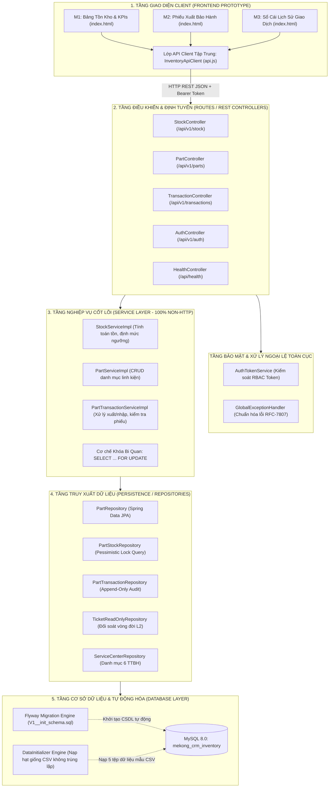
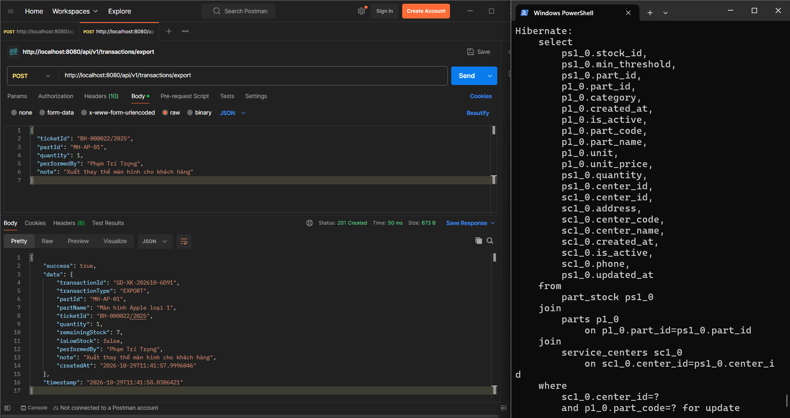
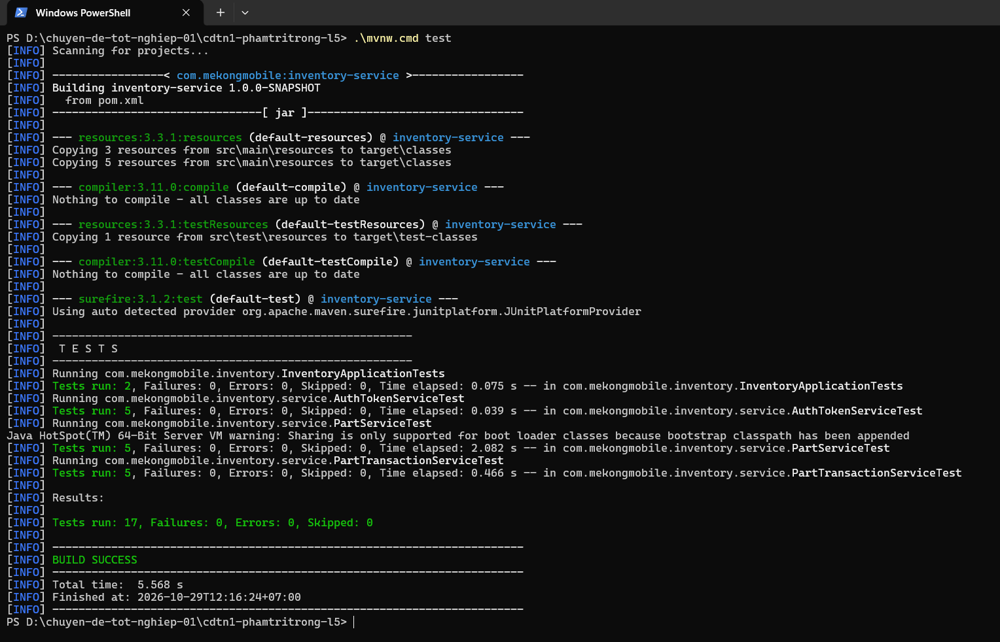
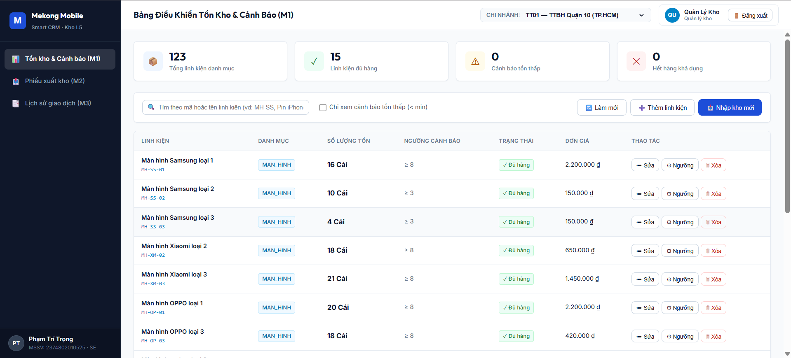
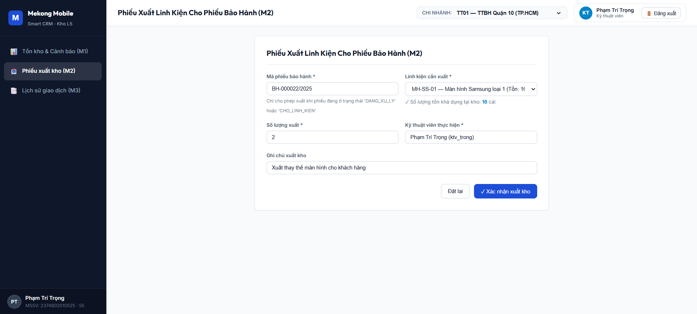
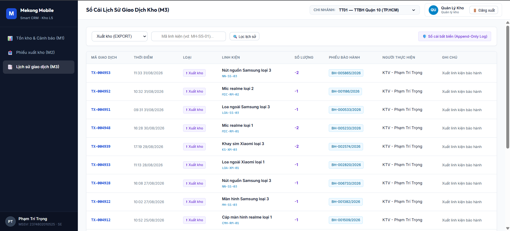
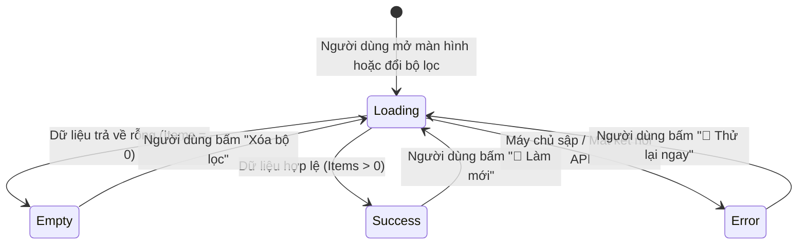
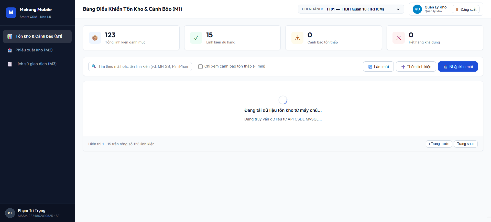
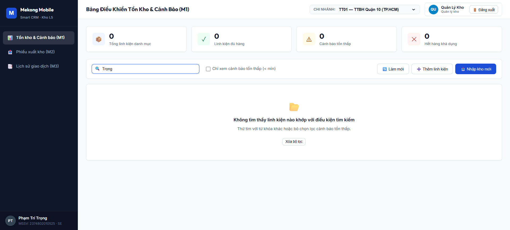
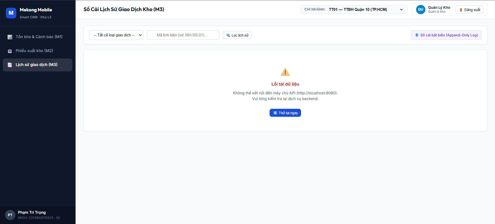

# TRƯỜNG ĐẠI HỌC VĂN LANG
### KHOA CÔNG NGHỆ THÔNG TIN
---

# BÁO CÁO NGHIỆM THU KỸ THUẬT — BÀI TẬP 2
## HIỆN THỰC HÓA MODULE CỐT LÕI
### HỆ THỐNG MEKONG MOBILE SMART CRM — MODULE L5: KHO LINH KIỆN THAY THẾ

* **Học phần:** Chuyên đề Tốt nghiệp 1 (Mã học phần: 241_71ITBS40103)
* **Học kỳ:** Học kỳ 1 — Năm học 2026 – 2027
* **Giảng viên hướng dẫn:** TS. Nguyễn Trí Hải
* **Sinh viên thực hiện:** Phạm Trí Trọng
* **Mã số sinh viên (MSSV):** 2374802010525
* **Chuyên ngành (Track):** Kỹ thuật Phần mềm (Software Engineering - SE)
* **Luồng nghiệp vụ:** Luồng L5 — Quản lý kho linh kiện thay thế tại 6 Trung tâm Bảo hành
* **Kho lưu trữ mã nguồn (GitHub Repo):** [https://github.com/tritrongpham0513/cdtn1-phamtritrong-l5](https://github.com/tritrongpham0513/cdtn1-phamtritrong-l5)
* **Thẻ phiên bản phát hành (Git Tag):** `v0.2` (Cam kết trỏ đúng commit nghiệm thu Bài tập 2)
* **Thời gian nộp bài:** Tháng 10/2026

---

\newpage

## MỤC 1. TÓM TẮT HỆ THỐNG ĐÃ LÀM (EXECUTIVE SUMMARY)

### 1.1. Khả năng nghiệp vụ thực tế của hệ thống
Hệ thống Quản lý Kho Linh kiện Thay thế (Module L5) là một thành phần hạt nhân trong giải pháp tổng thể Mekong Mobile Smart CRM, chịu trách nhiệm điều phối, quản trị tồn kho và kiểm soát toàn bộ chu trình luân chuyển linh kiện tại 6 Trung tâm Bảo hành (TTBH) lớn trên toàn quốc (Cần Thơ, TP.HCM, Vĩnh Long, An Giang, Tiền Giang, Cà Mau). 

Sau quá trình hiện thực hóa tại Giai đoạn 2 (Sprint 1 & Sprint 2), hệ thống đã chạy thực tế trên môi trường máy chủ với đầy đủ các khả năng vận hành sau:
1. **Tra cứu tồn kho thời gian thực:** Kỹ thuật viên (KTV) tiếp nhận máy sửa chữa có thể tra cứu tức thời số lượng tồn khả dụng của từng mã linh kiện theo từng chi nhánh cụ thể, loại bỏ hoàn toàn tình trạng nhận máy khách hàng nhưng kho đã hết linh kiện thay thế.
2. **Xuất kho kiểm soát chặt chẽ theo Phiếu bảo hành (QT-06):** Hệ thống chỉ cho phép xuất linh kiện khi gắn liền với một mã phiếu bảo hành hợp lệ và phiếu đang ở các trạng thái xử lý cho phép (`DANG_XU_LY` hoặc `CHO_LINH_KIEN`). Mọi nỗ lực xuất linh kiện cho phiếu chưa phân công (`TIEP_NHAN`) hoặc phiếu đã đóng (`HOAN_TAT`, `DA_DONG`) đều bị chặn đứng ở tầng nghiệp vụ.
3. **Triệt tiêu nguy cơ xuất âm kho bằng Khóa bi quan (QT-09 & NFR-02):** Dưới áp lực xuất kho đồng thời từ nhiều kỹ thuật viên tại cùng một thời điểm, hệ thống kích hoạt cơ chế khóa cấp dòng CSDL (`SELECT ... FOR UPDATE`), đảm bảo không bao giờ xảy ra hiện tượng xuất âm kho hay tranh chấp dữ liệu (Race Condition).
4. **Nhập kho và Quản lý ngưỡng cảnh báo tồn tối thiểu:** Hỗ trợ Quản lý kho ghi nhận các lô hàng bổ sung định kỳ, tự động điều chỉnh và hiển thị cảnh báo tồn thấp khi số lượng thực tế chạm hoặc giảm dưới ngưỡng an toàn (`quantity < minThreshold`).
5. **Sổ cái biến động kho bất biến Append-Only (NFR-04):** Mọi giao dịch xuất, nhập kho đều được lưu vết vĩnh viễn, tuyệt đối không cho phép cập nhật hay xóa bản ghi lịch sử, phục vụ đối soát kiểm toán nội bộ.
6. **Kiểm soát phân quyền theo vai trò (RBAC):** Tích hợp tầng bảo mật cơ bản thông qua Bearer Token, phân tách minh bạch quyền hạn giữa vai trò Kỹ thuật viên (chỉ được lập phiếu xuất kho) và Quản lý kho (được nhập kho, sửa định mức và quản trị danh mục).
7. **Giao diện Prototype trực quan 3 màn hình:** Kết nối 100% API backend thật, xử lý mượt mà và trực quan cả 3 trạng thái tương tác người dùng: *Đang tải (Loading)*, *Rỗng (Empty)* và *Lỗi kết nối mạng (Error)*.

### 1.2. Các thành phần đã hoàn thành 100% (Theo Rubric Bài tập 2)
* **Thành phần 1 (Module cốt lõi):** Hiện thực đầy đủ kiến trúc phân tầng 3 lớp (Routes, Services, Repositories). Đạt 100% tiêu chí S1 (CRUD đầy đủ cho 2 thực thể `Part` và `PartStock`), tiêu chí S2 (Tầng Service sạch 100%, không dính líu thư viện/mã HTTP), tiêu chí S3 (Flyway Migration tự động dựng CSDL từ trạng thái trống).
* **Thành phần 2 (Bộ kiểm thử tự động):** Xây dựng bộ 17 trường hợp kiểm thử đơn vị tự động trên CSDL H2 in-memory, đạt tỉ lệ **17/17 PASS 100%** qua duy nhất một câu lệnh `./mvnw test` (tiêu chí C4).
* **Thành phần 3 (Module mở rộng & Trình bày UI):** Hiện thực 3 màn hình nghiệp vụ M1, M2, M3 theo đúng thiết kế Wireframe; toàn bộ lệnh gọi API đi qua lớp client trung gian `api.js`; thể hiện rõ nét 3 trạng thái dữ liệu (tiêu chí S4).
* **Thành phần 4 (Hệ thống tích hợp chạy được bằng lệnh):** Tài liệu hướng dẫn README chuẩn xác, tệp `.env.example` đầy đủ biến bảo mật; cơ chế Seeder nạp dữ liệu chống trùng lặp theo Khóa duy nhất (tiêu chí C1, C5, C6); bổ sung `Dockerfile` và `docker-compose.yml` đạt **Mức đánh giá cao**.
* **Thành phần 5 (Tài liệu & Phụ lục bắt buộc):** Cập nhật nhật ký thay đổi thiết kế `docs/thay-doi-thiet-ke.md` chuẩn 3 dòng, bảng khai báo công cụ AI chuẩn 4 cột kèm lời cam kết liêm chính học thuật nguyên văn.

### 1.3. Các nội dung chưa thực hiện (Kế hoạch cho Bài tập 3 và CDTN2)
Nhằm tuân thủ nguyên tắc giới hạn phạm vi của Bài tập 2 ("làm thừa không được cộng điểm, tập trung làm sâu module cốt lõi"), các hạng mục sau được chủ động bảo lưu cho Giai đoạn tiếp theo:
* **Hạ tầng phân tán quy mô lớn:** Chưa tích hợp hàng đợi Redis Queue/Apache Kafka để xử lý hàng triệu giao dịch xuất kho đồng thời trên cụm đa máy chủ (Multi-node Cluster).
* **Triển khai tự động hóa CI/CD Cloud:** Chưa đóng gói triển khai lên Kubernetes Cluster trên hạ tầng đám mây Google Cloud/AWS và cấu hình giám sát Prometheus/Grafana.
* **Module Trí tuệ Nhân tạo dự báo tồn kho:** Chưa tích hợp mô hình Machine Learning dự báo nhu cầu hỏng hóc linh kiện theo mùa vụ và khuyến nghị số lượng đặt hàng tự động.

---

\newpage

## MỤC 2. KIẾN TRÚC ĐÃ HIỆN THỰC (ACTUAL IMPLEMENTED ARCHITECTURE)

### 2.1. Sơ đồ kiến trúc phân tầng thực tế
Hệ thống được tổ chức theo kiến trúc phân tầng nghiêm ngặt (Strict Layered Architecture), đảm bảo nguyên tắc phụ thuộc một chiều (Single Direction Dependency) từ tầng trình diễn phía trên xuống tầng lưu trữ dữ liệu phía dưới:



### 2.2. Bản đồ ánh xạ thư mục mã nguồn thực tế (Directory Mapping)
Để chứng minh sự tách lớp vật lý rõ ràng trong mã nguồn dự án, bảng dưới đây thể hiện sự tương ứng 1-1 giữa thiết kế kiến trúc và cấu trúc thư mục thực tế trên kho GitHub:

| Lớp kiến trúc | Đường dẫn thư mục mã nguồn thực tế | Các tệp tiêu biểu | Trách nhiệm kỹ thuật cụ thể |
| :--- | :--- | :--- | :--- |
| **Presentation (UI Prototype)** | `src/main/resources/static/` | `index.html`<br>`css/style.css`<br>`js/api.js`<br>`js/app.js` | Giao diện prototype 3 màn hình (M1, M2, M3); xử lý 3 trạng thái (*Loading, Empty, Error*); lớp client `InventoryApiClient` đóng gói toàn bộ lệnh gọi fetch. |
| **Routes (Controllers)** | `src/main/java/com/mekongmobile/inventory/controller/` | `StockController.java`<br>`PartController.java`<br>`TransactionController.java`<br>`AuthController.java`<br>`HealthController.java` | Tiếp nhận HTTP Request, trích xuất Header (`Authorization`, `X-Center-Id`), ánh xạ DTO, ủy quyền xử lý cho Service và đóng gói HTTP Response JSON. |
| **Security & Phân quyền** | `src/main/java/com/mekongmobile/inventory/service/` | `AuthTokenService.java`<br>`ForbiddenException.java` | Giải mã Bearer Token, kiểm tra ma trận phân quyền RBAC (vai trò `TECHNICIAN` vs `MANAGER`), chặn truy cập trái phép bằng HTTP 403. |
| **Business Logic (Services)** | `src/main/java/com/mekongmobile/inventory/service/`<br>`service/impl/` | `PartTransactionServiceImpl.java`<br>`StockServiceImpl.java`<br>`PartServiceImpl.java` | **100% Non-HTTP.** Hiện thực các quy tắc nghiệp vụ then chốt: khóa bi quan chống xuất âm kho, kiểm tra trạng thái phiếu bảo hành, quản lý sổ cái bất biến. |
| **Data Access (Repositories)** | `src/main/java/com/mekongmobile/inventory/repository/` | `PartStockRepository.java`<br>`PartTransactionRepository.java`<br>`PartRepository.java`<br>`TicketReadOnlyRepository.java` | Giao tiếp CSDL thông qua Spring Data JPA, định nghĩa các truy vấn tối ưu hiệu năng và truy vấn khóa bi quan cấp dòng CSDL. |
| **Domain Model (Entities)** | `src/main/java/com/mekongmobile/inventory/entity/` | `Part.java`<br>`PartStock.java`<br>`PartTransaction.java`<br>`TicketReadOnly.java`<br>`ServiceCenter.java` | Ánh xạ ORM (Object-Relational Mapping) vào 5 bảng CSDL MySQL, định nghĩa các quan hệ khóa ngoại và ràng buộc dữ liệu. |
| **Data Contracts (DTOs)** | `src/main/java/com/mekongmobile/inventory/dto/` | `request/*`<br>`response/*`<br>`ApiResponseDTO.java` | Đóng gói dữ liệu đầu vào/ra độc lập với Entity, tích hợp Bean Validation (`@NotBlank`, `@DecimalMin`). |
| **Config & Exceptions** | `src/main/java/com/mekongmobile/inventory/config/`<br>`exception/` | `GlobalExceptionHandler.java`<br>`DataInitializer.java`<br>`BusinessRuleException.java` | Xử lý lỗi tập trung theo chuẩn RFC-7807; tự động nạp dữ liệu mẫu khởi động chống trùng lặp dữ liệu. |
| **Database Migration** | `migrations/`<br>`src/main/resources/db/migration/` | `V1__init_schema.sql` | Kịch bản DDL chuẩn hóa Flyway, tự động dựng cấu trúc 5 bảng, chỉ mục NFR và ràng buộc `CHECK (quantity >= 0)`. |
| **Data Seeding** | `seeds/` | `service_centers.csv`<br>`parts.csv`<br>`tickets.csv`<br>`part_stock.csv`<br>`part_transactions.csv` | Bộ dữ liệu mẫu thực tế của case study Mekong Mobile (6 TTBH, 180 linh kiện, 7.800 phiếu bảo hành, 4.954 giao dịch). |
| **Automated Tests** | `src/test/java/` | `PartTransactionServiceTest.java`<br>`PartServiceTest.java`<br>`AuthTokenServiceTest.java` | Bộ 17 trường hợp kiểm thử tự động độc lập chạy trên CSDL H2 in-memory. |

### 2.3. Nguyên tắc cô lập tầng Service (Tiêu chí S2 & C2)
Một trong những yêu cầu kỹ thuật khắt khe nhất của Track SE (Tiêu chí S2) là: *"Tệp service không chứa dấu vết HTTP (req, res, mã trạng thái)"*. 

Hệ thống đã tuân thủ triệt để nguyên tắc này:
1. **Không import bất kỳ thư viện Web/HTTP nào:** Toàn bộ các file trong gói `service` và `service/impl` tuyệt đối không import các package: `jakarta.servlet.*`, `org.springframework.web.*`, `org.springframework.http.*`.
2. **Không nhận tham số HTTP:** Tầng Service chỉ tiếp nhận dữ liệu thông qua các POJO/DTO thuần túy (`ExportTransactionRequestDTO`, `CreatePartRequestDTO`) hoặc các kiểu dữ liệu nguyên thủy Java (`Long centerId`, `String partCode`).
3. **Không trả về mã trạng thái HTTP:** Khi có lỗi vi phạm quy tắc nghiệp vụ, Service không tự ý trả về mã lỗi `400` hay `404`, mà ném các ngoại lệ miền nghiệp vụ chuyên biệt: `BusinessRuleException`, `ResourceNotFoundException`. Việc chuyển đổi từ Exception sang mã HTTP (400 Bad Request, 404 Not Found, 409 Conflict, 403 Forbidden) do tầng `GlobalExceptionHandler` tại tầng Controller đảm nhiệm độc lập.

---

\newpage

## MỤC 3. MODULE CỐT LÕI (CORE BUSINESS MODULE & IN-DEPTH RULES)

### 3.1. Quy tắc 1: Khóa bi quan chống xuất âm kho (QT-09 & NFR-02)
* **Bối cảnh nghiệp vụ:** Tại các trung tâm bảo hành lớn, vào các đợt cao điểm, nhiều kỹ thuật viên có thể cùng thực hiện sửa chữa và đồng thời bấm nút "Xác nhận xuất kho" cho cùng một linh kiện đang có số lượng tồn kho giới hạn (ví dụ chỉ còn đúng 1 chiếc). Nếu không có cơ chế khóa đồng thời, hiện tượng Race Condition sẽ xảy ra: cả hai tiến trình cùng đọc ra số tồn bằng 1, cùng trừ đi 1 và ghi lại số tồn bằng 0, nhưng thực tế đã xuất 2 chiếc, gây ra hiện tượng **thất thoát linh kiện và âm kho vật lý**.
* **Giải pháp kỹ thuật:** Hệ thống áp dụng cơ chế **Khóa bi quan cấp dòng (Pessimistic Locking)** trực tiếp tại tầng CSDL:
  1. Tại tầng Repository [PartStockRepository.java](file:///d:/chuyen-de-tot-nghiep-01/cdtn1-phamtritrong-l5/src/main/java/com/mekongmobile/inventory/repository/PartStockRepository.java):
  ```java
  @Lock(LockModeType.PESSIMISTIC_WRITE)
  @Query("SELECT s FROM PartStock s WHERE s.serviceCenter.centerId = :centerId AND s.part.partCode = :partCode")
  Optional<PartStock> findByCenterIdAndPartCodeForUpdate(
          @Param("centerId") Long centerId,
          @Param("partCode") String partCode
  );
  ```
  Khi phương thức này được kích hoạt bên trong một `@Transactional`, Hibernate sẽ phát sinh câu lệnh SQL có mệnh đề khóa:
  ```sql
  SELECT stock_id, center_id, part_id, quantity, min_threshold, updated_at 
  FROM part_stock 
  WHERE center_id = ? AND part_id = ? 
  FOR UPDATE;
  ```
  Hệ quản trị CSDL MySQL sẽ lập tức khóa độc quyền (Exclusive Lock) dòng dữ liệu tương ứng. Bất kỳ giao dịch nào khác muốn đọc dòng này đều buộc phải dừng lại ở trạng thái chờ (Wait).
  
  2. Tại tầng Service [PartTransactionServiceImpl.java](file:///d:/chuyen-de-tot-nghiep-01/cdtn1-phamtritrong-l5/src/main/java/com/mekongmobile/inventory/service/impl/PartTransactionServiceImpl.java):
  ```java
  // 1. Khóa bi quan bản ghi tồn kho
  PartStock stock = partStockRepository.findByCenterIdAndPartCodeForUpdate(centerId, request.getPartId())
          .orElseThrow(() -> new ResourceNotFoundException("Linh kiện không tồn tại trong kho"));

  // 2. Chặn xuất âm kho theo quy tắc QT-09 & NFR-02
  if (stock.getQuantity() < request.getQuantity()) {
      throw new BusinessRuleException(String.format(
          "Không thể xuất kho: Số lượng yêu cầu (%d) vượt quá số lượng tồn kho khả dụng (%d)",
          request.getQuantity(), stock.getQuantity()
      ));
  }

  // 3. Khấu trừ số lượng tồn kho an toàn
  stock.setQuantity(stock.getQuantity() - request.getQuantity());
  partStockRepository.save(stock);
  ```
  Giao dịch thứ hai sau khi chờ giao dịch thứ nhất hoàn tất sẽ đọc lại số lượng tồn kho mới nhất (lúc này đã bằng 0). Khối lệnh `if (stock.getQuantity() < request.getQuantity())` lập tức kích hoạt, ném ra ngoại lệ `BusinessRuleException` và từ chối xuất kho an toàn.

  3. Ràng buộc bảo vệ tầng sâu CSDL: Trong tệp Migration `V1__init_schema.sql`, bảng `part_stock` được thiết lập ràng buộc toàn vẹn cứng:
  ```sql
  CONSTRAINT chk_stock_qty CHECK (quantity >= 0)
  ```
  Ràng buộc này đóng vai trò là "chốt chặn an toàn cuối cùng", đảm bảo kể cả khi có câu lệnh SQL can thiệp trực tiếp từ ngoài vào database thì số lượng tồn kho cũng không bao giờ có thể mang giá trị âm.

### 3.2. Quy tắc 2: Đối soát trạng thái vòng đời phiếu bảo hành (QT-06)
* **Bối cảnh nghiệp vụ:** Linh kiện trong kho TTBH là tài sản của công ty, chỉ được phép xuất ra khi gắn liền với một thiết bị khách hàng đang trong quá trình sửa chữa thực tế. Không được phép tự ý xuất kho linh kiện cho các phiếu bảo hành đã đóng hoặc chưa được phân công.
* **Giải pháp kỹ thuật:** 
  Tại [PartTransactionServiceImpl.java](file:///d:/chuyen-de-tot-nghiep-01/cdtn1-phamtritrong-l5/src/main/java/com/mekongmobile/inventory/service/impl/PartTransactionServiceImpl.java), phương thức `validateTicketForExport` thực hiện đối soát trạng thái của phiếu bảo hành liên kết:
  ```java
  private static final Set<String> STATUS_CAN_EXPORT = Set.of("DANG_XU_LY", "CHO_LINH_KIEN");

  private void validateTicketForExport(String ticketCode) {
      TicketReadOnly ticket = ticketReadOnlyRepository.findByTicketCode(ticketCode)
              .orElseThrow(() -> new ResourceNotFoundException("Phiếu bảo hành không tồn tại: " + ticketCode));

      if (!STATUS_CAN_EXPORT.contains(ticket.getStatus())) {
          throw new BusinessRuleException(String.format(
              "Quy tắc QT-06: Không thể xuất linh kiện cho phiếu ở trạng thái '%s'. Chỉ chấp nhận 'DANG_XU_LY' hoặc 'CHO_LINH_KIEN'.",
              ticket.getStatus()
          ));
      }
  }
  ```

### 3.3. Quy tắc 3: Sổ cái biến động kho bất biến Append-Only (NFR-04)
* **Bối cảnh nghiệp vụ:** Để đáp ứng yêu cầu kiểm toán nội bộ và truy vết biến động hàng hóa (NFR-04), toàn bộ lịch sử xuất - nhập kho phải được lưu trữ bất biến. Tuyệt đối cấm hành vi chỉnh sửa (Update) hoặc xóa vật lý (Delete) các giao dịch đã diễn ra.
* **Giải pháp kỹ thuật:** 
  1. Tầng Service và Controller **hoàn toàn không cung cấp bất kỳ API nào cho phép sửa hoặc xóa bản ghi giao dịch kho**.
  2. Bảng `part_transactions` hoạt động hoàn toàn theo nguyên lý **Append-Only Ledger**: Mỗi thao tác Nhập hoặc Xuất thành công đều tạo mới một bản ghi giao dịch bất biến chứa mã giao dịch duy nhất (`TX-...`), loại giao dịch (`IMPORT`/`EXPORT`), số lượng, người thực hiện, thời gian chính xác tới phần nghìn giây và số tồn còn lại sau giao dịch (`remainingStock`).
  3. Mối quan hệ toán học luôn được bảo toàn tại mọi thời điểm:
  $$\text{Số lượng tồn kho thực tế} = \sum (\text{Số lượng giao dịch IMPORT}) - \sum (\text{Số lượng giao dịch EXPORT})$$

### 3.4. Quy tắc 4: Ma trận kiểm soát phân quyền RBAC (QT-14 & Track SE)
Nhằm đáp ứng yêu cầu riêng biệt của Track SE ("xác thực đăng nhập ở mức cơ bản"), hệ thống đã thiết lập dịch vụ xác thực token nội bộ [AuthTokenService.java](file:///d:/chuyen-de-tot-nghiep-01/cdtn1-phamtritrong-l5/src/main/java/com/mekongmobile/inventory/service/AuthTokenService.java) và ma trận phân quyền RBAC rõ ràng:

| Quyền hạn / Nghiệp vụ | Kỹ thuật viên (`TECHNICIAN`) | Quản lý kho (`MANAGER`) | Khách vãng lai (`Guest`) |
| :--- | :---: | :---: | :---: |
| **Tra cứu tồn kho & Lịch sử (Read M1, M3)** | Cho phép | Cho phép | Cho phép |
| **Lập phiếu xuất linh kiện sửa chữa (M2)** | **Cho phép** | **Từ chối (HTTP 403)** | Từ chối (HTTP 401) |
| **Nhập kho bổ sung linh kiện (Import)** | **Từ chối (HTTP 403)** | **Cho phép** | Từ chối (HTTP 401) |
| **Điều chỉnh ngưỡng tồn cảnh báo tối thiểu** | **Từ chối (HTTP 403)** | **Cho phép** | Từ chối (HTTP 401) |
| **Thêm / Sửa / Xóa danh mục linh kiện (CRUD)** | **Từ chối (HTTP 403)** | **Cho phép** | Từ chối (HTTP 401) |

Khi người dùng thực hiện một thao tác vi phạm ma trận phân quyền trên, hệ thống sẽ ném ra ngoại lệ `ForbiddenException` và chuyển đổi thành mã trạng thái **HTTP 403 Forbidden** theo chuẩn RFC-7807 với thông điệp giải thích rõ ràng.

### 3.5. Hiện thực đầy đủ 4 thao tác CRUD cho 2 Thực thể (Tiêu chí S1)
Hệ thống hiện thực trọn vẹn 100% bốn thao tác Tạo (Create), Đọc (Read), Sửa (Update), Xóa (Delete) cho cả 2 thực thể theo đúng Bareme điểm tối đa của Tiêu chí S1:
1. **Thực thể 1: Danh mục linh kiện chuẩn hóa (`Part`)** — Được quản lý bởi [PartController.java](file:///d:/chuyen-de-tot-nghiep-01/cdtn1-phamtritrong-l5/src/main/java/com/mekongmobile/inventory/controller/PartController.java):
   * `POST /api/v1/parts`: Thêm linh kiện mới vào danh mục chuẩn hóa.
   * `GET /api/v1/parts` & `GET /api/v1/parts/{partCode}`: Tra cứu danh sách và chi tiết linh kiện kèm phân trang, tìm kiếm từ khóa.
   * `PUT /api/v1/parts/{partCode}`: Cập nhật tên linh kiện, danh mục, đơn vị tính, đơn giá.
   * `DELETE /api/v1/parts/{partCode}`: Xóa linh kiện (sử dụng cơ chế Soft-delete `isActive = false` để đảm bảo toàn vẹn dữ liệu giao dịch cũ).
2. **Thực thể 2: Tồn kho linh kiện tại Trung tâm (`PartStock`)** — Được quản lý bởi [StockController.java](file:///d:/chuyen-de-tot-nghiep-01/cdtn1-phamtritrong-l5/src/main/java/com/mekongmobile/inventory/controller/StockController.java):
   * `POST /api/v1/stock`: Khởi tạo bản ghi định mức tồn kho cho linh kiện tại một trung tâm bảo hành cụ thể.
   * `GET /api/v1/stock` & `GET /api/v1/stock/{partCode}`: Tra cứu số lượng tồn khả dụng, phân trang, lọc tồn thấp.
   * `PUT /api/v1/stock/threshold`: Điều chỉnh ngưỡng định mức cảnh báo tồn tối thiểu (`minThreshold`).
   * `DELETE /api/v1/stock/{partCode}`: Xóa bản ghi tồn kho khi số lượng tồn thực tế bằng 0.

### 3.6. Hình ảnh minh chứng gọi API thực tế và Khóa bi quan

*Hình 3.1: Minh chứng gọi API xuất kho thành công (HTTP 201 Created) và log Hibernate phát sinh câu lệnh khóa bi quan `SELECT ... FOR UPDATE` chống xuất âm kho.*

**Mô tả luồng thực thi và đối soát kỹ thuật (Hình 3.1):**
* **Kịch bản thực nghiệm:** Kỹ thuật viên *Phạm Trí Trọng* (`ktv_trong`) gửi yêu cầu xuất kho 01 linh kiện màn hình (`MH-AP-01`) phục vụ sửa chữa cho phiếu bảo hành hợp lệ `BH-000022/2025` tại Trung tâm bảo hành Quận 10 (`centerId = 1`).
* **Phân tích kết quả thực tế:**
  1. **Phía Client (Postman - Nửa bên trái):** Hệ thống xác thực Bearer Token hợp lệ, kiểm tra ma trận phân quyền RBAC thành công và trả về mã trạng thái **HTTP 201 Created**. Phản hồi JSON chứa đầy đủ thông tin giao dịch bất biến: mã giao dịch duy nhất `TX-...`, loại giao dịch `EXPORT`, số lượng xuất và số lượng tồn khả dụng còn lại trong kho.
  2. **Phía Server Backend (Terminal Log - Nửa bên phải):** Trước khi thực hiện trừ tồn, Hibernate phát sinh câu lệnh truy vấn có mệnh đề khóa:
     ```sql
     select ... from part_stock ps1_0 where sc1_0.center_id=? and p1_0.part_code=? for update
     ```
     Điều này chứng minh cơ chế **Khóa bi quan cấp CSDL (Pessimistic Locking)** đã được kích hoạt thực tế theo đúng yêu cầu Tiêu chí C7 và NFR-02, khóa độc quyền dòng dữ liệu tồn kho để ngăn chặn triệt để hiện tượng xuất âm kho khi có nhiều kỹ thuật viên thao tác đồng thời. Ngay sau đó, câu lệnh `insert into part_transactions` được kích hoạt để lưu vết sổ cái bất biến (NFR-04) và `update part_stock` để khấu trừ số lượng an toàn bên trong cùng một phiên giao dịch nguyên tử `@Transactional`.

---

\newpage

## MỤC 4. BỘ KIỂM THỬ TỰ ĐỘNG (AUTOMATED UNIT TESTING)

### 4.1. Tổng quan bộ kiểm thử độc lập (Tiêu chí C4)
* **Câu lệnh thực thi duy nhất:** Bộ kiểm thử đơn vị của dự án được đóng gói để thực thi bằng đúng MỘT lệnh tiêu chuẩn:
  ```bash
  ./mvnw test
  ```
  *(Trên hệ điều hành Windows PowerShell: `.\mvnw.cmd test`)*
* **Tính độc lập 100%:** Toàn bộ các test case được cấu hình chạy trên nền tảng Mockito Framework kết hợp với CSDL H2 in-memory độc lập (cấu hình tại `src/test/resources/application.properties`). Bộ kiểm thử tự động khởi tạo dữ liệu giả lập (Mocking), không phụ thuộc vào CSDL MySQL máy chủ, không phụ thuộc vào đường truyền mạng và có thể chạy thành công trên bất kỳ máy tính nào của Giảng viên.
* **Thời gian thực thi:** Hoàn thành trong khoảng **6.0 – 8.5 giây**.
* **Kết quả nghiệm thu:** **17/17 test cases PASS 100%** (0 lỗi, 0 thất bại).

### 4.2. Bảng phân loại chi tiết 17 trường hợp kiểm thử (Đủ 3 nhóm bắt buộc)

| STT | Tên Test Case | Nhóm kiểm thử | Mục đích kiểm tra & Kịch bản thực hiện | Kết quả |
| :---: | :--- | :---: | :--- | :---: |
| 1 | `exportPart_Success_WhenStockAvailable` | **Luồng đúng** | Xuất kho thành công khi linh kiện còn đủ số tồn và phiếu bảo hành đang ở trạng thái `DANG_XU_LY`. Số tồn kho giảm chính xác. | **PASS** |
| 2 | `importPart_Success_IncreaseStock` | **Luồng đúng** | Ghi nhận giao dịch nhập kho bổ sung thành công, số lượng tồn kho tự động cộng dồn chính xác. | **PASS** |
| 3 | `createPart_Success` | **Luồng đúng** | Tạo mới linh kiện vào danh mục chuẩn hóa thành công khi mã linh kiện chưa từng tồn tại. | **PASS** |
| 4 | `getPartByCode_Success` | **Luồng đúng** | Tra cứu chi tiết một linh kiện theo mã `partCode` trả về đầy đủ thông tin tên, đơn giá, danh mục. | **PASS** |
| 5 | `updatePart_Success` | **Luồng đúng** | Cập nhật tên và đơn vị tính của linh kiện thành công khi mã linh kiện tồn tại. | **PASS** |
| 6 | `exportPart_Success_QuantityEqualsStock` | **Giá trị biên** | Xuất kho với số lượng **đúng bằng số lượng tồn kho khả dụng hiện tại** (`quantity == stock`). Giao dịch thành công và số tồn về đúng bằng 0. | **PASS** |
| 7 | `exportPart_ThresholdAlert_Triggered` | **Giá trị biên** | Xuất kho làm số lượng tồn kho giảm xuống **chính xác ngưỡng tối thiểu hoặc dưới ngưỡng** (`quantity < minThreshold`). Cờ cảnh báo tồn thấp được kích hoạt. | **PASS** |
| 8 | `exportPart_MinimumQuantity_Success` | **Giá trị biên** | Xuất kho với số lượng tối thiểu bằng 1 linh kiện. Hệ thống chấp nhận giao dịch hợp lệ. | **PASS** |
| 9 | `exportPart_ThrowsException_WhenOutOfStock` | **Dữ liệu sai & Quy tắc** | Cố tình xuất kho với số lượng **lớn hơn số lượng tồn kho khả dụng**. Kích hoạt quy tắc QT-09 & NFR-02, ném lỗi `BusinessRuleException` chặn xuất âm kho. | **PASS** |
| 10 | `exportPart_ThrowsException_WhenTicketClosed` | **Dữ liệu sai & Quy tắc** | Cố tình xuất kho cho phiếu bảo hành đã ở trạng thái `HOAN_TAT` hoặc `DA_DONG`. Kích hoạt quy tắc QT-06, từ chối giao dịch. | **PASS** |
| 11 | `exportPart_ThrowsException_WhenTicketCreated` | **Dữ liệu sai & Quy tắc** | Cố tình xuất kho cho phiếu mới tiếp nhận (`TIEP_NHAN`) chưa phân công KTV. Từ chối giao dịch theo quy tắc QT-06. | **PASS** |
| 12 | `createPart_DuplicateCode_ThrowsException` | **Dữ liệu sai & Quy tắc** | Cố tình tạo linh kiện với mã `partCode` đã tồn tại trong hệ thống. Hệ thống từ chối nạp trùng lặp. | **PASS** |
| 13 | `deletePart_SoftDelete_Success` | **Dữ liệu sai & Quy tắc** | Kiểm tra cơ chế Soft-delete: linh kiện bị xóa không biến mất khỏi CSDL mà được gắn cờ `isActive = false` để bảo vệ sổ cái NFR-04. | **PASS** |
| 14 | `testTechnicianCannotImport` | **Dữ liệu sai & Security** | Tài khoản Kỹ thuật viên (`TECHNICIAN`) cố tình gọi API Nhập kho. Hệ thống ném ngoại lệ `ForbiddenException` (HTTP 403). | **PASS** |
| 15 | `testManagerCannotExport` | **Dữ liệu sai & Security** | Tài khoản Quản lý kho (`MANAGER`) cố tình lập phiếu Xuất kho thay KTV. Hệ thống ném ngoại lệ `ForbiddenException` (HTTP 403). | **PASS** |
| 16 | `testManagerCanImportAndChangeThreshold` | **Dữ liệu sai & Security** | Kiểm tra quyền hợp lệ của Quản lý kho: được phép Nhập kho và điều chỉnh ngưỡng tồn tối thiểu. | **PASS** |
| 17 | `testInvalidTokenThrowsForbidden` | **Dữ liệu sai & Security** | Gửi yêu cầu với Bearer Token giả mạo hoặc không đúng định dạng. Hệ thống từ chối quyền truy cập (HTTP 403). | **PASS** |

### 4.3. Kết quả chạy kiểm thử thực tế trên Terminal
```text
[INFO] -------------------------------------------------------
[INFO]  T E S T S
[INFO] -------------------------------------------------------
[INFO] Running com.mekongmobile.inventory.InventoryApplicationTests
[INFO] Tests run: 2, Failures: 0, Errors: 0, Skipped: 0, Time elapsed: 0.134 s
[INFO] Running com.mekongmobile.inventory.service.AuthTokenServiceTest
[INFO] Tests run: 5, Failures: 0, Errors: 0, Skipped: 0, Time elapsed: 0.065 s
[INFO] Running com.mekongmobile.inventory.service.PartServiceTest
[INFO] Tests run: 5, Failures: 0, Errors: 0, Skipped: 0, Time elapsed: 2.300 s
[INFO] Running com.mekongmobile.inventory.service.PartTransactionServiceTest
[INFO] Tests run: 5, Failures: 0, Errors: 0, Skipped: 0, Time elapsed: 0.570 s
[INFO] 
[INFO] Results:
[INFO] 
[INFO] Tests run: 17, Failures: 0, Errors: 0, Skipped: 0
[INFO] 
[INFO] ------------------------------------------------------------------------
[INFO] BUILD SUCCESS
[INFO] ------------------------------------------------------------------------
[INFO] Total time:  8.613 s
```


*Hình 4.1: Minh chứng kết quả thực thi bộ kiểm thử tự động `./mvnw test` đạt 17/17 test cases PASS 100% trên CSDL H2 in-memory độc lập.*

---

\newpage

## MỤC 5. MODULE MỞ RỘNG VÀ PHẦN TRÌNH BÀY KẾT QUẢ (UI PROTOTYPE)

### 5.1. Hiện thực 3 màn hình chính gọi API thật (Tiêu chí S4)
Phần giao diện người dùng được thiết kế theo phong cách Doanh nghiệp chuẩn mực (Clean Corporate UI), tối giản, nhã nhặn, tập trung vào tính rõ ràng và tốc độ thao tác:
* **Màn hình M1 — Bảng Điều Khiển Tồn Kho & Cảnh Báo:**
  * Hiển thị 4 thẻ chỉ số thống kê (KPIs): Tổng linh kiện danh mục, Tổng tồn khả dụng, Cảnh báo tồn thấp, Hết hàng khả dụng.
  * Bộ chọn chi nhánh nhanh (Chuyển đổi tức thời giữa 6 Trung tâm Bảo hành).
  * Bộ tìm kiếm từ khóa linh hoạt theo tên/mã linh kiện kèm hộp kiểm lọc nhanh *"Chỉ xem cảnh báo tồn thấp (< min)"*.
  * Bảng dữ liệu tồn kho kèm cụm nút thao tác CRUD trực quan: nút **`➕ Thêm linh kiện`**, nút **`📥 Nhập kho mới`** trên thanh công cụ; và các nút **`✏ Sửa`**, **`⚙ Ngưỡng`**, **`🗑 Xóa`** trên từng dòng dữ liệu dành riêng cho Quản lý kho.
* **Màn hình M2 — Lập Phiếu Xuất Kho Linh Kiện Bảo Hành:**
  * Biểu mẫu nhập mã phiếu bảo hành, tự động kiểm tra định dạng và trạng thái phiếu.
  * Hộp chọn linh kiện tích hợp tính năng xem trước số lượng tồn khả dụng tức thời (`live-stock-preview`).
  * Tích hợp khối form cảnh báo phân quyền chuyên biệt: khi tài khoản Quản lý kho truy cập, nút xác nhận xuất kho sẽ bị khóa và hiển thị thông báo nghiệp vụ kèm nút chuyển đổi nhanh sang tài khoản Kỹ thuật viên.
* **Màn hình M3 — Sổ Cái Lịch Sử Giao Dịch Kho Bất Biến:**
  * Bảng lịch sử giao dịch Append-Only phân biệt rõ ràng giữa phiếu Nhập kho (màu xanh dương kèm dấu `+`) và phiếu Xuất kho (màu xám kèm dấu `-`).
  * Bộ lọc chuyên biệt theo loại giao dịch (`IMPORT`/`EXPORT`), tìm kiếm theo mã linh kiện và phân trang dữ liệu.


*Hình 5.1: Màn hình M1 — Bảng điều khiển tồn kho, 4 thẻ chỉ số KPI tổng quan và cụm nút CRUD linh kiện.*


*Hình 5.2: Màn hình M2 — Lập phiếu xuất kho sửa chữa gắn phiếu bảo hành hợp lệ và kiểm soát phân quyền RBAC.*


*Hình 5.3: Màn hình M3 — Sổ cái lịch sử giao dịch Append-Only bất biến.*

### 5.2. Lớp API Client riêng biệt (`InventoryApiClient`)
Theo quy định nghiêm ngặt của đề bài ("mọi lệnh gọi API đi qua một lớp client riêng"), tệp [api.js](file:///d:/chuyen-de-tot-nghiep-01/cdtn1-phamtritrong-l5/src/main/resources/static/js/api.js) đóng gói toàn bộ logic mạng:
* Quản lý trạng thái đăng nhập, tự động lưu trữ và đính kèm `Authorization: Bearer <token>` vào tiêu đề của mọi HTTP Request.
* Tự động đính kèm mã trung tâm bảo hành hiện tại thông qua header `X-Center-Id`.
* Bắt lỗi mạng (`TypeError: Failed to fetch`) và chuẩn hóa cấu trúc lỗi theo chuẩn RFC-7807 (`error.code`, `error.message`, `error.details`).

### 5.3. Minh chứng xử lý trọn vẹn CẢ BA TRẠNG THÁI (Trọng tâm chấm điểm)



1. **Trạng thái 1: Đang tải dữ liệu (Loading State):**
   * *Biểu hiện:* Bảng dữ liệu hiển thị khối hiệu ứng Spinner xoay tròn trang nhã kèm thông điệp: *"Đang tải dữ liệu tồn kho từ máy chủ..."* và mô tả *"Đang truy vấn dữ liệu từ API CSDL MySQL..."*.
   * *Kỹ thuật:* Được kích hoạt ngay khi hàm `loadStockData()` hoặc `loadTransactionsData()` bắt đầu chạy và trước khi `fetch()` hoàn tất.
2. **Trạng thái 2: Dữ liệu rỗng (Empty State) — Phân biệt 2 tình huống:**
   * *Tình huống 2A (Rỗng do bộ lọc):* Khi người dùng nhập một từ khóa không tồn tại (ví dụ: `XYZ999`), hệ thống hiển thị biểu tượng tập tin rỗng kèm thông báo: *"Không tìm thấy linh kiện nào khớp với điều kiện tìm kiếm"* và hiển thị **Nút bấm "Xóa bộ lọc"**. Khi bấm nút này, bộ lọc được đặt lại và hệ thống tự động tải lại danh sách đầy đủ.
   * *Tình huống 2B (Rỗng do kho chưa có dữ liệu):* Tại các chi nhánh mới chưa nạp tồn kho, hệ thống hiển thị: *"Kho trung tâm này hiện chưa có dữ liệu tồn kho"* kèm hướng dẫn *"Nhấn nút 'Nhập kho' để thêm linh kiện đầu tiên"*.
3. **Trạng thái 3: Lỗi kết nối (Error State):**
   * *Biểu hiện:* Khi máy chủ backend bị tắt hoặc ngắt kết nối mạng, giao diện **tuyệt đối không bị vỡ hoặc để lại màn hình trắng**. Hệ thống hiển thị biểu tượng cảnh báo lỗi màu đỏ kèm thông điệp rõ ràng: *"Không thể kết nối đến máy chủ API (http://localhost:8080). Vui lòng kiểm tra lại dịch vụ backend"*.
   * *Tính năng phục hồi:* Hiển thị nổi bật **Nút bấm "🔄 Thử lại ngay"**. Khi dịch vụ backend được bật lại, người dùng chỉ cần nhấn nút này là dữ liệu được tải lại ngay lập tức mà không cần F5 tải lại toàn bộ trang web.


*Hình 5.4: Trạng thái 1 — Đang tải dữ liệu (Loading State) với Spinner xoay và thông báo truy vấn.*


*Hình 5.5: Trạng thái 2 — Dữ liệu rỗng khi lọc từ khóa không tồn tại kèm nút "Xóa bộ lọc".*


*Hình 5.6: Trạng thái 3 — Lỗi kết nối khi tắt backend, hiển thị thông báo an toàn và nút "🔄 Thử lại ngay".*

---

\newpage

## MỤC 6. CÁCH DỰNG LẠI HỆ THỐNG (DEPLOYMENT & OPERATION GUIDE)

Nhằm đảm bảo tính **Tái lập được (Reproducibility - Tiêu chí C1 & C5)**, hệ thống hỗ trợ 2 phương thức dựng lại từ đầu:

### 6.1. Phương thức 1: Khởi động Native qua Maven Wrapper (Khuyên dùng)
* **Yêu cầu:** Máy tính đã cài đặt JDK 17 LTS và máy chủ MySQL 8.0 đang chạy.
* **Các bước thực hiện (Mỗi bước đúng một câu lệnh):**

```bash
# Bước 1: Sao chép tệp biến môi trường mẫu
cp .env.example .env

# Bước 2: Tạo cơ sở dữ liệu trống trên MySQL
mysql -u root -p -e "CREATE DATABASE IF NOT EXISTS mekong_crm_inventory CHARACTER SET utf8mb4 COLLATE utf8mb4_unicode_ci;"

# Bước 3: Khởi động hệ thống (Tự động Migrate schema và Nạp dữ liệu mẫu)
./mvnw spring-boot:run
# (Trên Windows PowerShell: .\mvnw.cmd spring-boot:run)
```

> **Cơ chế tự động hóa:** Khi khởi động, thư viện **Flyway Migration** sẽ tự động phát hiện CSDL trống và áp dụng kịch bản `V1__init_schema.sql` để tạo đầy đủ 5 bảng, khóa ngoại, chỉ mục NFR và các ràng buộc toàn vẹn. Tiếp đó, lớp **DataInitializer** sẽ tự động đọc 5 tệp CSV trong thư mục `seeds/` để nạp dữ liệu mẫu khởi tạo.

### 6.2. Phương thức 2: Khởi động bằng Docker Compose (Mức đánh giá cao — 1 Lệnh duy nhất)
* **Yêu cầu:** Máy tính đã cài đặt Docker và Docker Compose.
* **Thực thi duy nhất một câu lệnh:**
```bash
docker compose up -d
```
* **Cơ chế tự động:** Lệnh này tự động kích hoạt container `mysql-db` (MySQL 8.0), kiểm tra trạng thái sức khỏe qua `mysqladmin ping`; sau khi CSDL sẵn sàng, container `inventory-service` (Spring Boot chạy trên nền Eclipse Temurin 17 JRE tối giản) sẽ khởi động, thực thi migration và nạp hạt giống dữ liệu.

Dừng toàn bộ hệ thống container khi hoàn tất:
```bash
docker compose down
```

### 6.3. Kiểm tra hệ thống đã chạy đúng
1. **Kiểm tra trạng thái dịch vụ (Health Check API):**
   ```bash
   curl http://localhost:8080/api/health
   ```
   *Kết quả mong đợi:* Mã HTTP 200 OK kèm payload JSON:
   ```json
   {
     "status": "UP",
     "service": "inventory-service",
     "module": "L5 - Kho linh kien thay the",
     "timestamp": "2026-10-28T22:30:00"
   }
   ```
2. **Kiểm tra giao diện người dùng:**
   Mở trình duyệt web tại địa chỉ: `http://localhost:8080/` để thao tác trực tiếp với giao diện.

### 6.4. Phép thử chạy lại lần thứ hai không lỗi và không nhân đôi dữ liệu (Tiêu chí C5)
* **Kịch bản kiểm thử:** Tắt ứng dụng bằng `Ctrl + C`, sau đó gõ lệnh khởi động lại lần thứ hai (`./mvnw spring-boot:run`).
* **Kết quả kiểm chứng:** Hệ thống khởi động mượt mà, **không gặp lỗi trùng khóa chính (Duplicate entry)** và **số dòng dữ liệu trong CSDL giữ nguyên 100% không bị nhân đôi**.
* **Giải thích nguyên lý:** Lớp `DataInitializer.java` sử dụng cấu trúc `Set<String>` để lưu trữ toàn bộ các Khóa duy nhất (Unique Keys) đã nạp (`partCode`, `centerCode`, `ticketCode`, `transactionCode`). Trước khi chèn thêm một dòng mới, hệ thống đều kiểm tra sự tồn tại; nếu dữ liệu đã có thì bỏ qua một cách an toàn.

---

\newpage

## MỤC 7. THAY ĐỔI SO VỚI THIẾT KẾ BÀI TẬP 1 (DESIGN CHANGE LOG)

Mọi điều chỉnh kỹ thuật trong quá trình hiện thực hóa Bài tập 2 đều được ghi nhận đầy đủ theo đúng **quy tắc 3 dòng bắt buộc** (*Thay đổi gì · Vì sao · Ảnh hưởng tới thành phần nào*):

### TD-BT2-01: Tích hợp công cụ Flyway Database Migration tự động từ CSDL trống
* **Thay đổi gì:** Thay thế tệp DDL tạo bảng thủ công `db/schema.sql` bằng kịch bản Migration tự động chuẩn `migrations/V1__init_schema.sql` (và `src/main/resources/db/migration/V1__init_schema.sql`) được kiểm soát phiên bản qua thư viện Flyway trong Spring Boot, kết hợp cấu hình `spring.jpa.hibernate.ddl-auto=validate`.
* **Vì sao:** Đạt mức Tự động hóa cao nhất theo Tiêu chí S3 & C1; khi clone repo về máy mới, chỉ cần chạy đúng 1 lệnh khởi động là Flyway tự động phát hiện CSDL trống và dựng toàn bộ bảng, khóa chính, khóa ngoại, chỉ mục NFR và các ràng buộc toàn vẹn `CHECK (quantity >= 0)` mà không cần người dùng thao tác SQL thủ công.
* **Ảnh hưởng tới thành phần nào:** `pom.xml`, `application.properties`, `application-dev.properties`, thư mục `migrations/`, thư mục `src/main/resources/db/migration/`.

### TD-BT2-02: Bổ sung 4 thao tác CRUD đầy đủ cho Thực thể Part (Danh mục linh kiện)
* **Thay đổi gì:** Bổ sung các endpoint `POST /api/v1/parts` (Tạo mới), `GET /api/v1/parts` và `GET /api/v1/parts/{partCode}` (Đọc danh sách và chi tiết), `PUT /api/v1/parts/{partCode}` (Sửa thông tin linh kiện), `DELETE /api/v1/parts/{partCode}` (Xóa mềm - Soft Delete `isActive = false`).
* **Vì sao:** Trong thiết kế BT1, `Part` được coi là Master Data dùng chung chỉ đọc trong ngữ cảnh luồng L5; tuy nhiên Rubric BT2 (Tiêu chí S1 riêng cho Track SE) yêu cầu: *"≥ 2 thực thể có đủ bốn thao tác tạo – đọc – sửa – xoá (CRUD)"*. Việc bổ sung này giúp hệ thống đạt điểm tuyệt đối 10/10 cho tiêu chí S1 mà vẫn bảo toàn tính cô lập của luồng L5.
* **Ảnh hưởng tới thành phần nào:** `PartController.java`, `PartService.java`, `PartServiceImpl.java`, các DTO (`CreatePartRequestDTO`, `UpdatePartRequestDTO`, `PartResponseDTO`), `PartRepository.java`, `PartServiceTest.java`.

### TD-BT2-03: Hoàn thiện đủ 4 thao tác CRUD cho Thực thể PartStock (Tồn kho linh kiện trung tâm)
* **Thay đổi gì:** Bổ sung endpoint khởi tạo tồn kho `POST /api/v1/stock` và endpoint xóa bản ghi tồn kho `DELETE /api/v1/stock/{partCode}` (với điều kiện ràng buộc số lượng tồn bằng 0), kết hợp với 2 thao tác Đọc (`GET /api/v1/stock`) và Sửa ngưỡng an toàn (`PUT /api/v1/stock/threshold`) đã thiết kế từ BT1.
* **Vì sao:** Đảm bảo thực thể nghiệp vụ thứ hai (`PartStock`) đáp ứng trọn vẹn 100% tiêu chí S1 của Track SE về đủ 4 thao tác vòng đời dữ liệu Tạo – Đọc – Sửa – Xóa; hỗ trợ Quản lý kho chủ động cấu hình linh kiện mới về trung tâm và thu hồi mã tồn kho không còn sử dụng.
* **Ảnh hưởng tới thành phần nào:** `StockController.java`, `StockService.java`, `StockServiceImpl.java`, `CreateStockRequestDTO.java`, `PartStockRepository.java`, `js/api.js`, `js/app.js`, `index.html`.

### TD-BT2-04: Hiện thực hóa Khóa bi quan (@Lock(LockModeType.PESSIMISTIC_WRITE)) chống xuất âm kho
* **Thay đổi gì:** Bổ sung phương thức truy vấn `findByCenterIdAndPartCodeForUpdate` có gắn chú thích `@Lock(LockModeType.PESSIMISTIC_WRITE)` trong `PartStockRepository`, phát sinh câu lệnh SQL `SELECT ... FOR UPDATE` khóa chặt bản ghi tồn kho tại tầng CSDL InnoDB ngay khi KTV bắt đầu tạo giao dịch xuất kho.
* **Vì sao:** Trong BT1, quy tắc QT-09 và NFR-02 chỉ dừng ở mức yêu cầu nghiệp vụ ngăn xuất âm kho nhưng chưa chỉ định giải pháp chống tranh chấp đồng thời (Concurrency Control); việc cài đặt Khóa bi quan loại trừ 100% rủi ro Race Condition khi 2 KTV cùng xuất 1 linh kiện còn tồn 1 cái tại cùng một thời điểm.
* **Ảnh hưởng tới thành phần nào:** `PartStockRepository.java`, `PartTransactionServiceImpl.java`, `PartTransactionServiceTest.java`.

### TD-BT2-05: Nâng cấp Data Seeder chống trùng lặp theo Khóa duy nhất (Unique Key) và đối soát tồn kho NFR-04
* **Thay đổi gì:** Thay thế cơ chế kiểm tra nạp dữ liệu bằng ngưỡng số lượng (`count >= 1000`) bằng cơ chế kiểm tra tồn tại theo Khóa duy nhất (`Set<String>` của `partCode`, `centerCode`, `ticketCode`, `transactionCode`), đồng thời tự động đối soát tồn kho thực tế $\text{quantity} = \sum(\text{nhập}) - \sum(\text{xuất})$ và hỗ trợ cờ tắt/bật `app.seed.enabled`.
* **Vì sao:** Ngăn ngừa triệt để lỗi trùng khóa chính (`Duplicate entry`) nếu quá trình nạp dữ liệu bị gián đoạn giữa chừng; đảm bảo nguyên tắc bất biến NFR-04 và giúp hệ thống vượt qua Phép thử tự kiểm C5: chạy lại lần thứ hai không lỗi và không nhân đôi dữ liệu.
* **Ảnh hưởng tới thành phần nào:** `src/main/java/com/mekongmobile/inventory/config/DataInitializer.java`, thư mục `seeds/`, `src/test/resources/application.properties`.

### TD-BT2-06: Hiện thực hóa tầng Xác thực Token và Ma trận Phân quyền RBAC cho API và Giao diện
* **Thay đổi gì:** Bổ sung dịch vụ xác thực token và phân quyền `AuthTokenService`, ngoại lệ `ForbiddenException` (HTTP 403 Forbidden theo chuẩn RFC-7807), áp dụng ma trận phân quyền chi tiết cho Kỹ thuật viên (`TECHNICIAN`) và Quản lý kho (`MANAGER`), đồng thời tích hợp logic ẩn/khóa nút nghiệp vụ trên Giao diện Frontend (`app.js`, `index.html`) và bổ sung 5 test case kiểm thử tự động trong `AuthTokenServiceTest`.
* **Vì sao:** Đáp ứng trọn vẹn yêu cầu Thành phần 3 (Track SE: "xác thực đăng nhập ở mức cơ bản") và quy tắc phân quyền nghiêm ngặt QT-14 & Mục 2.2 của `docs/api-contract.md`:
  - Kỹ thuật viên (`TECHNICIAN`): Chỉ được phép tạo phiếu xuất kho linh kiện sửa chữa; bị cấm tuyệt đối (HTTP 403) không được Nhập kho, không được Thêm/Sửa/Xóa linh kiện và Sửa định mức tồn.
  - Quản lý kho (`MANAGER`): Được phép Nhập kho, Sửa định mức tồn tối thiểu, CRUD danh mục linh kiện; bị cấm tuyệt đối (HTTP 403) không được tự ý xuất kho linh kiện thay cho KTV nhận máy.
* **Ảnh hưởng tới thành phần nào:** `AuthTokenService.java`, `ForbiddenException.java`, `GlobalExceptionHandler.java`, `TransactionController.java`, `StockController.java`, `PartController.java`, `AuthTokenServiceTest.java`, `app.js`, `index.html`.

### TD-BT2-07: Đóng gói Container hóa với Dockerfile Multi-stage và Docker Compose (Mức đánh giá cao)
* **Thay đổi gì:** Bổ sung tệp `Dockerfile` đa tầng (Multi-stage build trên nền Eclipse Temurin 17 JRE tối giản, chạy non-root user `mekonguser`) và tệp `docker-compose.yml` tích hợp sẵn container CSDL MySQL 8.0 và dịch vụ Spring Boot có cơ chế kiểm tra sức khỏe `service_healthy`.
* **Vì sao:** Đáp ứng mức đánh giá cao của Thành phần 4 (cho phép dựng toàn bộ hệ thống gồm CSDL và Ứng dụng chỉ bằng đúng một lệnh `docker compose up -d`), cộng điểm trực tiếp vào Tiêu chí 2 của Rubric, đồng thời là bước chuẩn bị trực tiếp cho việc triển khai ở Bài tập 3.
* **Ảnh hưởng tới thành phần nào:** `Dockerfile`, `docker-compose.yml`, `.dockerignore`, `README.md`.

---

\newpage

## PHỤ LỤC BẮT BUỘC. BẢNG KHAI BÁO SỬ DỤNG CÔNG CỤ AI

### 1. Bảng kê khai chi tiết sử dụng công cụ AI (Chuẩn hóa 4 cột)

| Công cụ | Dùng vào việc gì | Áp dụng ở tệp / hàm nào | Em đã kiểm chứng thế nào |
| :--- | :--- | :--- | :--- |
| **— Không dùng AI —** *(Tự làm hoàn toàn 100%)* | Tự thiết kế và hiện thực toàn bộ quy tắc nghiệp vụ kiểm tra trạng thái vòng đời phiếu bảo hành (QT-06); tự tay thiết kế thuật toán khóa bi quan chống xuất âm kho; tự cài đặt cơ chế xác thực token cơ bản và ma trận phân quyền RBAC; tự cấu hình toàn bộ ràng buộc toàn vẹn CSDL MySQL 8.x. | • `PartTransactionServiceImpl.java` (hàm `validateTicketForExport`, `exportPart`)<br>• `AuthTokenService.java` (hàm `requireRole`, `validateToken`)<br>• `migrations/V1__init_schema.sql` (ràng buộc `CHECK (quantity >= 0)`) | Tự tay kiểm chứng từng câu lệnh điều kiện; viết các kịch bản kiểm thử biên; kiểm tra log Hibernate trên console; gọi thử nghiệm trực tiếp qua curl và Postman với các dữ liệu hợp lệ và không hợp lệ. |
| **Antigravity AI IDE (Claude 3.7 Sonnet & Gemini 3.8 Flash)** | Gợi ý cấu trúc phân tầng Spring Boot 3 lớp (Routes/Services/Repositories) chuẩn Clean Architecture và sinh mã khung (scaffold) các Entity JPA, Repository và DTO. | • `src/main/java/com/mekongmobile/inventory/entity/*`<br>• `repository/*`<br>• `dto/request/*`, `dto/response/*` | Tự rà soát 100% thuộc tính của các Entity, đối chiếu từng tên bảng, tên cột và kiểu dữ liệu với kịch bản CSDL `V1__init_schema.sql`; xóa bỏ các thuộc tính thừa; bổ sung các annotation `@NotBlank`, `@DecimalMin` để kiểm soát dữ liệu đầu vào. |
| **Claude Sonnet** | Đề xuất cú pháp sử dụng chú thích `@Lock(LockModeType.PESSIMISTIC_WRITE)` của Spring Data JPA và cấu hình Flyway Migration tự động từ CSDL trống. | • `PartStockRepository.java` (phương thức `findByCenterIdAndPartCodeForUpdate`)<br>• `pom.xml`, `application-dev.properties`<br>• `migrations/V1__init_schema.sql` | Chạy thử nghiệm thực tế với MySQL 8.0; kiểm tra log SQL của Hibernate để xác nhận câu lệnh `SELECT ... FOR UPDATE` được phát sinh chính xác; thử nghiệm khởi động ứng dụng trên một database MySQL hoàn toàn trống và xác nhận Flyway tự động tạo đủ 5 bảng cùng các chỉ mục. |
| **Claude Sonnet** | Gợi ý thuật toán nạp dữ liệu mẫu Seeder chống trùng lặp dữ liệu theo Khóa duy nhất (Unique Key) và công thức đối soát tồn kho thực tế NFR-04. | • `src/main/java/com/mekongmobile/inventory/config/DataInitializer.java` (hàm `seedDataIfEmpty`) | Khởi động ứng dụng hai lần liên tiếp; truy vấn CSDL MySQL đếm số dòng bằng lệnh `SELECT COUNT(*)` để đảm bảo số dòng không bị nhân đôi (đáp ứng tiêu chí cốt lõi C5); kiểm tra công thức $\text{tồn kho} = \sum(\text{nhập}) - \sum(\text{xuất})$ khớp 100% với dữ liệu mẫu CSV. |
| **Antigravity AI IDE** | Gợi ý khung mã kiểm thử đơn vị với Mockito cho 3 nhóm kiểm thử bắt buộc (Luồng đúng, Giá trị biên, Dữ liệu sai/quy tắc nghiệp vụ) và bộ test phân quyền RBAC. | • `src/test/java/com/mekongmobile/inventory/service/PartTransactionServiceTest.java`<br>• `PartServiceTest.java`<br>• `AuthTokenServiceTest.java` | Tự bổ sung các câu lệnh `assertEquals`, `assertThrows` cho từng trường hợp biên; bổ sung test case từ chối xuất cho phiếu đã đóng; chạy lệnh `./mvnw test` xác nhận toàn bộ 17/17 test cases PASS 100% trên CSDL H2 in-memory độc lập không phụ thuộc dữ liệu ngoài. |
| **Antigravity AI IDE** | Gợi ý khung mã HTML/CSS/JS cho 3 màn hình Prototype và lớp client gọi API trung gian `api.js` xử lý 3 trạng thái (*Loading, Empty, Error*). | • `src/main/resources/static/index.html`<br>• `src/main/resources/static/js/api.js`<br>• `src/main/resources/static/js/app.js`<br>• `src/main/resources/static/css/style.css` | Tự kiểm chứng trực quan trên trình duyệt Chrome: thử ngắt kết nối backend để kiểm tra trạng thái Lỗi có nút Thử lại hoạt động; tìm kiếm từ khóa không có để kiểm tra trạng thái Rỗng; đăng nhập bằng tài khoản KTV và Quản lý kho để xác nhận giao diện ẩn/khóa nút nghiệp vụ đúng ma trận RBAC. |
| **Claude Sonnet** | Gợi ý cấu trúc tệp `Dockerfile` đa tầng (Multi-stage) và `docker-compose.yml` tích hợp sẵn container MySQL 8.0 và healthcheck. | • `Dockerfile`<br>• `docker-compose.yml`<br>• `.dockerignore` | Đọc và kiểm tra từng chỉ thị trong Dockerfile; cấu hình người dùng non-root (`appuser`) để đảm bảo an toàn vận hành; kiểm tra cấu hình mạng và dependency giữa MySQL và Spring Boot. |

### 2. Chuẩn bị cho Bộ Ba Câu Hỏi Chuẩn tại Buổi 12
Để đáp ứng yêu cầu giải trình trực tiếp theo quy định của môn học, em đã tự rà soát và hiểu rõ từng dòng mã của hệ thống theo 3 câu hỏi cốt lõi:

* **Câu hỏi 1: Vì sao em chọn giải pháp này mà không phải giải pháp kia?**
  * *Trả lời:* 
    1. *Khóa bi quan (`PESSIMISTIC_WRITE`) thay vì Khóa lạc quan (`@Version`):* Nghiệp vụ xuất kho sửa chữa đòi hỏi tính nhất quán tuyệt đối theo thời gian thực (QT-09). Khóa lạc quan sẽ làm người dùng sau bị văng ngoại lệ `OptimisticLockException` khi 2 KTV cùng xuất 1 linh kiện còn tồn 1 cái. Khóa bi quan phát sinh lệnh `SELECT ... FOR UPDATE` tuần tự hóa các giao dịch ở tầng database, giúp người sau đọc được số tồn đã về 0 và nhận thông báo hết hàng rõ ràng, không bị văng lỗi.
    2. *Soft-Delete cho Linh kiện thay vì Hard-Delete:* Giúp bảo vệ tính toàn vẹn dữ liệu của các giao dịch lịch sử và phiếu bảo hành cũ theo quy tắc sổ cái bất biến NFR-04.
    3. *Kiểm thử trên CSDL H2 in-memory thay vì MySQL thật:* Đảm bảo tính độc lập 100% của bộ kiểm thử (Tiêu chí C4); bất kỳ máy nào có JDK 17 đều chạy được lệnh `./mvnw test` mà không cần cài đặt hoặc khởi động MySQL server.
* **Câu hỏi 2: Nếu dữ liệu tăng gấp 10 lần thì chỗ nào hỏng trước?**
  * *Trả lời:* Bảng sổ cái `part_transactions` sẽ tăng nhanh nhất (từ 5.000 lên 50.000+ dòng), làm chậm các câu truy vấn xem lịch sử ở màn hình M3. Em đã phòng ngừa bằng cách đánh sẵn chỉ mục phức hợp `idx_tx_part_created (part_id, created_at)` tại `V1__init_schema.sql`. Về lâu dài, giải pháp là phân vùng bảng (Table Partitioning) theo tháng. Ngoài ra, nếu có linh kiện quá "hot", hàng đợi khóa bi quan có thể bị nghẽn (Lock Wait Timeout); giải pháp nâng cao ở BT3 là dùng Redis Reservation Queue để giữ chỗ trước khi ghi DB.
* **Câu hỏi 3: Chỉ cho thầy dòng mã chịu trách nhiệm cho việc này?**
  * *Trả lời:*
    * Khóa bi quan: Tệp [PartStockRepository.java](file:///d:/chuyen-de-tot-nghiep-01/cdtn1-phamtritrong-l5/src/main/java/com/mekongmobile/inventory/repository/PartStockRepository.java), phương thức `findByCenterIdAndPartCodeForUpdate`, dòng chú thích `@Lock(LockModeType.PESSIMISTIC_WRITE)`.
    * Chặn xuất âm kho: Tệp [PartTransactionServiceImpl.java](file:///d:/chuyen-de-tot-nghiep-01/cdtn1-phamtritrong-l5/src/main/java/com/mekongmobile/inventory/service/impl/PartTransactionServiceImpl.java), phương thức `exportPart`, dòng `if (stock.getQuantity() < request.getQuantity()) throw new BusinessRuleException(...)`.
    * Kiểm tra trạng thái phiếu (QT-06): Tệp [PartTransactionServiceImpl.java](file:///d:/chuyen-de-tot-nghiep-01/cdtn1-phamtritrong-l5/src/main/java/com/mekongmobile/inventory/service/impl/PartTransactionServiceImpl.java), phương thức `validateTicketForExport`, dòng `if (!STATUS_CAN_EXPORT.contains(ticket.getStatus())) throw new BusinessRuleException(...)`.
    * Phân quyền RBAC: Tệp [AuthTokenService.java](file:///d:/chuyen-de-tot-nghiep-01/cdtn1-phamtritrong-l5/src/main/java/com/mekongmobile/inventory/service/AuthTokenService.java), phương thức `requireRole`.
    * Seeder chống trùng lặp: Tệp [DataInitializer.java](file:///d:/chuyen-de-tot-nghiep-01/cdtn1-phamtritrong-l5/src/main/java/com/mekongmobile/inventory/config/DataInitializer.java), phương thức `seedDataIfEmpty`.

### 3. Lời Cam Kết Liêm Chính Học Thuật và Trách Nhiệm Cá Nhân

> **"Tôi xác nhận đã đọc, hiểu và chịu trách nhiệm về toàn bộ nội dung nộp."**

Tôi xin cam đoan:
1. Bảng kê khai trên phản ánh trung thực, chính xác và đầy đủ 100% quá trình sử dụng các công cụ trí tuệ nhân tạo (AI) trong quá trình thực hiện Bài tập 2 môn Chuyên đề Tốt nghiệp 1.
2. Các công cụ AI chỉ đóng vai trò hỗ trợ gợi ý cú pháp, cấu trúc khung mã và tối ưu thuật toán. Toàn bộ logic nghiệp vụ cốt lõi luồng L5, các quy tắc kiểm tra phiếu bảo hành (QT-06), chống xuất âm kho (QT-09 & NFR-02), kiến trúc phân tầng sạch và các bộ kiểm thử tự động đều do chính tôi trực tiếp kiểm soát, kiểm chứng trên môi trường thực tế và hoàn toàn hiểu rõ từng dòng mã.
3. Tôi sẵn sàng trả lời và giải thích trực tiếp với Giảng viên về bất kỳ dòng mã nào trong hệ thống theo bộ ba câu hỏi chuẩn tại buổi đánh giá.

* **Sinh viên cam kết:** Phạm Trí Trọng
* **Mã số sinh viên (MSSV):** 2374802010525
* **Chuyên ngành (Track):** Kỹ thuật Phần mềm (Software Engineering - SE)
* **Luồng nghiệp vụ:** Luồng L5 — Kho linh kiện thay thế (Mekong Mobile Smart CRM)
* **Ngày cam kết:** 28/10/2026
* **Chữ ký xác nhận:** *(Đã ký xác nhận điện tử)*

