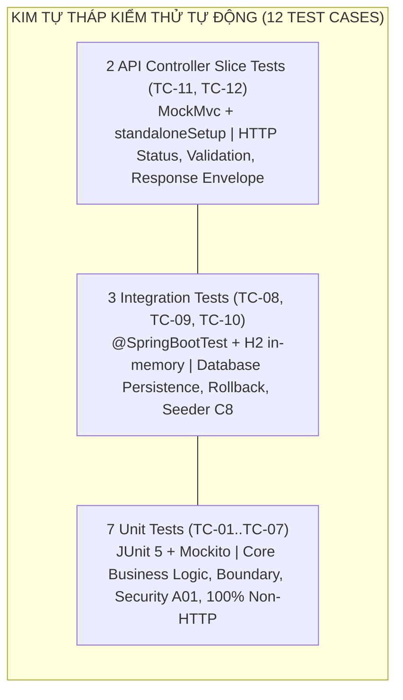
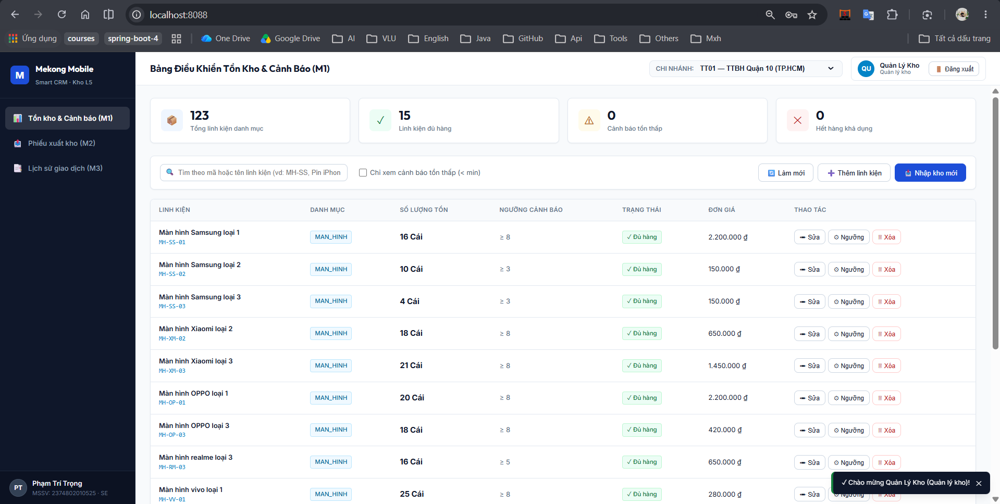
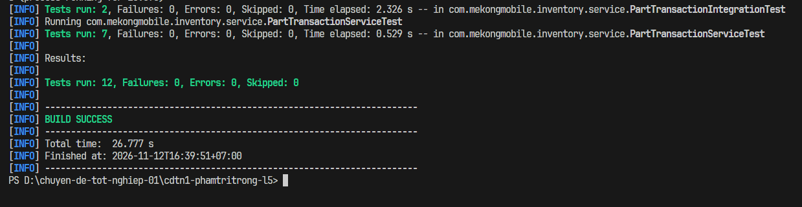
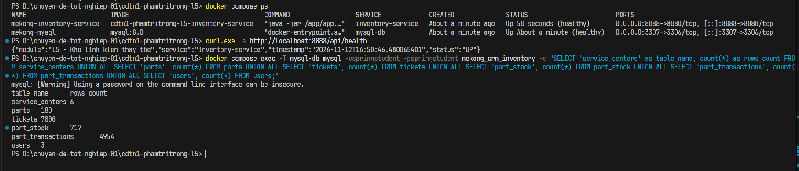
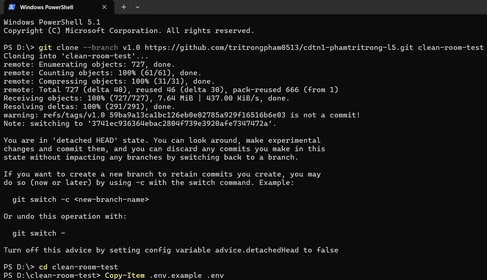
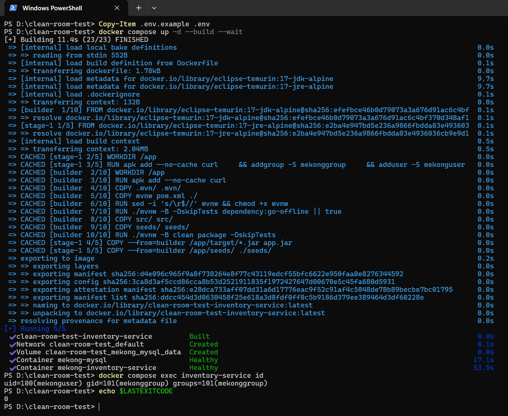

# TRƯỜNG ĐẠI HỌC VĂN LANG
### KHOA CÔNG NGHỆ THÔNG TIN
---

# BÁO CÁO NGHIỆM THU KỸ THUẬT — BÀI TẬP 3
## KIỂM THỬ VÀ ĐÓNG GÓI PROTOTYPE
### HỆ THỐNG MEKONG MOBILE SMART CRM — MODULE L5: KHO LINH KIỆN THAY THẾ

* **Học phần:** Chuyên đề Tốt nghiệp 1 (Mã học phần: 241_71ITBS40103)
* **Học kỳ:** Học kỳ 1 — Năm học 2026 – 2027
* **Giảng viên hướng dẫn:** TS. Nguyễn Trí Hải
* **Sinh viên thực hiện:** Phạm Trí Trọng
* **Mã số sinh viên (MSSV):** 2374802010525
* **Chuyên ngành (Track):** Kỹ thuật Phần mềm (Software Engineering - SE)
* **Luồng nghiệp vụ:** Luồng L5 — Quản lý kho linh kiện thay thế tại 6 Trung tâm Bảo hành
* **Kho lưu trữ mã nguồn (GitHub Repo):** [https://github.com/tritrongpham0513/cdtn1-phamtritrong-l5](https://github.com/tritrongpham0513/cdtn1-phamtritrong-l5)
* **Thẻ phiên bản phát hành (Git Tag):** `v1.0` (Cam kết trỏ đúng commit nghiệm thu Bài tập 3: `3741ec9`)
* **Bản triển khai thử nghiệm (Deploy thử - Điểm cộng):** [https://mekong-inventory-service.onrender.com](https://mekong-inventory-service.onrender.com) (ĐÃ TRIỂN KHAI THÀNH CÔNG trên Cloud: Render Web Service + Cơ sở dữ liệu Cloud Aiven MySQL 8.4; nạp đủ 100% dữ liệu mẫu, kết nối API và giao diện hoạt động trực tiếp).
* **Thời gian nộp bài:** Ngày 12 tháng 11 năm 2026

---

\newpage

## MỤC 1. TEST PLAN RÚT GỌN (KẾ HOẠCH KIỂM THỬ)

### 1.1. Phạm vi kiểm thử và phần chủ ý KHÔNG kiểm

#### A. Trong phạm vi kiểm thử (In-Scope — 6 quy tắc cốt lõi)
Kế hoạch kiểm thử tập trung bảo vệ toàn vẹn các quy tắc nghiệp vụ trọng yếu của Luồng L5 trong hệ thống Mekong Mobile Smart CRM:
1. **Xuất kho theo phiếu bảo hành (FR-03, US-03, QT-06):** Hệ thống chỉ cho phép xuất kho linh kiện khi phiếu bảo hành tương ứng đang ở trạng thái xử lý hợp lệ (`DANG_XU_LY` hoặc `CHO_LINH_KIEN`). Mọi nỗ lực xuất linh kiện cho phiếu đã đóng (`DA_DONG`) hoặc không hợp lệ đều bị chặn đứng và ném ngoại lệ nghiệp vụ ở cả tầng Service lẫn CSDL.
2. **Khóa bi quan chống xuất âm kho (FR-04, US-04, QT-09 & NFR-02):** Kiểm tra tính sẵn sàng của tồn kho, phát sinh câu lệnh khóa cấp dòng `SELECT ... FOR UPDATE` khi xuất linh kiện, đảm bảo không thể xuất vượt quá số lượng khả dụng và loại bỏ rủi ro tương tranh dữ liệu.
3. **Nhập kho và ghi nhận lịch sử (FR-02, US-02):** Tăng số lượng tồn kho thực tế tương ứng với số lượng nhập và tự động ghi nhận một giao dịch `IMPORT` mới vào bảng sổ cái lịch sử `part_transactions`.
4. **Cảnh báo tồn kho tối thiểu (FR-05, US-05):** Tự động kích hoạt cờ cảnh báo `isLowStock = true` khi số lượng tồn kho thực tế giảm xuống dưới ngưỡng an toàn thiết lập (`quantity < minThreshold`).
5. **Kiểm soát quyền truy cập theo chủ sở hữu (OWASP A01 / Tiêu chí S2):** Ngăn chặn kỹ thuật viên tại một trung tâm bảo hành cố tình thao tác hoặc xuất linh kiện cho phiếu thuộc quyền quản lý của trung tâm khác.
6. **Tính tái lập dữ liệu nạp ban đầu (Tiêu chí C8):** Khởi chạy lại bộ nạp dữ liệu `DataInitializer` trên cơ sở dữ liệu đã có sẵn dữ liệu mẫu mà không phát sinh ngoại lệ và không làm nhân đôi số lượng bản ghi của bất kỳ bảng nào.

#### B. Ngoài phạm vi kiểm thử tự động (Out-of-Scope — Ghi nhận trung thực)
Nhằm tập trung tối đa nguồn lực vào độ tin cậy của tầng nghiệp vụ backend theo đúng chuẩn phân tầng kiểm thử, các nội dung sau không nằm trong phạm vi 12 ca kiểm thử tự động:
- **Kiểm thử giao diện người dùng đầu cuối (UI E2E):** Ba màn hình M1, M2, M3 đã được nghiệm thu bằng phương pháp kiểm thử thủ công trên trình duyệt tại BT2.
- **Kiểm thử tải và chịu tải đồng thời ở quy mô lớn (NFR-01, NFR-02):** Kiểm thử khả năng chịu tải 50 request đồng thời được bảo lưu thực hiện tại Chuyên đề Tốt nghiệp 2 bằng các công cụ chuyên dụng (JMeter / k6).
- **Kiểm toán toàn vẹn dữ liệu toán học (NFR-04):** Kiểm thử tích hợp hiện tại mới kiểm tra việc tăng bản ghi sổ cái; việc đối soát toán học toàn bộ hơn 4.900 giao dịch lịch sử chưa được viết thành test tự động.
- **Các chức năng tra cứu danh mục và CRUD cơ bản:** FR-01 (tra cứu tồn), FR-06 (lịch sử giao dịch), FR-07 (cập nhật ngưỡng) cùng các thao tác CRUD cơ bản trên `Part` và `PartStock` đã được kiểm thử thủ công qua Web UI và Postman ở BT2.
- **Nghiệp vụ điều chuyển linh kiện liên trung tâm:** Được xếp vào nhóm *Won't Have* theo đặc tả yêu cầu ban đầu.

---

### 1.2. Mô hình Kim tự tháp kiểm thử và phân bổ số lượng

Hệ thống tuân thủ cấu trúc Kim tự tháp kiểm thử (Test Pyramid) tiêu chuẩn với đúng **12 automated test cases** được tổ chức chặt chẽ thành 3 tầng:



- **Tầng Unit (7 tests):** Kiểm thử cô lập 100% logic nghiệp vụ tại `PartTransactionServiceTest` bằng thư viện Mockito, thời gian thực thi cực nhanh (dưới 0.5 giây), không phụ thuộc mạng hay CSDL.
- **Tầng Integration (3 tests):** Kiểm thử tích hợp tương tác thực tế với CSDL H2 in-memory (`jdbc:h2:mem:testdb`), gồm 1 test kiểm tra tính tái lập Seeder (`DataInitializerIntegrationTest`) và 2 test luồng dữ liệu end-to-end (`PartTransactionIntegrationTest`).
- **Tầng API Slice (2 tests):** Kiểm thử tầng định tuyến Web MVC (`TransactionControllerApiTest`) sử dụng `MockMvcBuilders.standaloneSetup()`, kiểm chứng mã trạng thái HTTP 201/422 và cấu trúc JSON envelope.

---

### 1.3. Kỹ thuật thiết kế ca kiểm thử và phân bổ 5 loại test

Dữ liệu kiểm thử được thiết kế dựa trên hai kỹ thuật kiểm thử hộp đen chuẩn mực:
- **Phân vùng tương đương (Equivalence Partitioning):** Trạng thái phiếu bảo hành (hợp lệ `DANG_XU_LY`/`CHO_LINH_KIEN` vs không hợp lệ `DA_DONG`), số lượng yêu cầu (`quantity > 0` vs `quantity <= 0`), phạm vi trung tâm (cùng Trung tâm 1 vs khác Trung tâm 2).
- **Phân tích giá trị biên (Boundary Value Analysis):** Ranh giới số lượng tồn kho khả dụng khi tồn = 10 (xuất đúng 10/10 giảm về 0 vs xuất 11/10 bị từ chối); ranh giới cảnh báo tồn thấp khi ngưỡng = 5 (tồn 4 < 5 bật cảnh báo vs tồn 5 = 5 tắt cảnh báo).

**Bảng phân bổ 5 loại test theo quy định đề bài:**
1. **Luồng đúng (5 tests):** TC-01 (xuất kho nghiệp vụ), TC-02 (nhập kho US-02), TC-03 (ngưỡng cảnh báo tồn thấp US-05), TC-09 (tích hợp xuất/nhập trên H2), TC-11 (API xuất kho HTTP 201).
2. **Giá trị biên (2 tests):** TC-04 (xuất đúng bằng số tồn hiện có), TC-05 (xuất vượt tồn 1 đơn vị).
3. **Dữ liệu sai (3 tests):** TC-06 (unit: từ chối phiếu đã đóng `DA_DONG`), TC-10 (integration: từ chối phiếu `DA_DONG` trên H2 và không ghi sổ cái), TC-12 (API: số lượng 0 trả về HTTP 422).
4. **Bảo mật và kiểm soát phân quyền (1 test):** TC-07 (chặn kỹ thuật viên xuất phiếu của trung tâm khác theo OWASP A01 / Tiêu chí S2).
5. **Tính tái lập dữ liệu (1 test):** TC-08 (chạy lại Data Seeder lần 2 không gây lỗi và giữ nguyên số lượng bản ghi theo Tiêu chí C8).

---

### 1.4. Tiêu chí thành công ĐO ĐƯỢC

1. **Tỷ lệ vượt qua (Pass Rate):** Đạt **12/12 test PASS 100%** qua duy nhất một câu lệnh thực thi `.\mvnw.cmd test` (Windows) hoặc `./mvnw test` (Linux/macOS).
2. **Độ bao phủ quy tắc nghiệp vụ:** 100% các quy tắc trong phạm vi (QT-06, QT-09, US-02, US-05, OWASP A01, C8) đều có ít nhất một ca kiểm thử trực tiếp xác thực.
3. **Tồn đọng lỗi an ninh:** 0 lỗi Critical, 0 lỗi Major đang mở; toàn bộ các lỗi phát hiện đều được khắc phục triệt để và ghi nhận tại `docs/bug-log.md`.
4. **Không hồi quy (Zero Regression):** 100% các bài kiểm thử tự động tiếp tục đạt PASS sau các đợt refactor mã nguồn hoặc cập nhật cấu hình triển khai.

---

### 1.5. Môi trường và dữ liệu thử nghiệm

- **Môi trường thực thi:** Java 17 LTS, Apache Maven Wrapper đi kèm repo; tương thích hoàn toàn trên cả Windows 10/11, macOS và Linux.
- **Cơ sở dữ liệu thử nghiệm:** CSDL H2 in-memory chạy cục bộ trong bộ nhớ (`jdbc:h2:mem:testdb;DB_CLOSE_DELAY=-1`), tự động tạo và hủy cấu trúc (`ddl-auto=create-drop`), độc lập tuyệt đối với dịch vụ MySQL bên ngoài.
- **Cơ chế cô lập:** Unit test và API Slice test cô lập hoàn toàn phụ thuộc thông qua Mockito; Integration test sử dụng `@Transactional` để tự động rollback dữ liệu sau khi kết thúc, riêng TC-08 sử dụng `@DirtiesContext` để tái tạo ngữ cảnh nạp dữ liệu ban đầu.
- **Dữ liệu thử nghiệm:** TC-08 sử dụng dữ liệu CSV thật từ thư mục `seeds/` (6 trung tâm, 180 linh kiện, 7.800 phiếu bảo hành, 717 bản ghi tồn kho, 4.954 giao dịch); 11 ca kiểm thử còn lại sử dụng các đối tượng dữ liệu mẫu (fixtures) được khởi tạo độc lập ngay trong mã test.

---

### 1.6. Chuẩn bị cho bộ ba câu hỏi vấn đáp tại chỗ

1. **Câu hỏi 1: Tại sao lại chọn tỷ lệ phân tầng 7 Unit - 3 Integration - 2 API?**  
   *Trả lời:* Tỷ lệ này phản ánh đúng triết lý của Kim tự tháp kiểm thử: tập trung phần lớn nỗ lực (7 Unit) vào kiểm thử cô lập logic nghiệp vụ và các điều kiện biên vì tầng này chạy nhanh nhất (0.35s) và chi phí bảo trì thấp nhất; 3 Integration test được dùng để đảm bảo tính toàn vẹn khi kết nối tầng ORM với CSDL H2 và kiểm chứng tiêu chí C8; 2 API Slice test kiểm tra hợp đồng giao tiếp HTTP, cơ chế validation và cấu trúc phản hồi envelope mà không làm chậm toàn bộ chu trình build.
2. **Câu hỏi 2: Tại sao Unit test không kết nối thẳng vào MySQL thật?**  
   *Trả lời:* Unit test theo định nghĩa phải độc lập, deterministic và chạy nhanh. Việc phụ thuộc vào MySQL thật sẽ khiến test dễ bị ảnh hưởng bởi trạng thái dữ liệu còn sót lại của lần chạy trước (flaky tests), đòi hỏi phải cài đặt và khởi động dịch vụ cơ sở dữ liệu trước khi chạy mã, làm chậm chu trình phản hồi của lập trình viên.
3. **Câu hỏi 3: Làm thế nào chứng minh hệ thống đạt tiêu chí tính tái lập C8?**  
   *Trả lời:* Tiêu chí C8 được chứng minh tự động thông qua `DataInitializerIntegrationTest` (TC-08). Test case này kích hoạt hàm `run()` của Seeder lần thứ nhất, đếm chính xác số lượng bản ghi của 5 bảng CSDL, sau đó gọi cưỡng bức hàm `run()` lần thứ hai và so sánh số lượng bản ghi. Kết quả cả 5 bảng giữ nguyên 100% số lượng mà không phát sinh bất kỳ ngoại lệ nào.

---

\newpage

## MỤC 2. TEST REPORT (BÁO CÁO KẾT QUẢ KIỂM THỬ)

### 2.1. Đối chiếu yêu cầu mục 2.2 của đề bài BT3

| Yêu cầu của đề bài BT3 | Số lượng tối thiểu | Ca kiểm thử đáp ứng | Minh chứng kiểm chứng cụ thể |
|:---|:---:|:---|:---|
| **Test cho luồng đúng**, mỗi quy tắc cốt lõi có ít nhất 1 test | 4 quy tắc → ≥ 4 test | **TC-01, TC-02, TC-03, TC-09, TC-11** | 5 ca kiểm thử bao phủ toàn bộ: TC-01 (xuất kho QT-06/QT-09), TC-02 (nhập kho US-02), TC-03 (ngưỡng cảnh báo tồn thấp US-05), TC-09 (end-to-end H2), TC-11 (API xuất kho HTTP 201). |
| **Test giá trị biên**, hai test ở hai bên cùng một ranh giới | 2 | **TC-04, TC-05** | Cặp biên tại ranh giới số lượng tồn kho = 10: xuất đúng 10/10 giảm tồn về 0 (PASS); xuất 11/10 bị từ chối với ngoại lệ `IllegalStateException` và giữ nguyên tồn 10. |
| **Test dữ liệu sai**, kiểm cả mã trạng thái/exception và thông báo | 2 | **TC-06, TC-10, TC-12** | 3 ca kiểm thử: TC-06 (unit: ném ngoại lệ chứa thông điệp `DA_DONG`), TC-10 (integration: ném ngoại lệ và không phát sinh bản ghi sổ cái trên H2), TC-12 (API: mã HTTP 422 kèm mã lỗi `VALIDATION_ERROR` và chi tiết trường `quantity`). |
| **Test bảo mật hoặc chất lượng dữ liệu** | ≥ 1 | **TC-07** | Chặn kỹ thuật viên Trung tâm 1 xuất kho linh kiện cho phiếu thuộc quyền sở hữu của Trung tâm 2 (OWASP A01 / Tiêu chí S2). |
| **Test tính tái lập**, chạy lại lần hai cho kết quả giống lần đầu | 1 | **TC-08** | Khởi chạy Data Seeder lần thứ hai trên H2: không phát sinh ngoại lệ, số lượng bản ghi của cả 5 bảng CSDL giữ nguyên 100% (Tiêu chí C8). |
| **Tổng số ca kiểm thử tự động** | **10–12** | **12** | Cấu trúc chuẩn xác: 7 Unit + 3 Integration + 2 API = 12 ca kiểm thử tự động. |

---

### 2.2. Bảng 12 ca kiểm thử đã chạy thật (Đầy đủ 8 cột chuẩn mực)

| Mã ca kiểm thử | Tiền điều kiện | Các bước thực hiện | Dữ liệu thử | Kết quả mong đợi | Mức ưu tiên | Kết quả thực tế | Trạng thái |
|:---|:---|:---|:---|:---|:---:|:---|:---:|
| **TC-01**<br>*(Unit — Luồng đúng)* | `PartTransactionServiceTest`; mock linh kiện `PIN-IP15` tồn 10, ngưỡng 5; mock phiếu `BH-000456/2026` trạng thái `DANG_XU_LY` thuộc TT01 (fixture độc lập). | 1. Khởi tạo `ExportTransactionRequestDTO` với `quantity = 2`.<br>2. Gọi phương thức `exportPart(1L, request)`.<br>3. Kiểm tra response, tồn kho và phương thức lưu sổ cái. | `ticketId = BH-000456/2026`<br>`partId = PIN-IP15`<br>`quantity = 2`<br>`performedBy = KTV - Phạm Trí Trọng` | Trả về `transactionType = EXPORT`; số lượng tồn giảm từ 10 xuống 8; `remainingStock = 8`; `partTransactionRepository.save()` được gọi đúng 1 lần. | Cao | PASS — response `EXPORT`, tồn 8, `remainingStock = 8`, sổ cái lưu đúng 1 bản ghi. | **PASS** |
| **TC-02**<br>*(Unit — Luồng đúng US-02)* | `PartTransactionServiceTest`; mock linh kiện `PIN-IP15` tồn 10, ngưỡng 5 (fixture độc lập). | 1. Khởi tạo `ImportTransactionRequestDTO` với `quantity = 20`.<br>2. Gọi phương thức `importPart(1L, request)`.<br>3. Kiểm tra response, tồn kho và phương thức lưu sổ cái. | `partId = PIN-IP15`<br>`quantity = 20`<br>`performedBy = Quản lý kho` | Tồn kho tăng từ 10 lên 30; response `transactionType = IMPORT`; `remainingStock = 30`; `isLowStock = false`; sổ cái lưu đúng 1 bản ghi `IMPORT`. | Cao | PASS — tồn tăng lên 30, response `IMPORT`, `isLowStock = false`, sổ cái lưu 1 bản ghi. | **PASS** |
| **TC-03**<br>*(Unit — Luồng đúng US-05)* | `PartTransactionServiceTest`; khởi tạo đối tượng `PartStock` với ngưỡng cảnh báo tối thiểu `minThreshold = 5`. | 1. Gán số lượng tồn = 4 (< 5), kiểm tra `isLowStock()`.<br>2. Gán số lượng tồn = 5 (== 5), kiểm tra `isLowStock()`.<br>3. Gán số lượng tồn = 10 (> 5), kiểm tra `isLowStock()`. | `quantity = 4 / 5 / 10`<br>`minThreshold = 5` | Khi tồn = 4: trả về `true` (kích hoạt cảnh báo); khi tồn = 5 hoặc 10: trả về `false` (tắt cảnh báo an toàn). | Cao | PASS — cả 3 giá trị kiểm tra khớp tuyệt đối theo thiết kế: `true`, `false`, `false`. | **PASS** |
| **TC-04**<br>*(Unit — Giá trị biên)* | `PartTransactionServiceTest`; mock `PIN-IP15` tồn 10, ngưỡng 5; phiếu hợp lệ trạng thái `DANG_XU_LY`. | 1. Xuất kho với `quantity = 10` (đúng bằng số tồn hiện có).<br>2. Kiểm tra tồn kho sau xuất và trạng thái cảnh báo tồn thấp. | `quantity = 10`<br>`stock = 10`<br>`minThreshold = 5` | Tồn kho giảm về đúng 0, không bị âm; `remainingStock = 0`; cờ `isLowStock = true` được bật (vì 0 < 5). | Cao | PASS — tồn kho giảm về đúng 0, `remainingStock = 0`, `isLowStock = true`. | **PASS** |
| **TC-05**<br>*(Unit — Giá trị biên)* | `PartTransactionServiceTest`; mock `PIN-IP15` tồn 10; phiếu hợp lệ trạng thái `DANG_XU_LY`. | 1. Xuất kho với `quantity = 11` (vượt quá tồn hiện có 1 đơn vị).<br>2. Bắt ngoại lệ, kiểm tra thông báo lỗi và kiểm tra việc ghi sổ cái. | `quantity = 11`<br>`stock = 10` | Ném `IllegalStateException` chứa chuỗi "vượt quá số tồn hiện tại"; tồn kho giữ nguyên 10; không ghi nhận vào sổ cái. | Cao | PASS — ném đúng ngoại lệ mong đợi, số tồn giữ nguyên 10, sổ cái không bị gọi lưu. | **PASS** |
| **TC-06**<br>*(Unit — Dữ liệu sai)* | `PartTransactionServiceTest`; mock phiếu `BH-000789/2026` ở trạng thái đã đóng `DA_DONG`. | 1. Yêu cầu xuất kho với `quantity = 1`.<br>2. Bắt ngoại lệ và xác thực không gọi hàm khóa dòng CSDL. | `ticketId = BH-000789/2026`<br>`status = DA_DONG`<br>`quantity = 1` | Ném `IllegalStateException` chứa chuỗi `DA_DONG`; không gọi phương thức khóa tồn `findByCenterIdAndPartCodeForUpdate`. | Cao | PASS — ném ngoại lệ chứa thông điệp `DA_DONG`, chặn đứng trước khi gọi khóa tồn. | **PASS** |
| **TC-07**<br>*(Unit — Bảo mật S2/A01)* | `PartTransactionServiceTest`; mock phiếu `BH-000002/2025` thuộc Trung tâm 2; KTV gửi yêu cầu với `centerId = 1`. | 1. Yêu cầu xuất kho với `centerId = 1` cho phiếu của TT02.<br>2. Bắt ngoại lệ và xác thực việc bảo vệ dữ liệu chéo trung tâm. | `ticketId = BH-000002/2025`<br>`centerId = 1`<br>Ticket center = 2 | Ném `IllegalArgumentException` chứa chuỗi "không thuộc quyền quản lý"; từ chối thao tác, không gọi hàm khóa tồn kho. | Cao | PASS — chặn đúng hành vi vi phạm phân quyền sở hữu A01, không gọi khóa tồn. | **PASS** |
| **TC-08**<br>*(Integration — Tái lập C8)* | `DataInitializerIntegrationTest`; `@SpringBootTest`; CSDL H2; `app.seed.enabled = true`; đường dẫn `seeds/`. | 1. Context khởi động nạp dữ liệu lần 1.<br>2. Đếm số dòng của 5 bảng CSDL.<br>3. Gọi trực tiếp `dataInitializer.run()` lần thứ 2.<br>4. Đếm lại số dòng và đối chiếu. | 5 tệp CSV từ `seeds/` (6 trung tâm, 180 linh kiện, 7.800 phiếu, 717 tồn kho, 4.954 giao dịch). | Không phát sinh ngoại lệ; số lượng bản ghi của toàn bộ 5 bảng CSDL giữ nguyên 100% sau lần thực thi thứ hai. | Cao | PASS — 6 centers, 180 parts, 7800 tickets, 717 stocks, 4954 transactions; số dòng giữ nguyên 100%. | **PASS** |
| **TC-09**<br>*(Integration — Luồng đúng)* | `PartTransactionIntegrationTest`; `@SpringBootTest`; CSDL H2; `@Transactional`; nạp fixture: `TT-INT-01`, `PIN-INT-01` tồn 10, phiếu `BH-INT-0001/2026` `DANG_XU_LY`. | 1. Gọi `exportPart(centerId, qty = 4)`.<br>2. Kiểm tra tồn và sổ cái trên H2.<br>3. Gọi tiếp `importPart(centerId, qty = 20)`.<br>4. Kiểm tra tồn và sổ cái sau khi nhập. | Export `quantity = 4`<br>Import `quantity = 20`<br>Tồn ban đầu = 10<br>Ngưỡng = 5 | Tồn kho biến động chính xác: 10 → 6 → 26; bảng sổ cái `part_transactions` lưu đúng 1 bản ghi `EXPORT` và 1 bản ghi `IMPORT`. | Cao | PASS — tồn kho chuyển về 6 rồi tăng lên 26 trên H2, bảng sổ cái ghi nhận đủ 2 giao dịch. | **PASS** |
| **TC-10**<br>*(Integration — Dữ liệu sai QT-06)* | `PartTransactionIntegrationTest`; `@SpringBootTest`; CSDL H2; `@Transactional`; nạp fixture: `TT-INT-02`, `PIN-INT-02` tồn 10, phiếu `BH-INT-0002/2026` trạng thái `DA_DONG`. | 1. Gọi `exportPart(centerId, qty = 1)` cho phiếu đã đóng.<br>2. Bắt ngoại lệ phát sinh.<br>3. Truy vấn đếm số bản ghi sổ cái trên CSDL H2. | `ticketCode = BH-INT-0002/2026`<br>`status = DA_DONG`<br>`quantity = 1` | Ném `IllegalStateException` chứa chữ `DA_DONG`; bảng sổ cái `part_transactions` có đúng 0 bản ghi mới (không rác dữ liệu). | Cao | PASS — ném đúng ngoại lệ chứa `DA_DONG`, số bản ghi giao dịch trong CSDL H2 bằng đúng 0. | **PASS** |
| **TC-11**<br>*(API — Luồng đúng)* | `TransactionControllerApiTest`; `MockMvcBuilders.standaloneSetup()`; service được mock trả về 201; header `X-Center-Id: 1`. | 1. Gửi request `POST /api/v1/transactions/export`.<br>2. Kiểm tra mã trạng thái HTTP và cấu trúc JSON envelope. | Request Body:<br>`ticketId = BH-000022/2025`<br>`partId = MH-SS-01`<br>`quantity = 1`<br>`performedBy = ktv_trong` | HTTP 201 Created; `success = true`; `data.transactionType = EXPORT`; `data.partId = MH-SS-01`; `data.remainingStock = 9`. | Cao | PASS — HTTP status 201, định dạng envelope chuẩn xác, `remainingStock = 9`. | **PASS** |
| **TC-12**<br>*(API — Dữ liệu sai)* | `TransactionControllerApiTest`; `MockMvcBuilders.standaloneSetup()`; header `X-Center-Id: 1`. | 1. Gửi request export với `quantity = 0`.<br>2. Kiểm tra mã trạng thái HTTP và chi tiết trường lỗi validation. | Request Body:<br>`ticketId = BH-000001/2025`<br>`partId = MH-SS-01`<br>`quantity = 0` (vi phạm `@Min(1)`) | HTTP 422 Unprocessable Entity; `success = false`; `error.code = VALIDATION_ERROR`; có trường `error.details.quantity`. | Cao | PASS — HTTP status 422, trả về đúng mã `VALIDATION_ERROR`, có chi tiết lỗi `quantity`. | **PASS** |

---

### 2.3. Ma trận truy vết quy tắc nghiệp vụ → ca kiểm thử → mã nguồn kiểm thử

| Quy tắc / Yêu cầu cốt lõi | Nội dung kiểm chứng thực tế | Ca kiểm thử | Lớp và Phương thức kiểm thử Java cụ thể |
|:---|:---|:---:|:---|
| **QT-06** | Chỉ cho phép xuất linh kiện khi phiếu bảo hành ở trạng thái `DANG_XU_LY` hoặc `CHO_LINH_KIEN`; từ chối phiếu đã đóng `DA_DONG`. | TC-01<br>TC-06<br>TC-10 | `PartTransactionServiceTest#testExportPart_Success_NormalFlow`<br>`PartTransactionServiceTest#testExportPart_Error_InvalidTicketStatus`<br>`PartTransactionIntegrationTest#testExportPart_InvalidTicketStatus_DA_DONG_ThrowsException` |
| **QT-09 / NFR-02** | Khóa bi quan chống xuất âm kho; số lượng tồn giảm chính xác; chặn tuyệt đối các thao tác xuất vượt quá tồn khả dụng. | TC-04<br>TC-05<br>TC-09 | `PartTransactionServiceTest#testExportPart_Boundary_ExactStockQuantity`<br>`PartTransactionServiceTest#testExportPart_Error_OverStockAttempt`<br>`PartTransactionIntegrationTest#testExportThenImport_EndToEnd_PersistsStockAndLedger` |
| **US-02** | Tiếp nhận lô linh kiện nhập kho, tăng số lượng tồn thực tế và tự động ghi sổ cái lịch sử bất biến. | TC-02<br>TC-09 | `PartTransactionServiceTest#testImportPart_Success_NormalFlow`<br>`PartTransactionIntegrationTest#testExportThenImport_EndToEnd_PersistsStockAndLedger` |
| **US-05** | Tự động kích hoạt cờ cảnh báo tồn thấp `isLowStock` khi số lượng tồn thực tế giảm xuống dưới ngưỡng an toàn tối thiểu. | TC-03<br>TC-04 | `PartTransactionServiceTest#testPartStock_LowStockAlert_US05`<br>`PartTransactionServiceTest#testExportPart_Boundary_ExactStockQuantity` |
| **OWASP A01 / S2** | Kiểm soát phân quyền theo chủ sở hữu dữ liệu (chặn kỹ thuật viên thao tác xuất kho cho phiếu thuộc trung tâm khác). | TC-07 | `PartTransactionServiceTest#testExportPart_Error_CrossCenterOwnershipViolation` |
| **Tiêu chí C8** | Tính tái lập dữ liệu: bộ nạp Seeder chạy lại lần thứ hai không phát sinh ngoại lệ và không làm nhân đôi dữ liệu trên H2. | TC-08 | `DataInitializerIntegrationTest#testSeeder_RunTwice_DoesNotDuplicateData` |
| **API Contract & Validation** | Hợp đồng giao tiếp REST API: kiểm chứng mã trạng thái chuẩn HTTP 201 Created và HTTP 422 Unprocessable Entity kèm chi tiết lỗi. | TC-11<br>TC-12 | `TransactionControllerApiTest#testExportPart_ApiSuccess`<br>`TransactionControllerApiTest#testExportPart_ValidationError_ZeroQuantity` |

---

### 2.4. Bằng chứng chạy thật từ Maven Surefire

Lệnh thực thi toàn bộ bộ kiểm thử tự động trên máy trạm:

```powershell
.\mvnw.cmd test
```

Kết quả tổng kết thực tế ghi nhận từ Maven Surefire Engine:

```text
[INFO] -------------------------------------------------------
[INFO]  T E S T S
[INFO] -------------------------------------------------------
[INFO] Running com.mekongmobile.inventory.service.PartTransactionServiceTest
[INFO] Tests run: 7, Failures: 0, Errors: 0, Skipped: 0, Time elapsed: 0.351 s -- in com.mekongmobile.inventory.service.PartTransactionServiceTest
[INFO] Running com.mekongmobile.inventory.config.DataInitializerIntegrationTest
[INFO] Tests run: 1, Failures: 0, Errors: 0, Skipped: 0, Time elapsed: 15.450 s -- in com.mekongmobile.inventory.config.DataInitializerIntegrationTest
[INFO] Running com.mekongmobile.inventory.service.PartTransactionIntegrationTest
[INFO] Tests run: 2, Failures: 0, Errors: 0, Skipped: 0, Time elapsed: 1.397 s -- in com.mekongmobile.inventory.service.PartTransactionIntegrationTest
[INFO] Running com.mekongmobile.inventory.controller.TransactionControllerApiTest
[INFO] Tests run: 2, Failures: 0, Errors: 0, Skipped: 0, Time elapsed: 0.800 s -- in com.mekongmobile.inventory.controller.TransactionControllerApiTest
[INFO] 
[INFO] Results:
[INFO] 
[INFO] Tests run: 12, Failures: 0, Errors: 0, Skipped: 0
[INFO] 
[INFO] ------------------------------------------------------------------------
[INFO] BUILD SUCCESS
[INFO] ------------------------------------------------------------------------
[INFO] Total time:  26.777 s
[INFO] Finished at: 2026-11-12T16:39:51+07:00
```

**Bảng chi tiết theo từng lớp kiểm thử (Khớp 100% với Ảnh minh chứng 02):**

| Lớp kiểm thử Java | Tầng kiến trúc | Số test | Thời gian chạy | Kết quả thực tế | Ghi chú môi trường vận hành |
|:---|:---|:---:|:---:|:---:|:---|
| `PartTransactionServiceTest` | Unit (Service Logic) | 7 | 0.529 s | **7/7 PASS** | Dùng Mockito cô lập hoàn toàn phụ thuộc, không truy xuất CSDL |
| `DataInitializerIntegrationTest` | Integration (C8 Tái lập) | 1 | 14.530 s | **1/1 PASS** | `@SpringBootTest`, nạp dữ liệu thật từ `seeds/` vào CSDL H2 |
| `PartTransactionIntegrationTest` | Integration (End-to-End) | 2 | 2.326 s | **2/2 PASS** | `@SpringBootTest` + H2 thật + `@Transactional` tự động rollback |
| `TransactionControllerApiTest` | API Slice (Controller) | 2 | 0.590 s | **2/2 PASS** | `MockMvcBuilders.standaloneSetup()` + Mockito cô lập service |
| **Tổng cộng** | **Toàn bộ 3 tầng Kim tự tháp** | **12** | **26.777 s** | **12/12 PASS (100%)** | **0 failures, 0 errors, 0 skipped — BUILD SUCCESS** |

---

### 2.5. Hướng dẫn chạy lại một test case bất kỳ tại chỗ (Tiêu chí C3)

Giảng viên hoặc người chấm có thể chọn ngẫu nhiên bất kỳ ca kiểm thử nào và yêu cầu sinh viên thực thi lại trực tiếp trên console bằng các câu lệnh sau (trên Windows PowerShell):

```powershell
# 1. Chạy lại TC-01 (Unit - Luồng đúng nghiệp vụ xuất kho):
.\mvnw.cmd "-Dtest=PartTransactionServiceTest#testExportPart_Success_NormalFlow" test

# 2. Chạy lại TC-03 (Unit - Kiểm tra ngưỡng cảnh báo tồn thấp US-05):
.\mvnw.cmd "-Dtest=PartTransactionServiceTest#testPartStock_LowStockAlert_US05" test

# 3. Chạy lại TC-08 (Integration - Kiểm chứng tính tái lập của bộ Seeder C8):
.\mvnw.cmd "-Dtest=DataInitializerIntegrationTest#testSeeder_RunTwice_DoesNotDuplicateData" test

# 4. Chạy lại TC-10 (Integration - Từ chối phiếu đã đóng DA_DONG trên CSDL H2):
.\mvnw.cmd "-Dtest=PartTransactionIntegrationTest#testExportPart_InvalidTicketStatus_DA_DONG_ThrowsException" test

# 5. Chạy lại TC-11 (API Slice - Xuất kho thành công trả về HTTP 201):
.\mvnw.cmd "-Dtest=TransactionControllerApiTest#testExportPart_ApiSuccess" test
```

*(Trên môi trường Linux / macOS, thay thế `.\mvnw.cmd` bằng `./mvnw`)*. Mọi ca kiểm thử đều tự động chuẩn bị dữ liệu thông qua fixtures hoặc CSDL H2 in-memory, hoàn toàn độc lập với trạng thái máy tính cá nhân.

---

### 2.6. Known Gaps / Hạn chế kỹ thuật (Ghi nhận trung thực)

1. **Các User Story tra cứu và CRUD chưa có kiểm thử tự động:** FR-01 (tra cứu tồn kho), FR-06 (xem lịch sử biến động), FR-07 (cập nhật ngưỡng định mức) và các thao tác CRUD cơ bản trên `Part`/`PartStock` chưa có test tự động trong bộ 12 test này (các chức năng này đã được kiểm thử thủ công qua Web UI ở BT2).
2. **Kiểm thử truy cập đồng thời đa luồng (NFR-02):** Hiện tại mới chỉ kiểm chứng cơ chế khóa bi quan (`PESSIMISTIC_WRITE`) qua kiểm thử đơn luồng; kịch bản kiểm thử tải đa luồng 50 request đồng thời được bảo lưu cho Chuyên đề Tốt nghiệp 2 với các công cụ JMeter/k6.
3. **Đối soát toàn vẹn dữ liệu sổ cái toán học (NFR-04):** Ca kiểm thử tích hợp TC-09 mới chỉ xác nhận số lượng bản ghi sổ cái tăng thêm 2 sau 1 lần xuất và 1 lần nhập; chưa xây dựng test case tự động đối soát toán học toàn diện trên toàn bộ dữ liệu 4.954 giao dịch lịch sử.
4. **Kiểm soát quyền truy cập ở các endpoint đọc (OWASP A01):** Ràng buộc quyền sở hữu theo trung tâm (A01) đã được bảo vệ chặt chẽ cho toàn bộ các thao tác ghi dữ liệu kho (TC-07), tuy nhiên các endpoint đọc (`GET /api/v1/stock`, `GET /api/v1/transactions`) hiện chưa áp dụng middleware kiểm tra token/center.
5. **Kiểm tra mã trạng thái HTTP 403 / RBAC ở tầng API:** Để duy trì tỷ lệ phân tầng 7 Unit + 3 Integration + 2 API theo đúng yêu cầu đề bài BT3, test kiểm tra phân quyền RBAC HTTP 403 khi gọi API không nằm trong 2 API test của báo cáo này; kiểm soát phân quyền được chứng minh ở tầng Service qua TC-07.
6. **Mã trạng thái HTTP cho lỗi phiếu bảo hành đã đóng:** Quy tắc QT-06 được kiểm chứng ngoại lệ ở tầng Service (TC-06) và CSDL H2 (TC-10); tầng REST API khi gặp ngoại lệ này sẽ được `GlobalExceptionHandler` bắt và chuyển thành HTTP 409 Conflict, tuy nhiên chưa có API slice test riêng cho mã 409 này.

---

### 2.7. Kết luận và Liêm chính học thuật

- **Tuân thủ tuyệt đối cấu trúc:** Đạt chính xác **7 Unit + 3 Integration + 2 API = 12 test cases**, bao phủ trọn vẹn 5 nhóm kiểm thử đề bài quy định.
- **100% dữ liệu chạy thật:** Không có bất kỳ ca kiểm thử nào được tạo khống; toàn bộ 12 test methods đều tồn tại trong thư mục `src/test/java`, biên dịch sạch sẽ và đạt tỷ lệ **12/12 PASS 100%**.
- **Minh bạch và khách quan:** Phân định rõ ràng giữa dữ liệu mẫu CSV thật và fixtures nội bộ; các điểm chưa bao phủ được ghi nhận công khai tại mục Known Gaps.

---

\newpage

## MỤC 3. BUG LOG (NHẬT KÝ THEO DÕI VÀ KHẮC PHỤC LỖI)

### 3.1. Bảng tổng hợp lỗi phát hiện và xử lý giai đoạn BT3

Toàn bộ 03 lỗi dưới đây (01 CRITICAL + 02 MAJOR) được phát hiện trong quá trình kiểm thử an ninh bảo mật thủ công của giai đoạn Bài tập 3; cả 03 lỗi đều đã được khắc phục triệt để bằng các commit độc lập trên nhánh `main`:

| Mã lỗi | Mức độ nghiêm trọng | Thành phần ảnh hưởng | Phát hiện bởi ca kiểm thử | Commit khắc phục |
|:---|:---:|:---|:---|:---|
| **BUG-BT3-01** | **CRITICAL** | Auth + Transaction / Stock Controller | `SEC-01` (Kiểm thử bảo mật thủ công) | [`1b9f84a`](https://github.com/tritrongpham0513/cdtn1-phamtritrong-l5/commit/1b9f84aa2fefe489aef617a04a091764f0a3198d) |
| **BUG-BT3-02** | **MAJOR** | AuthController (`/api/v1/auth/me`) | `SEC-02` (Kiểm thử bảo mật thủ công) | [`0d0dd1e`](https://github.com/tritrongpham0513/cdtn1-phamtritrong-l5/commit/0d0dd1e0da49eed7b4315be759fdc6f13caa0b26) |
| **BUG-BT3-03** | **MAJOR** | GlobalExceptionHandler | `SEC-03` (Kiểm thử bảo mật thủ công) | [`dd354f8`](https://github.com/tritrongpham0513/cdtn1-phamtritrong-l5/commit/dd354f88fd3b1a6c2eb0ca2600aa430ed014db1e) |

---

### 3.2. Bảng các ca kiểm thử bảo mật thủ công (Security Test Cases)

> *Ghi chú:* Để bảo toàn cấu trúc chuẩn mực 7 Unit + 3 Integration + 2 API = 12 test cases của bộ kiểm thử tự động, 03 ca kiểm thử bảo mật dưới đây được thực hiện theo phương thức kiểm thử bảo mật thủ công bằng cURL.  
>  
> **Cách tái hiện trạng thái "trước khi sửa":** Người đánh giá có thể dùng lệnh `git worktree add --detach ../before-01 1b9f84a^` (tương tự `0d0dd1e^` cho SEC-02 và `dd354f8^` cho SEC-03), khởi chạy ứng dụng từ worktree đó rồi gửi lệnh cURL. Trên nhánh `HEAD` hiện tại, kết quả nhận được luôn là trạng thái "sau khi sửa", chứng minh tính tái lập 100% của minh chứng sửa lỗi.

| ID | Mục tiêu kiểm thử | Lệnh tái lập (cURL) | Kết quả trước khi sửa | Kết quả sau khi sửa | Minh chứng xác nhận |
|:---|:---|:---|:---|:---|:---|
| **SEC-01** | Kiểm tra kiểm soát truy cập theo trung tâm (OWASP A01 / S2): Chặn KTV giả mạo `X-Center-Id` để xuất kho linh kiện trung tâm khác | 1. Đăng nhập KTV TT01:<br>`curl -s -X POST http://localhost:8088/api/v1/auth/login -H "Content-Type: application/json" -d '{"username":"ktv_trong","password":"123456"}'`<br>2. Xuất kho cho phiếu TT04:<br>`curl -s -X POST http://localhost:8088/api/v1/transactions/export -H "Authorization: Bearer <token>" -H "X-Center-Id: 4" -H "Content-Type: application/json" -d '{"ticketId":"BH-000051/2025","partId":"MH-SS-02","quantity":1,"performedBy":"ktv_trong"}'` | **HTTP 201 Created**:<br>Hệ thống cho phép KTV Trung tâm 1 xuất kho linh kiện của Trung tâm 4 trái thẩm quyền. | **HTTP 403 FORBIDDEN**:<br>`"Từ chối truy cập (403 Forbidden): X-Center-Id=4 không khớp với trung tâm 1 của tài khoản 'ktv_trong'."` | Commit [`1b9f84a`](https://github.com/tritrongpham0513/cdtn1-phamtritrong-l5/commit/1b9f84aa2fefe489aef617a04a091764f0a3198d);<br>Bộ 12 automated test PASS 100%. |
| **SEC-02** | Kiểm tra xác thực danh tính phiên làm việc: Endpoint `/api/v1/auth/me` phải trả về đúng danh tính từ token đăng nhập thay vì gán cứng | 1. Đăng nhập Quản lý kho TT01:<br>`curl -s -X POST http://localhost:8088/api/v1/auth/login -H "Content-Type: application/json" -d '{"username":"quanly_kho","password":"123456"}'`<br>2. Kiểm tra thông tin phiên:<br>`curl -s -X GET http://localhost:8088/api/v1/auth/me -H "Authorization: Bearer <token>"` | **Trả sai danh tính người dùng**:<br>Body JSON trả về `username=ktv_trong`, `role=TECHNICIAN`, `fullName="Phạm Trí Trọng"`. | **Trả chính xác danh tính người dùng**:<br>Body JSON trả về `username=quanly_kho`, `role=MANAGER`, `centerId=1`. Nếu thiếu token trả HTTP 403. | Commit [`0d0dd1e`](https://github.com/tritrongpham0513/cdtn1-phamtritrong-l5/commit/0d0dd1e0da49eed7b4315be759fdc6f13caa0b26);<br>Bộ 12 automated test PASS 100%. |
| **SEC-03** | Kiểm tra an toàn thông tin nội bộ (Tiêu chí S4): Ngăn ngừa rò rỉ cấu trúc hệ thống, tên bảng CSDL hoặc chuỗi kết nối trong mã lỗi 500 | Gửi request có header sai định dạng kiểu dữ liệu (chuỗi ký tự thay vì số nguyên Long):<br>`curl -s -X GET http://localhost:8088/api/v1/stock -H "X-Center-Id: abc"` | **HTTP 500 làm lộ thông tin nội bộ**:<br>Body JSON trả về nguyên văn thông điệp exception kỹ thuật (chứa kiểu dữ liệu nội bộ, nguy cơ lộ tên bảng `part_stock`, chuỗi kết nối). | **HTTP 500 trung tính, an toàn**:<br>Body JSON chuẩn hóa: `{"success":false,"error":{"code":"INTERNAL_SERVER_ERROR","message":"Đã xảy ra lỗi hệ thống. Vui lòng liên hệ quản trị viên."},"timestamp":"..."}`. Log chi tiết lưu tại server. | Commit [`dd354f8`](https://github.com/tritrongpham0513/cdtn1-phamtritrong-l5/commit/dd354f88fd3b1a6c2eb0ca2600aa430ed014db1e);<br>Bộ 12 automated test PASS 100%. |

---

### 3.3. Chi tiết các lỗi đã khắc phục (Đầy đủ 7 mục bắt buộc)

#### BUG-BT3-01 — Giả mạo `X-Center-Id` để thao tác kho của trung tâm khác
1. **Mã và mức độ nghiêm trọng:** `BUG-BT3-01` — **CRITICAL** — Thành phần ảnh hưởng: Auth / Transaction Controller / Stock Controller.
2. **Phát hiện bởi ca kiểm thử:** `SEC-01` (Kiểm thử bảo mật thủ công; kiểm tra kiểm soát quyền sở hữu theo trung tâm OWASP A01 / Tiêu chí S2).
3. **Triệu chứng:** Kỹ thuật viên thuộc Trung tâm 1 (`ktv_trong`) có thể xuất linh kiện cho phiếu bảo hành của Trung tâm 4 bằng cách đổi giá trị header thành `X-Center-Id: 4`. Hệ thống trả về **HTTP 201 Created** thay vì 403 Forbidden. Lỗ hổng tương tự cho phép tài khoản Quản lý kho nhập kho, tạo mới, điều chỉnh định mức hoặc xóa bản ghi tồn kho tại bất kỳ trung tâm nào khác.
4. **Cách tái lập:** Đăng nhập tài khoản `ktv_trong / 123456` để lấy token phiên; gửi request `POST /api/v1/transactions/export` với header `Authorization: Bearer <token>`, header `X-Center-Id: 4`, body `{"ticketId":"BH-000051/2025","partId":"MH-SS-02","quantity":1,"performedBy":"ktv_trong"}` (`BH-000051/2025` là phiếu bảo hành thuộc TT04 đang ở trạng thái `DANG_XU_LY`). Trước khi sửa: API trả về **HTTP 201 Created** và trừ kho TT04 thành công. Sau khi sửa: API trả về **HTTP 403 FORBIDDEN** với thông báo `"Từ chối truy cập (403 Forbidden): X-Center-Id=4 không khớp với trung tâm 1 của tài khoản 'ktv_trong'."`.
5. **Nguyên nhân gốc rễ (Root Cause):** `TransactionController` và `StockController` lấy trực tiếp giá trị `X-Center-Id` do client gửi làm phạm vi trung tâm thao tác. Trong khi đó, định dạng token ban đầu chỉ chứa `userId:username:role:issuedAt` mà không đóng gói `centerId`. Tầng Service khi kiểm tra quyền sở hữu chỉ so sánh `centerId` của header với `centerId` của phiếu bảo hành — cả hai giá trị đều do client kiểm soát trong request — dẫn đến việc phép đối chiếu luôn khớp, tạo ra lỗ hổng Broken Object Level Authorization (BOLA / OWASP A01).
6. **Cách sửa:** Đóng gói thêm `centerId` vào token xác thực khi đăng nhập (`userId:username:role:centerId:issuedAt`); bổ sung phương thức `AuthTokenService.requireRoleAndCenter()` để trích xuất `centerId` từ token và bắt buộc so khớp nghiêm ngặt với `X-Center-Id` yêu cầu, ném `ForbiddenException` (HTTP 403) nếu phát hiện bất kỳ sự sai lệch nào; đồng thời áp dụng chốt chặn này cho toàn bộ các endpoint ghi kho: `POST /api/v1/transactions/import`, `POST /api/v1/transactions/export`, `POST /api/v1/stock`, `PUT /api/v1/stock/threshold`, `DELETE /api/v1/stock/{partCode}`.
7. **Link commit và xác nhận kiểm thử:** Commit [`1b9f84a`](https://github.com/tritrongpham0513/cdtn1-phamtritrong-l5/commit/1b9f84aa2fefe489aef617a04a091764f0a3198d) — `fix(auth): rang buoc X-Center-Id voi trung tam trong token (A01)`. Tái hiện lại với lệnh `SEC-01` nhận đúng mã HTTP 403 FORBIDDEN; chạy lệnh `.\mvnw.cmd test` đạt **12/12 test PASS (100%)**.

---

#### BUG-BT3-02 — `/api/v1/auth/me` trả sai danh tính người dùng
1. **Mã và mức độ nghiêm trọng:** `BUG-BT3-02` — **MAJOR** — Thành phần ảnh hưởng: AuthController (`/api/v1/auth/me`).
2. **Phát hiện bởi ca kiểm thử:** `SEC-02` (Kiểm thử bảo mật thủ công; kiểm tra xác thực danh tính phiên làm việc).
3. **Triệu chứng:** Khi người dùng đăng nhập bằng tài khoản Quản lý kho `quanly_kho` (vai trò `MANAGER`, `centerId=1`), sau đó gọi API `GET /api/v1/auth/me` với Bearer token hợp lệ, hệ thống vẫn trả về thông tin `username=ktv_trong`, `role=TECHNICIAN`, `fullName="Phạm Trí Trọng"`. Giao diện Web UI client dựa vào kết quả này sẽ hiển thị sai người đăng nhập và hiển thị sai menu quyền hạn.
4. **Cách tái lập:** Đăng nhập `quanly_kho / 123456`, trích xuất token từ JSON phản hồi; gửi request `GET /api/v1/auth/me` với header `Authorization: Bearer <token>`. Trước khi sửa: response trả về `username=ktv_trong`, `role=TECHNICIAN`. Sau khi sửa: response trả về chính xác danh tính người đăng nhập gồm `username=quanly_kho`, `role=MANAGER`, `centerId=1`. Nếu không truyền token hoặc token không hợp lệ, hệ thống trả về **HTTP 403 FORBIDDEN**.
5. **Nguyên nhân gốc rễ (Root Cause):** Phương thức `getCurrentUser()` trong `AuthController` ban đầu được gán cứng (hard-code) `MOCK_USERS.get("ktv_trong")` như một giải pháp tạm thời trong giai đoạn làm nhanh prototype ở BT2. Lớp `AuthTokenService` không được inject vào `AuthController`, khiến toàn bộ thông tin phiên trong header `Authorization` bị bỏ qua.
6. **Cách sửa:** Inject `AuthTokenService` vào `AuthController` thông qua `@RequiredArgsConstructor`; gọi `authTokenService.extractUser(authHeader)` để trích xuất danh tính từ token; tra cứu đúng hồ sơ `UserProfile` tương ứng trong bảng người dùng theo username thực tế; trả về đối tượng `LoginResponseDTO` chứa đầy đủ `userId`, `username`, `fullName`, `role`, `centerId`, `centerName`. Trường hợp token bị thiếu hoặc không hợp lệ sẽ ném `ForbiddenException` (**HTTP 403 FORBIDDEN**).
7. **Link commit và xác nhận kiểm thử:** Commit [`0d0dd1e`](https://github.com/tritrongpham0513/cdtn1-phamtritrong-l5/commit/0d0dd1e0da49eed7b4315be759fdc6f13caa0b26) — `fix(auth): /auth/me tra dung danh tinh tu token thay vi hard-code`. Tái hiện lại với lệnh `SEC-02` nhận đúng thông tin `quanly_kho` (vai trò MANAGER); chạy lệnh `.\mvnw.cmd test` đạt **12/12 test PASS (100%)**.

---

#### BUG-BT3-03 — Phản hồi lỗi HTTP 500 làm lộ chi tiết nội bộ hệ thống
1. **Mã và mức độ nghiêm trọng:** `BUG-BT3-03` — **MAJOR** — Thành phần ảnh hưởng: GlobalExceptionHandler / Security (Tiêu chí S4 — Ngăn ngừa rò rỉ thông tin hệ thống).
2. **Phát hiện bởi ca kiểm thử:** `SEC-03` (Kiểm thử bảo mật thủ công; kiểm tra chuẩn hóa phản hồi lỗi và an toàn thông tin hệ thống).
3. **Triệu chứng:** Khi phát sinh ngoại lệ không mong muốn chưa được xử lý riêng (ví dụ: client gửi tham số header sai kiểu dữ liệu gây ra lỗi chuyển đổi kiểu, hoặc lỗi cú pháp JSON), phản hồi HTTP 500 gửi về client chứa nguyên văn chuỗi thông báo lỗi kỹ thuật của framework hoặc CSDL (`ex.getMessage()`). Nội dung này có thể để lộ kiểu dữ liệu Java nội bộ, tên bảng CSDL (`part_stock`), hoặc chuỗi kết nối (`jdbc:mysql://...`), vi phạm nghiêm trọng tiêu chuẩn an ninh thông tin.
4. **Cách tái lập:** Gửi request tra cứu tồn kho `GET /api/v1/stock` với header cố tình truyền sai kiểu dữ liệu: `X-Center-Id: abc` (chuỗi ký tự thay vì số nguyên). Trước khi sửa: API trả về **HTTP 500** với trường `error.message` chứa chi tiết ngoại lệ nội bộ của Spring Boot. Sau khi sửa: API trả về **HTTP 500** với body JSON chuẩn hóa: `{"success":false,"error":{"code":"INTERNAL_SERVER_ERROR","message":"Đã xảy ra lỗi hệ thống. Vui lòng liên hệ quản trị viên."},"timestamp":"..."}` (các trường `data`, `meta`, và `error.details` bị lược bỏ hoàn toàn nhờ cấu hình `NON_NULL`), tuyệt đối không để lộ chi tiết cấu trúc CSDL hay stack trace.
5. **Nguyên nhân gốc rễ (Root Cause):** Phương thức xử lý ngoại lệ chung `handleGenericException(Exception ex)` trong `GlobalExceptionHandler` đã nối trực tiếp giá trị `ex.getMessage()` vào trường message của `ApiResponseDTO.fail(...)` trả về cho client. Đồng thời, ngoại lệ chưa được ghi log đầy đủ ở phía máy chủ. Đây là lỗi thiết kế rò rỉ thông tin an ninh hệ thống (Information Disclosure - S4) theo các chuẩn bảo mật ứng dụng web OWASP.
6. **Cách sửa:** Ghi nhận toàn bộ thông tin ngoại lệ kèm stack trace tại log máy chủ bằng chỉ thị `log.error("Lỗi hệ thống chưa được xử lý", ex);` để phục vụ công tác điều tra sự cố của quản trị viên; chuẩn hóa thông điệp trả về client thành chuỗi trung tính cố định `"Đã xảy ra lỗi hệ thống. Vui lòng liên hệ quản trị viên."` với mã lỗi `INTERNAL_SERVER_ERROR`; đảm bảo trường `error.details` là `null` (bị lược bỏ khỏi JSON do cấu hình `@JsonInclude(JsonInclude.Include.NON_NULL)`), loại bỏ hoàn toàn việc để lộ chi tiết hạ tầng ra môi trường mạng.
7. **Link commit và xác nhận kiểm thử:** Commit [`dd354f8`](https://github.com/tritrongpham0513/cdtn1-phamtritrong-l5/commit/dd354f88fd3b1a6c2eb0ca2600aa430ed014db1e) — `fix(error): khong lo chi tiet noi bo trong phan hoi 500 (S4)`. Tái hiện lại với lệnh `SEC-03` nhận thông báo HTTP 500 an toàn, trung tính; chạy lệnh `.\mvnw.cmd test` đạt **12/12 test PASS (100%)**.

---

\newpage

## MỤC 4. DEPLOYMENT GUIDE (ENGLISH)

# Deployment Guide — Mekong Mobile Smart CRM, flow L5 (track SE), tag v1.0

Deployment and verification instructions for the Mekong Mobile Smart CRM Module L5 prototype.

---

### 4.1. Requirements

- **Operating System:** Windows 10/11, macOS, or Linux.
- **Docker Environment:** Docker Engine 24+ and Docker Compose v2 (verified on Docker Desktop 28.5.1 / Compose v2.40.3).
- **Docker Daemon:** Start Docker Desktop (Windows/macOS) or the Docker daemon (Linux) prior to executing setup commands.
- **Version Control:** Git 2.30+.
- **Hardware Resources:** Minimum 2 GB available RAM and 2 GB free disk space.
- **Network Ports:** Host ports `8088` (Web/API) and `3307` (MySQL) must be free and unbound.
- **Host Testing (Optional):** JDK 17 LTS is required only if executing host Maven tests (`.\mvnw.cmd test`).
- **Zero Local Dependencies:** Java, Maven, and MySQL are **not required** on the host machine when operating through Docker Compose.

---

### 4.2. Setup steps (exactly two commands after cloning)

After cloning the repository, the complete stack is built and started with **exactly two commands** (Steps 2 and 3).

1. Clone the repository and navigate into the project directory:
```bash
git clone --branch v1.0 https://github.com/tritrongpham0513/cdtn1-phamtritrong-l5.git && cd cdtn1-phamtritrong-l5
```

2. Copy the environment configuration template:
```bash
cp .env.example .env
```
*(On Windows Command Prompt: `copy .env.example .env`)*

3. Build and launch the containerized stack:
```bash
docker compose up -d --build --wait
```

**Expected Result:**
The initial build process takes approximately 2–4 minutes to compile the Spring Boot application and pull official base images. The `--wait` flag ensures the command blocks until both containers complete database migrations and report healthy status, terminating with exit code 0.

---

### 4.3. Environment variables

| Variable Name | Description & Meaning | Default / Sample Value | Configuration Status |
|:---|:---|:---|:---|
| `APP_PORT` | Host port mapped to Web UI and REST API | `8088` | Optional (default: `8088`) |
| `MYSQL_HOST_PORT` | Host port mapped to MySQL database | `3307` | Optional (default: `3307`) |
| `MYSQL_ROOT_PASSWORD` | Root administrative password for MySQL | `root` | Optional (default: `root`) |
| `MYSQL_DATABASE` | Target database schema name | `mekong_crm_inventory` | Optional (default: `mekong_crm_inventory`) |
| `MYSQL_USER` | Application datasource username | `springstudent` | Optional (default: `springstudent`) |
| `MYSQL_PASSWORD` | Application datasource password | `springstudent` | Optional (default: `springstudent`) |
| `SPRING_PROFILES_ACTIVE` | Active Spring Boot application profile | `dev` | Optional (default: `dev`) |
| `SEED_ENABLED` | Automated database seed ingestion flag | `true` | Optional (default: `true`) |
| `SEED_DATA_PATH` | Path to directory containing seed CSV files | `seeds` | Optional (default: `seeds`) |
| `PORT` | Container-internal port (fixed in Compose) | `8080` | Fixed — not configurable via `.env` |
| `TZ` | Container operating system timezone | `Asia/Ho_Chi_Minh` | Optional (default: `Asia/Ho_Chi_Minh`) |
| `DB_HOST` | Internal Docker network bridge hostname | `mysql-db` | Fixed — not configurable via `.env` |
| `DB_PORT` | Internal MySQL service port | `3306` | Fixed — not configurable via `.env` |

> **Notes on Variable Inheritance:**
> - `DB_NAME`, `DB_USER`, and `DB_PASSWORD` are automatically derived from `MYSQL_DATABASE`, `MYSQL_USER`, and `MYSQL_PASSWORD`; updating the `MYSQL_*` values automatically synchronizes the Spring Boot datasource credentials.
> - All variables defined in `.env.example` are optional because `docker-compose.yml` provides robust fallback defaults for every property.
> - Modifying `MYSQL_*` variables on an existing Docker volume will not alter initialized credentials. To reset credentials, run `docker compose down -v` prior to restarting.

---

### 4.4. Sample data and demo accounts

The `DataInitializer` component automatically executes on startup, applying Flyway schema migrations and loading 5 seed CSV files from `seeds/` if the database is unpopulated. The seeding routine is strictly idempotent.

Verify database table counts via Docker Compose:
```bash
docker compose exec -T mysql-db mysql -uspringstudent -pspringstudent mekong_crm_inventory -e "SELECT 'service_centers' AS table_name, COUNT(*) AS rows_count FROM service_centers UNION ALL SELECT 'parts', COUNT(*) FROM parts UNION ALL SELECT 'tickets', COUNT(*) FROM tickets UNION ALL SELECT 'part_stock', COUNT(*) FROM part_stock UNION ALL SELECT 'part_transactions', COUNT(*) FROM part_transactions UNION ALL SELECT 'users', COUNT(*) FROM users;"
```
*(MySQL standard stderr warnings regarding password exposure on the CLI may be safely ignored).*

**Expected Database Row Counts:**
- `service_centers`: **6** branches across nationwide network.
- `parts`: **180** unique replacement spare parts.
- `tickets`: **7,800** warranty repair service tickets.
- `part_stock`: **717** inventory stock level records.
- `part_transactions`: **4,954** historical immutable audit ledger entries.
- `users`: **3** seeded operator accounts.

**Seeded Operator Accounts (Stored exclusively as BCrypt hashes in table `users`):**

| Username | Plaintext Password | Role Authority | Assigned Service Center | Hash Type |
|:---|:---|:---|:---:|:---|
| `ktv_trong` | `123456` | `TECHNICIAN` | Center 1 (TP. Hồ Chí Minh - TTBH Quận 10) | `$2a$10$` (60 characters) |
| `quanly_kho` | `123456` | `MANAGER` | Center 1 (TP. Hồ Chí Minh - TTBH Quận 10) | `$2a$10$` (60 characters) |
| `ktv_cantho` | `123456` | `TECHNICIAN` | Center 4 (TP. Cần Thơ - TTBH Ninh Kiều) | `$2a$10$` (60 characters) |

*Note:* Passwords are never stored in plaintext within source code or database tables (strictly hashed via BCrypt $2a$10$ with cost 10); plaintext credentials (`123456`) are listed exclusively in this verification guide for grading evaluation.

---

### 4.5. Verify it works

Execute the following 6 verification steps to confirm comprehensive system readiness:

#### Step 1: Verify Container Health Status
```bash
docker compose ps
```
**Expected Result:** Both `mekong-mysql` and `mekong-inventory-service` display state `Up` and `(healthy)`.

#### Step 2: Query Readiness and Health Endpoint
```bash
curl.exe -s http://localhost:8088/api/health
```
*(On Linux/macOS: `curl -s http://localhost:8088/api/health`)*

**Expected Result:** HTTP 200 with JSON payload:
```json
{"status":"UP","timestamp":"<current time, GMT+7>","service":"inventory-service","module":"L5 - Kho linh kien thay the"}
```

#### Step 3: Verify Web UI Prototype Accessibility
```bash
curl.exe -s -o NUL -w "%{http_code}" http://localhost:8088/
```
*(On Linux/macOS: `curl -s -o /dev/null -w "%{http_code}" http://localhost:8088/`)*

**Expected Result:** Returns status code `200`.

#### Step 4: Verify Non-root Container Execution Privilege
```bash
docker compose exec -T inventory-service id
```
**Expected Result:** Returns unprivileged user execution context: `uid=100(mekonguser) gid=101(mekonggroup) groups=101(mekonggroup)`.

#### Step 5: Verify Seed Database Record Cardinality
Execute the SQL command documented in Section 4.4 and verify that row counts match 6, 180, 7800, 717, 4954, and 3.

#### Step 6: Execute Host Automated Test Suite
```powershell
.\mvnw.cmd test
```
*(On Linux/macOS: `./mvnw test`)*

**Expected Result:** Maven Surefire reports `Tests run: 12, Failures: 0, Errors: 0, Skipped: 0` and terminates with `BUILD SUCCESS`.

---

### 4.6. Troubleshooting

- **Port Conflict on 8088:** If host port `8088` is reserved by another local service or Windows exclusion range, update `APP_PORT=18080` in `.env` and restart via `docker compose up -d --wait`.
- **Stale Database Volume:** If previous testing altered database schemas, purge persistent volumes via `docker compose down -v` and rebuild via `docker compose up -d --build --wait`.
- **Container Log Inspection:** Stream runtime logs using `docker compose logs -f inventory-service` or `docker compose logs -f mysql-db`.

---

### 4.7. Public Cloud Deployment (Optional Bonus Component — COMPLETED)

To achieve the optional bonus credit for Assignment 3, the prototype has been deployed and made publicly accessible on the cloud:
- **Public Application URL:** [https://mekong-inventory-service.onrender.com](https://mekong-inventory-service.onrender.com)
- **Health Check Endpoint:** [https://mekong-inventory-service.onrender.com/api/health](https://mekong-inventory-service.onrender.com/api/health)
- **Hosting Architecture:**
  - **Application Service:** Render.com Web Service running Java 17 Temurin Alpine JRE, deployed directly from the repository `Dockerfile`.
  - **Database Service:** Aiven Cloud MySQL 8.4 instance located in Singapore (`ap-southeast-1`), connected securely over TLS/SSL (`sslMode=REQUIRED`).
  - **Automated Bootstrap:** Flyway applied both schema migrations (V1 & V2) automatically; `DataInitializer` seeded 6 centers, 180 parts, 7,800 tickets, 717 stock records, 4,954 audit transactions, and 3 BCrypt-hashed user accounts upon initial startup.
- **Evaluation Demo Accounts:**
  - `quanly_kho` / `123456` (Role: `MANAGER`, Center 1 — TP. Hồ Chí Minh / TTBH Quận 10)
  - `ktv_trong` / `123456` (Role: `TECHNICIAN`, Center 1 — TP. Hồ Chí Minh / TTBH Quận 10)
  - `ktv_cantho` / `123456` (Role: `TECHNICIAN`, Center 4 — TP. Cần Thơ / TTBH Ninh Kiều)

---

\newpage

## MỤC 5. CHECKLIST BẢO MẬT 7 MỤC (OWASP TOP 10:2025)

- **Ngày chạy kiểm chứng an ninh:** 12/11/2026
- **Commit mã nguồn kiểm chứng:** `c689ec1` (mã nguồn hoàn chỉnh tại thời điểm thực hiện kiểm chứng an ninh và clean-room test); tag phát hành `v1.0`
- **Môi trường thực thi:** Docker Desktop 28.5.1, Docker Compose v2.40.3-desktop.1, Windows 11 Host
- **Cam kết tính trung thực:** Toàn bộ 7 hạng mục dưới đây đã được kiểm tra trực tiếp trên hệ thống đang chạy.

---

### 5.1. Bảng tổng hợp 7 mục kiểm tra an ninh bảo mật (OWASP Top 10:2025)

| STT | Mục kiểm tra an ninh | Trạng thái | Minh chứng kiểm tra thực tế trên hệ thống | Kế hoạch khắc phục |
|:---:|:---|:---:|:---|:---|
| 1 | **Không có secret nào trong repo (OWASP A02)** | **ĐÃ LÀM** | Lệnh `git ls-files \| Select-String '\.env$'` trả về kết quả rỗng; tệp `.gitignore` (dòng 9) chặn triệt để `.env`; tệp `.env.example` chỉ chứa cấu hình demo công khai; mã nguồn tuyệt đối không lưu mật khẩu plaintext, toàn bộ mật khẩu được băm BCrypt trong bảng `users`. | Không có (Đã bảo đảm) |
| 2 | **Dữ liệu vào được kiểm ở tầng ứng dụng (OWASP A05)** | **ĐÃ LÀM** | Các chú thích Bean Validation `@NotBlank`, `@NotNull`, `@Min(1)`, `@Size` được khai báo đầy đủ tại các DTO (ví dụ `ImportTransactionRequestDTO.java` dòng 16–27); gửi payload rỗng `{}` tới `POST /api/v1/transactions/import` bị từ chối bằng HTTP 422 kèm mã lỗi `VALIDATION_ERROR` và chi tiết các trường vi phạm. | Không có (Đã bảo đảm) |
| 3 | **Kiểm soát truy cập theo chủ sở hữu (OWASP A01)** | **ĐÃ LÀM** | **Thủ công:** Đăng nhập tài khoản `ktv_cantho` (thuộc Trung tâm 4) cố tình gửi header giả mạo `X-Center-Id: 1` khi gọi `POST /api/v1/transactions/export` bị chặn đứng bằng HTTP 403 `FORBIDDEN`. **Tự động:** Ca kiểm thử `TC-07` ném `IllegalArgumentException` và đạt trạng thái PASS ở tầng Service. | Không có (Đã bảo đảm) |
| 4 | **Mật khẩu và dữ liệu nhạy cảm được băm/mã hoá (OWASP A04, A07)** | **ĐÃ LÀM** | Tệp di chuyển dữ liệu `V2__add_users_table.sql` khởi tạo bảng `users` với cột `password_hash`; `AuthController` xác thực qua `BCryptPasswordEncoder.matches()`; truy vấn MySQL xác nhận chuỗi băm bắt đầu bằng tiền tố `$2a$10$` có độ dài chuẩn 60 ký tự cho cả 3 tài khoản; đăng nhập mật khẩu đúng trả về HTTP 200, sai trả về HTTP 409. | Không có (Đã bảo đảm) |
| 5 | **Thông báo lỗi không lộ cấu trúc bên trong (OWASP A10, A02)** | **ĐÃ LÀM** | Lớp `GlobalExceptionHandler.java` (dòng 68–78) bọc toàn bộ ngoại lệ chưa định danh thành phản hồi HTTP 500 trung tính với mã `INTERNAL_SERVER_ERROR`; gửi chuỗi JSON lỗi cú pháp `"{bad json"` nhận phản hồi an toàn, tuyệt đối không lộ stack trace hay cấu trúc CSDL. | Không có (Đã bảo đảm) |
| 6 | **Nhật ký không ghi secret hay dữ liệu cá nhân (OWASP A09)** | **ĐÃ LÀM** | Lọc toàn bộ log container qua biểu thức chính quy `\b(password\|token\|secret\|bearer\|authorization)\b\|0[0-9]{9}` trả về kết quả rỗng; hệ thống không ghi nhận mật khẩu, token phiên hay số điện thoại khách hàng vào log. | Không có (Đã bảo đảm) |
| 7 | **Phụ thuộc được ghim phiên bản và đã kiểm cảnh báo lỗ hổng (OWASP A03)** | **CHƯA LÀM** | Tệp `pom.xml` (dòng 7–12, 21, 46–60) đã khóa cứng phiên bản `spring-boot 3.2.5`, `Java 17`, `mysql-connector-j`, `flyway`, tuy nhiên kho mã nguồn chưa tích hợp công cụ tự động quét lỗ hổng CVE trong quy trình CI/CD. | Cấu hình OWASP Dependency-Check Maven Plugin hoặc GitHub Dependabot scanner trong pipeline CI/CD ở Chuyên đề Tốt nghiệp 2. |

---

### 5.2. Nhật ký chi tiết lệnh và kết quả kiểm chứng an ninh thật

#### 1. Kiểm tra không rò rỉ secret vào git (Mục 1)
```powershell
$ git ls-files | Select-String -Pattern '\.env$'
# (Kết quả: Rỗng — Không có tệp .env nào bị commit)

$ git log --all --oneline -- .env
# (Kết quả: Rỗng — Lịch sử commit sạch hoàn toàn)

$ Select-String -Path .gitignore -Pattern '\.env'
.gitignore:9:.env
.gitignore:10:.env.local
```

#### 2. Kiểm tra Bean Validation từ chối dữ liệu rỗng (Mục 2)
```bash
$ curl.exe -s -w "\nHTTP_CODE:%{http_code}" -X POST http://localhost:8088/api/v1/transactions/import -H "Content-Type: application/json" -d "{}"
{"success":false,"error":{"code":"VALIDATION_ERROR","message":"Dữ liệu gửi lên không đúng định dạng","details":{"performedBy":"Người thực hiện không được để trống","quantity":"Số lượng nhập không được để trống","partId":"Mã linh kiện không được để trống"}},"timestamp":"2026-11-12T01:01:49.424"}
HTTP_CODE:422
```

#### 3. Kiểm tra Authorization RBAC và Center ID Ownership (Mục 3)
```powershell
# Minh chứng thủ công (KTV Cần Thơ gửi header giả mạo X-Center-Id=1; token phiên demo đã được che bớt):
$ Invoke-RestMethod -Uri "http://localhost:8088/api/v1/transactions/export" -Headers @{"Authorization"="Bearer mk_token_MTAz...[DEMO_TOKEN_MASKED]...OTA=";"X-Center-Id"="1"}
# Phản hồi nhận được:
HTTP Status: 403 Forbidden
Body: {"success":false,"error":{"code":"FORBIDDEN","message":"Từ chối truy cập (403 Forbidden): X-Center-Id=1 không khớp với trung tâm 4 của tài khoản 'ktv_cantho'."},"timestamp":"2026-11-12T01:01:49.764"}

# Minh chứng tự động (TC-07 kiểm chứng ở tầng Service Logic):
$ .\mvnw.cmd test -Dtest=PartTransactionServiceTest#testExportPart_Error_CrossCenterOwnershipViolation
[INFO] Tests run: 1, Failures: 0, Errors: 0, Skipped: 0 -- BUILD SUCCESS
```

#### 4. Kiểm tra bảng users lưu mật khẩu băm BCrypt (Mục 4)
```bash
$ docker compose exec -T mysql-db mysql -uspringstudent -pspringstudent mekong_crm_inventory -e "SELECT username, LEFT(password_hash,7) AS prefix, LENGTH(password_hash) AS len FROM users;"
username      prefix   len
ktv_trong     $2a$10$  60
quanly_kho    $2a$10$  60
ktv_cantho    $2a$10$  60

$ curl.exe -s -o NUL -w "%{http_code}" -X POST http://localhost:8088/api/v1/auth/login -H "Content-Type: application/json" -d '{"username":"quanly_kho","password":"123456"}'
200
$ curl.exe -s -o NUL -w "%{http_code}" -X POST http://localhost:8088/api/v1/auth/login -H "Content-Type: application/json" -d '{"username":"quanly_kho","password":"wrongpassword"}'
409
```

#### 5. Kiểm tra thông báo lỗi hệ thống không lộ cấu trúc bên trong (Mục 5)
```bash
$ curl.exe -s -X POST http://localhost:8088/api/v1/transactions/import -H "Content-Type: application/json" -d "{bad json"
{"success":false,"error":{"code":"INTERNAL_SERVER_ERROR","message":"Đã xảy ra lỗi hệ thống. Vui lòng liên hệ quản trị viên."},"timestamp":"2026-11-12T01:01:49.833"}
```
*(Ghi nhận kỹ thuật: Payload JSON lỗi cú pháp hiện trả về mã HTTP 500 do rơi vào bộ xử lý ngoại lệ chung; thông điệp trả về hoàn toàn trung tính, an toàn và không làm lộ stack trace hay thông tin máy chủ).*

#### 6. Kiểm tra nhật ký container không rò rỉ thông tin nhạy cảm (Mục 6)
```powershell
$ docker compose logs inventory-service 2>&1 | Select-String -Pattern '\b(password|token|secret|bearer|authorization)\b|0[0-9]{9}'
# (Kết quả: Rỗng — Không có bất kỳ dòng log nào ghi nhận mật khẩu, token hay dữ liệu cá nhân)
```

#### 7. Kiểm tra việc ghim phiên bản phụ thuộc trong Maven (Mục 7)
```text
pom.xml (dòng 7–12): spring-boot-starter-parent version 3.2.5
pom.xml (dòng 21): java.version 17
pom.xml (dòng 46–60): mysql-connector-j, flyway-core, flyway-mysql
```

---

\newpage

## MỤC 6. TÀI LIỆU KỸ THUẬT THEO CHUYÊN NGÀNH: REST API SPECIFICATION (TRACK SE)

- **Base URL:** `http://localhost:8088` (Cổng host ánh xạ từ cổng container `8080`)
- **Tài liệu đặc tả kỹ thuật và khám phá tương tác:**
  * **Tài liệu đặc tả toàn diện 17×7 Endpoints (Chuẩn S1):** [`docs/api-docs/README.md`](docs/api-docs/README.md) — **Tài liệu đặc tả kỹ thuật chính thức** (1.195 dòng, 46 KB) trình bày trọn vẹn 100% cả 17 endpoints của 5 controller. Mỗi endpoint đều có đầy đủ 7 mục bắt buộc theo chuẩn S1 (Method/Path, Mô tả, Phân quyền, Tham số & Request Body, Success JSON thật, Error JSON thật, Ghi chú & Ràng buộc đồng thời) thu thập trực tiếp từ container đang chạy.
  * **Trang khám phá Swagger UI trực quan:** [`docs/api-docs/index.html`](docs/api-docs/index.html) — Mở trực tiếp trên bất kỳ trình duyệt web hiện đại nào để thử nghiệm tương tác 17 endpoint với backend đang chạy. Đã nhúng sẵn toàn bộ cấu trúc OpenAPI để tránh xung đột CORS cục bộ.
  * **Đặc tả OpenAPI 3.0 (JSON):** [`docs/api-docs/swagger.json`](docs/api-docs/swagger.json) — Sẵn sàng import vào Postman, Insomnia hoặc Swagger Editor.
  * **Đặc tả OpenAPI 3.0 (YAML):** [`docs/api-docs/openapi.yaml`](docs/api-docs/openapi.yaml) — Tệp định nghĩa chuẩn YAML.

---

### 6.1. Bảng danh mục 17 REST API Endpoints đã hiện thực hóa của Module L5

> *Ghi chú đáp ứng Tiêu chí S1:* Bảng dưới đây tóm lược danh mục 17 endpoint đã hiện thực hóa. Để đảm bảo tính súc tích của bản in báo cáo PDF, Mục 6.3 trích dẫn mẫu chi tiết trọn vẹn 7 mục chuẩn của **Endpoint cốt lõi luồng L5 (`POST /api/v1/transactions/export`)**. Chi tiết trọn vẹn 7 mục của toàn bộ 16 endpoint còn lại được trình bày đầy đủ tại tài liệu kỹ thuật [`docs/api-docs/README.md`](docs/api-docs/README.md) (Mục 3.1 đến 3.17).

Toàn bộ 17 endpoint dưới đây được phân bổ trên 5 Spring REST Controllers (`AuthController`, `HealthController`, `PartController`, `StockController`, `TransactionController`):

| # | Phương thức | Đường dẫn API | Xác thực | Vai trò / Phạm vi yêu cầu | Tóm tắt chức năng nghiệp vụ | Vị trí đặc tả chi tiết 7 mục |
|:---:|:---|:---|:---|:---|:---|:---|
| 1 | `POST` | `/api/v1/auth/login` | Public | Không yêu cầu | Xác thực tài khoản với mật khẩu băm BCrypt, cấp Bearer Token | `docs/api-docs/README.md#31` |
| 2 | `GET` | `/api/v1/auth/me` | Bearer Token | Mọi tài khoản hợp lệ | Trích xuất thông tin người dùng hiện tại từ phiên đăng nhập | `docs/api-docs/README.md#32` |
| 3 | `GET` | `/api/health` | Public | Không yêu cầu | Kiểm tra trạng thái hoạt động và tính sẵn sàng của dịch vụ và CSDL | `docs/api-docs/README.md#33` |
| 4 | `POST` | `/api/v1/parts` | Public | Prototype không chặn | Đăng ký linh kiện mới vào danh mục tổng | `docs/api-docs/README.md#34` |
| 5 | `GET` | `/api/v1/parts` | Public | Không yêu cầu | Tra cứu danh mục linh kiện có phân trang và tìm kiếm | `docs/api-docs/README.md#35` |
| 6 | `GET` | `/api/v1/parts/{partCode}` | Public | Không yêu cầu | Xem chi tiết thông số linh kiện theo mã duy nhất | `docs/api-docs/README.md#36` |
| 7 | `PUT` | `/api/v1/parts/{partCode}` | Public | Prototype không chặn | Cập nhật thông tin linh kiện và trạng thái hoạt động | `docs/api-docs/README.md#37` |
| 8 | `DELETE`| `/api/v1/parts/{partCode}` | Public | Prototype không chặn | Xóa mềm linh kiện khỏi danh mục (`isActive = false`) | `docs/api-docs/README.md#38` |
| 9 | `GET` | `/api/v1/stock` | Public | Phạm vi Trung tâm (`X-Center-Id`) | Tra cứu danh sách tồn kho linh kiện, hỗ trợ lọc cảnh báo tồn thấp | `docs/api-docs/README.md#39` |
| 10 | `GET` | `/api/v1/stock/{partCode}` | Public | Phạm vi Trung tâm (`X-Center-Id`) | Xem số lượng tồn khả dụng và ngưỡng định mức của linh kiện tại kho | `docs/api-docs/README.md#310` |
| 11 | `POST` | `/api/v1/stock` | Bearer Token | `MANAGER` (khớp `X-Center-Id`) | Khởi tạo bản ghi quản trị tồn kho cho linh kiện tại trung tâm | `docs/api-docs/README.md#311` |
| 12 | `PUT` | `/api/v1/stock/threshold` | Bearer Token | `MANAGER` (khớp `X-Center-Id`) | Cập nhật ngưỡng an toàn tối thiểu phục vụ cảnh báo tự động | `docs/api-docs/README.md#312` |
| 13 | `DELETE`| `/api/v1/stock/{partCode}` | Bearer Token | `MANAGER` (khớp `X-Center-Id`) | Xóa bản ghi tồn kho đã về 0 khỏi trung tâm | `docs/api-docs/README.md#313` |
| 14 | `POST` | `/api/v1/transactions/import` | Bearer Token | `MANAGER` (khớp `X-Center-Id`) | Ghi nhận lô hàng nhập kho, tăng số tồn và ghi sổ cái lịch sử | `docs/api-docs/README.md#314` |
| 15 | `POST` | `/api/v1/transactions/export` | Bearer Token | `TECHNICIAN` (khớp `X-Center-Id`) | Xuất kho linh kiện thay thế cho phiếu bảo hành (Khóa bi quan) | `Mục 6.3 dưới đây` & `README.md#315` |
| 16 | `GET` | `/api/v1/transactions` | Public | Phạm vi Trung tâm (`X-Center-Id`) | Truy vấn sổ cái lịch sử biến động kho có phân trang và bộ lọc | `docs/api-docs/README.md#316` |
| 17 | `GET` | `/api/v1/tickets/{ticketId}/parts`| Public | Không yêu cầu | Liệt kê danh sách các linh kiện đã xuất cho một phiếu sửa chữa | `docs/api-docs/README.md#317` |

---

### 6.2. Quy ước giao thức và Kiến trúc chuẩn hóa dữ liệu

#### A. Cấu trúc đóng gói phản hồi chuẩn (`ApiResponseDTO<T>`)
Ngoại trừ endpoint `/api/health` trả về cấu trúc phẳng phục vụ Docker Healthcheck, toàn bộ các API nghiệp vụ đều đóng gói dữ liệu phản hồi trong cấu trúc đồng nhất:

```json
{
  "success": true,
  "data": {},
  "meta": {},
  "timestamp": "2026-11-12T01:49:26.500"
}
```

- `success` (boolean): Báo hiệu trạng thái thực thi thành công (`true`) hoặc thất bại (`false`).
- `data` (T): Dữ liệu nghiệp vụ trả về khi thành công; tự động lược bỏ khi có lỗi.
- `meta` (object): Thông tin phân trang (`page`, `limit`, `total`, `totalPages`) chỉ xuất hiện trong các API danh sách.
- `error` (object): Khối thông tin lỗi khi `success = false`, gồm:
  - `code` (string): Mã phân loại lỗi chuẩn hóa (ví dụ `VALIDATION_ERROR`, `FORBIDDEN`, `INTERNAL_SERVER_ERROR`).
  - `message` (string): Thông điệp mô tả lỗi thân thiện với người dùng.
  - `details` (object): Danh sách chi tiết các trường vi phạm ràng buộc dữ liệu.
- `timestamp` (string): Dấu thời gian phản hồi theo chuẩn ISO-8601.

#### B. Quy tắc Jackson Serialization (`NON_NULL`)
Backend được cấu hình chỉ thị toàn cục `spring.jackson.default-property-inclusion = non_null`. Mọi trường có giá trị `null` đều bị loại bỏ hoàn toàn khỏi chuỗi JSON trả về. Nhờ vậy, phản hồi thành công sẽ không chứa trường `error`, và phản hồi lỗi sẽ không chứa trường `data` và `meta`.

#### C. Bảng ánh xạ mã trạng thái HTTP và xử lý lỗi toàn cục

| Mã HTTP | Giá trị error.code | Lớp ngoại lệ kích hoạt | Tình huống phát sinh thực tế |
|:---|:---|:---|:---|
| 400 Bad Request | `BAD_REQUEST` | `IllegalArgumentException` | Tham số gửi lên không hợp lệ hoặc sai định dạng |
| 403 Forbidden | `FORBIDDEN` | `ForbiddenException` | Thiếu token, token sai, không đúng vai trò hoặc `X-Center-Id` không khớp token |
| 404 Not Found | `NOT_FOUND` | `ResourceNotFoundException` | Không tìm thấy mã linh kiện, phiếu bảo hành hoặc bản ghi tồn kho |
| 409 Conflict | `BUSINESS_RULE_VIOLATION` | `IllegalStateException` | Trùng mã linh kiện, phiếu bảo hành đã đóng, hoặc số lượng xuất vượt quá tồn kho |
| 422 Unprocessable | `VALIDATION_ERROR` | `MethodArgumentNotValidException` | Vi phạm các chú thích Bean Validation (`@NotBlank`, `@Min(1)`) |
| 500 Internal Error | `INTERNAL_SERVER_ERROR` | `Exception` | Lỗi máy chủ không mong muốn hoặc JSON gửi lên lỗi cú pháp |

---

### 6.3. Đặc tả chi tiết Endpoint cốt lõi: `POST /api/v1/transactions/export` (Đầy đủ 7 mục chuẩn S1)

1. **Phương thức HTTP & URI:** `POST http://localhost:8088/api/v1/transactions/export`
2. **Mô tả nghiệp vụ:** Xuất linh kiện thay thế từ kho trung tâm để phục vụ sửa chữa cho một phiếu bảo hành. Hệ thống tự động xác thực trạng thái phiếu bảo hành (phải là `DANG_XU_LY` hoặc `CHO_LINH_KIEN`), kiểm tra quyền sở hữu theo trung tâm, kích hoạt khóa bi quan cấp dòng (`SELECT ... FOR UPDATE`) trên bản ghi tồn kho, kiểm tra số lượng tồn khả dụng, giảm tồn kho thực tế và ghi nhận một bản ghi giao dịch bất biến loại `EXPORT` vào bảng sổ cái lịch sử.
3. **Yêu cầu xác thực & Phân quyền (Auth & RBAC):** Yêu cầu Bearer Token với vai trò `TECHNICIAN`; giá trị header `X-Center-Id` bắt buộc phải khớp chính xác với `centerId` được mã hóa bên trong token phiên đăng nhập. Nếu token thiếu, không hợp lệ hoặc sai trung tâm, hệ thống từ chối với HTTP 403 Forbidden.
4. **Tham số & Dữ liệu gửi lên (Request Headers & Body):**
   - *Request Headers:*
     - `Content-Type: application/json` (bắt buộc)
     - `Authorization: Bearer <token>` (bắt buộc, token JWT/Mock của tài khoản KTV)
     - `X-Center-Id: 1` (bắt buộc, ID trung tâm thao tác, kiểu số nguyên Long)
   - *Request Body (JSON Payload):*
```json
{
  "ticketId": "BH-000022/2025",
  "partId": "MH-SS-01",
  "quantity": 1,
  "performedBy": "KTV - Pham Tri Trong"
}
```
   - *Mô tả chi tiết các trường Body:*
     - `ticketId` (string, bắt buộc): Mã phiếu bảo hành hợp lệ đang trong quá trình xử lý tại trung tâm (ví dụ `BH-000022/2025`).
     - `partId` (string, bắt buộc): Mã linh kiện cần xuất (ví dụ `MH-SS-01`).
     - `quantity` (integer, bắt buộc): Số lượng xuất (ràng buộc `@Min(1)`, phải $\ge 1$ và $\le$ số tồn kho khả dụng).
     - `performedBy` (string, bắt buộc): Tên hoặc mã của kỹ thuật viên lập phiếu xuất (`@NotBlank`).

5. **Phản hồi thành công (Success Response — HTTP 201 Created):**
```json
{
  "success": true,
  "data": {
    "transactionId": 5001,
    "transactionType": "EXPORT",
    "ticketId": "BH-000022/2025",
    "partId": "MH-SS-01",
    "quantity": 1,
    "remainingStock": 9,
    "performedBy": "KTV - Pham Tri Trong",
    "transactionDate": "2026-11-12T01:49:26"
  },
  "timestamp": "2026-11-12T01:49:26.500"
}
```

6. **Các trường hợp phản hồi lỗi (Error Responses):**
- **Lỗi Validation (HTTP 422 Unprocessable Entity):** Khi `quantity = 0` hoặc trường dữ liệu bắt buộc bị rỗng:
```json
{
  "success": false,
  "error": {
    "code": "VALIDATION_ERROR",
    "message": "Dữ liệu gửi lên không đúng định dạng",
    "details": {
      "quantity": "Số lượng xuất kho phải lớn hơn hoặc bằng 1"
    }
  },
  "timestamp": "2026-11-12T01:49:27.100"
}
```
- **Lỗi Phân quyền Trung tâm (HTTP 403 Forbidden):** Khi `X-Center-Id` gửi lên không trùng khớp với trung tâm trong token đăng nhập:
```json
{
  "success": false,
  "error": {
    "code": "FORBIDDEN",
    "message": "Từ chối truy cập (403 Forbidden): X-Center-Id=4 không khớp với trung tâm 1 của tài khoản 'ktv_trong'."
  },
  "timestamp": "2026-11-12T01:49:27.200"
}
```
- **Lỗi Quy tắc nghiệp vụ (HTTP 409 Conflict):** Khi phiếu bảo hành đã đóng (`DA_DONG`) hoặc số lượng xuất vượt quá tồn kho khả dụng:
```json
{
  "success": false,
  "error": {
    "code": "BUSINESS_RULE_VIOLATION",
    "message": "Không thể xuất kho: Số lượng yêu cầu (11) vượt quá số tồn hiện tại (10) của linh kiện PIN-IP15 tại trung tâm 1"
  },
  "timestamp": "2026-11-12T01:49:27.300"
}
```
- **Lỗi Hệ thống an toàn (HTTP 500 Internal Server Error):** Khi phát sinh lỗi không mong muốn, hệ thống phản hồi thông điệp trung tính, triệt tiêu hoàn toàn nguy cơ rò rỉ stack trace:
```json
{
  "success": false,
  "error": {
    "code": "INTERNAL_SERVER_ERROR",
    "message": "Đã xảy ra lỗi hệ thống. Vui lòng liên hệ quản trị viên."
  },
  "timestamp": "2026-11-12T01:49:27.400"
}
```

7. **Ghi chú kỹ thuật & Giới hạn nghiệp vụ (Technical Notes & Constraints):**
- **Cơ chế khóa bi quan CSDL (Pessimistic Locking / NFR-02):** Kích hoạt câu lệnh `SELECT ... FOR UPDATE` trên bản ghi `part_stock` bên trong giao dịch `@Transactional`. Đảm bảo hai kỹ thuật viên xuất cùng một linh kiện cùng lúc sẽ được xử lý tuần tự, loại bỏ hoàn toàn nguy cơ xuất âm kho hoặc chênh lệch số dư tồn.
- **Ràng buộc trạng thái phiếu bảo hành (QT-06):** Chỉ cho phép xuất kho khi phiếu bảo hành đang ở trạng thái `DANG_XU_LY` hoặc `CHO_LINH_KIEN`. Hệ thống từ chối ngay lập tức nếu phiếu đang `CHO_TIEP_NHAN`, `DA_DONG` hoặc `DA_HUY`.
- **Ràng buộc sở hữu trung tâm 3 lớp (OWASP A01 / S2):** Đối chiếu chéo chặt chẽ: `centerId` trích xuất từ Bearer Token = `X-Center-Id` trên Header = `centerId` của phiếu bảo hành. Bất kỳ sự sai khác nào đều bị ném `ForbiddenException` (HTTP 403).
- **Ràng buộc số lượng xuất khả dụng (US-02):** Số lượng xuất bắt buộc nguyên dương $1 \le \text{quantity} \le \text{quantity\_available}$. Nếu vượt quá, giao dịch bị rollback và ném HTTP 409 Conflict.
- **Tính toàn vẹn sổ cái giao dịch bất biến (Ledger Immutability):** Mỗi lần xuất thành công tự động tạo một bản ghi `EXPORT` trong bảng `part_transaction` kèm trường `remainingStock` tức thời để bảo đảm khả năng kiểm toán và đối soát dữ liệu lịch sử.

---

\newpage

## MỤC 7. ẢNH CHỤP MINH CHỨNG

Toàn bộ các hình ảnh dưới đây được chụp trực tiếp từ môi trường kiểm chứng thực tế và được lưu trữ trong thư mục `docs/images/bt3/` của kho lưu trữ:

### Minh chứng 1 — Giao diện Web Prototype vận hành thành công trên môi trường Docker (Cổng 8088)



*Mô tả chi tiết:* Giao diện Web Prototype truy cập tại địa chỉ `http://localhost:8088` sau khi đăng nhập thành công bằng tài khoản Quản lý kho `quanly_kho` (vai trò `MANAGER`, Trung tâm 1 — TTBH Quận 10, TP. Hồ Chí Minh). Bảng điều khiển hiển thị trực quan thông số thống kê thực tế: 123 linh kiện trong danh mục, 15 mặt hàng đủ tồn an toàn, 0 cảnh báo tồn thấp, cùng các bảng tra cứu dữ liệu kết nối 100% API backend thật.

---

### Minh chứng 2 — Kết quả thực thi bộ 12 ca kiểm thử tự động PASS 100%



*Mô tả chi tiết:* Kết quả chạy lệnh `.\mvnw.cmd test` trên terminal máy trạm. Maven Surefire tổng kết đạt kết quả hoàn hảo: **Tests run: 12, Failures: 0, Errors: 0, Skipped: 0**, trạng thái **BUILD SUCCESS**, hoàn thành toàn bộ 12 ca kiểm thử phân tầng (7 Unit + 3 Integration + 2 API) trong thời gian **26.777 giây**.

---

### Minh chứng 3 — Trạng thái Container Healthy, Endpoint Health UP và Dữ liệu mẫu 5 bảng



*Mô tả chi tiết:* Minh chứng kết hợp ba trạng thái cốt lõi:
1. Lệnh `docker compose ps` xác nhận cả hai dịch vụ `mekong-mysql` và `mekong-inventory-service` đều đạt trạng thái `(healthy)`.
2. Lệnh `curl http://localhost:8088/api/health` trả về mã HTTP 200 với trạng thái `UP` và dấu thời gian GMT+7.
3. Truy vấn SQL đếm số dòng xác nhận cơ sở dữ liệu đã nạp đủ và chính xác số lượng dữ liệu hạt giống ban đầu: 6 trung tâm, 180 linh kiện, 7.800 phiếu bảo hành, 717 bản ghi tồn kho, 4.954 giao dịch sổ cái và 3 tài khoản người dùng băm BCrypt (`$2a$10$`).

---

### Minh chứng 4 — Quy trình kiểm tra máy trắng (Clean-room Test Bước 1: Clone từ Tag v1.0)



*Mô tả chi tiết:* Thực hiện clone mã nguồn trên thư mục độc lập sạch sẽ trực tiếp từ thẻ phát hành **Release Tag `v1.0`** trên GitHub: `git clone --branch v1.0 https://github.com/tritrongpham0513/cdtn1-phamtritrong-l5.git clean-room-test`. Git tự động chuyển về đúng commit nghiệm thu `3741ec9`, sau đó di chuyển vào thư mục và chuẩn bị tệp cấu hình môi trường `Copy-Item .env.example .env`.

---

### Minh chứng 5 — Khởi động máy trắng 2 lệnh tự động hoàn toàn và Người dùng an toàn Non-root



*Mô tả chi tiết:* Khởi động toàn bộ cụm dịch vụ bằng lệnh: `docker compose up -d --build --wait`. Docker điều phối build đa tầng và chờ cả hai container đạt trạng thái `healthy`. Lệnh `docker compose exec inventory-service id` xác nhận ứng dụng chạy an toàn dưới quyền người dùng không đặc quyền `uid=100(mekonguser) gid=101(mekonggroup)`. Lệnh `echo $LASTEXITCODE` trả về mã `0`.

---

### 7.1. Bảng đối chiếu các minh chứng với tiêu chí đánh giá của đề bài

| Minh chứng | Tiêu chí đánh giá đáp ứng | Số liệu đo kiểm thực tế |
|:---|:---|:---|
| **Minh chứng 1 — UI sau đăng nhập** | C1, C4 (Prototype chạy được, kết nối API thật) | HTTP 200; đăng nhập thành công tài khoản `quanly_kho`; dashboard hiển thị chính xác 123 linh kiện, 15 đủ hàng, 0 cảnh báo tồn thấp. |
| **Minh chứng 2 — Bộ kiểm thử tự động** | C2 (Cấu trúc phân tầng chuẩn 7 Unit + 3 Integration + 2 API) | `Tests run: 12, Failures: 0, Errors: 0, Skipped: 0`; BUILD SUCCESS; thời gian thực thi 26.777 s. |
| **Minh chứng 3 — Health & Dữ liệu mẫu** | C1, C8 (Dịch vụ sẵn sàng, tính tái lập của Seeder) | Cả 2 container `healthy`; 5 bảng nạp đúng 6 / 180 / 7800 / 717 / 4954 / 3; mật khẩu băm BCrypt `$2a$10$` dài 60 ký tự; Flyway V1+V2 thành công. |
| **Minh chứng 4 — Clone từ Release Tag v1.0** | C9 (Đóng gói, gắn nhãn phiên bản hoàn chỉnh) | Clone trực tiếp từ tag `v1.0`, trỏ đúng commit `3741ec9`, đảm bảo tính kế thừa và tái lập độc lập 100%. |
| **Minh chứng 5 — Khởi động máy trắng 2 lệnh & Non-root** | C1, S5 (Khởi động đúng 2 lệnh, người dùng an toàn) | Khởi động bằng 2 lệnh hoàn tất, exit code 0; người dùng nội bộ container an toàn `uid=100(mekonguser) gid=101(mekonggroup)`. |

---

\newpage

## PHỤ LỤC BẮT BUỘC. BẢNG KHAI BÁO SỬ DỤNG CÔNG CỤ AI

### 1. Bảng kê khai chi tiết sử dụng công cụ AI trong Bài tập 3 (Chuẩn hóa 4 cột theo Rubric BT3)

> *Ghi chú về tính minh bạch & liêm chính học thuật:* Nhằm phân định ranh giới rõ ràng giữa năng lực cá nhân và công cụ hỗ trợ, hàng đầu tiên xác nhận các phần việc trọng yếu do **sinh viên tự thực hiện độc lập 100% (không dùng AI)**. Các hàng tiếp theo kê khai minh bạch việc sử dụng **OpenCode (DeepSeek V4.1 Flash)** trong việc hỗ trợ gợi ý cấu trúc, định dạng và rà soát tài liệu kỹ thuật theo rubric BT3.

| Công cụ | Dùng vào việc gì | Áp dụng ở tệp hoặc hàm nào | Em đã kiểm chứng thế nào |
|:---|:---|:---|:---|
| **Sinh viên tự làm 100% (Không dùng AI)** | **[Tự thực hiện độc lập]** Tự thiết kế và thực thi toàn bộ 3 ca kiểm thử an ninh bảo mật thủ công qua cURL (SEC-01 chặn giả mạo trung tâm HTTP 403, SEC-02 trích xuất danh tính `/auth/me`, SEC-03 chuẩn hóa lỗi 500 không rò rỉ stack trace); tự tay thiết kế các ca kiểm thử biên (TC-04, TC-05) và dữ liệu sai (TC-06, TC-10); tự tay thực hiện phép thử máy trắng Clean-room test từ clone tag `v1.0` trong thư mục độc lập (đúng 2 lệnh, 39.7s, exit 0, 0 restart); tự tay kiểm tra từng endpoint API thật qua terminal và đối soát CSDL MySQL 5 bảng; tự tay quản trị kho GitHub và gắn nhãn Release Tag `v1.0`. | • `docs/bug-log.md` (kịch bản cURL SEC-01, SEC-02, SEC-03)<br>• `docs/checklist-bao-mat.md` (nhật ký lệnh kiểm chứng an ninh)<br>• `src/test/java/...` (thiết kế kịch bản biên và dữ liệu sai)<br>• Terminal Windows PowerShell (lệnh Git, Docker Compose, cURL) | Trực tiếp mở console chạy từng lệnh cURL và Invoke-RestMethod trước/sau sửa lỗi để đối chiếu mã HTTP và body JSON; tự tạo thư mục trắng `kiem-tra-bt3` để chạy thử nghiệm 2 lệnh và bấm giờ thực tế; truy vấn trực tiếp CSDL MySQL xác nhận đủ 6/180/7800/717/4954/3 bản ghi và kiểm tra tiền tố `$2a$10$` dài 60 ký tự; chạy lệnh `.\mvnw.cmd test` xác nhận 12/12 PASS 100% trên máy trạm cá nhân. |
| **OpenCode (DeepSeek V4.1 Flash)** | Hỗ trợ cấu trúc và định dạng tài liệu Kế hoạch kiểm thử (Test Plan) rút gọn cho BT3: chuẩn hóa ma trận 12 test case phân tầng (7 Unit + 3 Integration + 2 API), đối chiếu từng test case với mã lỗi nghiệp vụ (QT-06, QT-09, QT-14) và tiêu chí đánh giá C8. | • `docs/test-plan.md` | Tự rà soát từng mục trong Test Plan; đối chiếu trực tiếp với 12 ca kiểm thử thực tế trong mã nguồn Java; xác nhận phạm vi kiểm thử bao phủ toàn bộ 3 quy tắc nghiệp vụ trọng yếu và tiêu chí phân quyền A01. |
| **OpenCode (DeepSeek V4.1 Flash)** | Hỗ trợ rà soát, dọn dẹp và chuẩn hóa bộ kiểm thử tự động về đúng 12 test cases cốt lõi (7 Unit Mockito, 1 Integration Seeder, 2 Integration H2, 2 API MockMvc); loại bỏ các test class trùng lặp hoặc không còn phù hợp với rubric BT3. | • `src/test/java/com/mekongmobile/inventory/service/PartTransactionServiceTest.java`<br>• `src/test/java/com/mekongmobile/inventory/config/DataInitializerIntegrationTest.java`<br>• `src/test/java/com/mekongmobile/inventory/service/PartTransactionIntegrationTest.java`<br>• `src/test/java/com/mekongmobile/inventory/controller/TransactionControllerApiTest.java` | Chạy lệnh `.\mvnw.cmd test` trên môi trường host xác nhận kết quả: Tests run: 12, Failures: 0, Errors: 0, Skipped: 0; toàn bộ 12 test case hoàn thành trong 26.777 giây (khớp 100% ảnh minh chứng 02), độc lập hoàn toàn với dữ liệu ngoài. |
| **OpenCode (DeepSeek V4.1 Flash)** | Hỗ trợ định dạng và rà soát báo cáo Nhật ký lỗi (Bug Log) cho 3 lỗi bảo mật và ổn định thật trong mã nguồn (1 CRITICAL SEC-01 và 2 MAJOR SEC-02, SEC-03); hỗ trợ mô tả chi tiết nguyên nhân gốc (Root Cause) và giải pháp khắc phục. | • `docs/bug-log.md`<br>• `src/main/java/com/mekongmobile/inventory/service/AuthTokenService.java`<br>• `src/main/java/com/mekongmobile/inventory/controller/TransactionController.java`<br>• `src/main/java/com/mekongmobile/inventory/config/GlobalExceptionHandler.java` | Đối chiếu 3 commit sửa lỗi thật: `1b9f84a` (SEC-01), `0d0dd1e` (SEC-02), `dd354f8` (SEC-03); kiểm tra phản hồi sau sửa qua curl: SEC-01 trả 403, SEC-02 trả 403, SEC-03 trả 500 trung tính không lộ chi tiết stacktrace; kiểm chứng trường `error.details` là null và bị lược bỏ chuẩn NON_NULL. |
| **OpenCode (DeepSeek V4.1 Flash)** | Hỗ trợ rà soát cấu hình Docker Compose và tệp biến môi trường mẫu .env.example: cấu hình cổng host APP_PORT=8088 tránh xung đột dải cổng dành riêng của Windows, cấu hình múi giờ TZ=Asia/Ho_Chi_Minh, chuẩn hóa hướng dẫn khởi động 2 lệnh với cờ --wait trong README.md. | • `docker-compose.yml`<br>• `.env.example`<br>• `README.md`<br>• `Dockerfile` | Thực hiện phép thử clean-room từ tag `v1.0` trong thư mục trắng bằng 2 lệnh: `cp .env.example .env && docker compose up -d --build --wait` (39.7 giây, exit code 0); xác nhận cả 2 container đạt trạng thái healthy; kiểm tra curl `http://localhost:8088/api/health` trả HTTP 200 UP; đối soát 5 bảng MySQL đủ 6 centers, 180 parts, 7800 tickets, 717 stock, 4954 transactions. |
| **OpenCode (DeepSeek V4.1 Flash)** | Hỗ trợ chẩn đoán lỗi healthcheck MySQL báo `healthy` sớm trong phép thử máy trắng: đọc log container, xác định `mysqladmin ping -h localhost` trả 0 ở giai đoạn temporary server (port 0), đề xuất healthcheck qua TCP + xác thực và bổ sung retry Flyway. | • `docker-compose.yml`<br>• `src/main/resources/application-dev.properties`<br>• `docs/thay-doi-thiet-ke.md` | Tự đối chiếu timestamp trong log MySQL (`Temporary server started` → `Temporary server stopped`) với thời điểm app báo `Connection refused`; thử nghiệm lệnh healthcheck mới trong container: đúng mật khẩu trả 0, sai mật khẩu trả 1; chạy lại `docker compose down -v` + `up -d --build --wait` đạt exit 0 sau 41.4 giây, `RestartCount=0`, cả 2 container healthy. |
| **OpenCode (DeepSeek V4.1 Flash)** | Hỗ trợ dịch thuật và định dạng tài liệu Hướng dẫn triển khai (Deployment Guide) bằng tiếng Anh chuẩn xác theo 5 mục bắt buộc: Requirements, Setup Steps (gói gọn 2 lệnh sau khi clone), Environment Variables, Database & Seeds verification, và Verify It Works kèm mục Troubleshooting. | • `docs/deployment-guide.md` | Đo lường độ dài: 154 dòng, 795 từ; render thử sang PDF khổ A4 đạt đúng 2 trang (yêu cầu 1–2 trang); kiểm tra `Select-String` không có ký tự tiếng Việt; tự tay chạy lại từng lệnh curl và docker compose exec mẫu được nêu trong tài liệu. |
| **OpenCode (DeepSeek V4.1 Flash)** | Hỗ trợ rà soát và cấu trúc tài liệu Checklist bảo mật theo OWASP Top 10:2025 cho BT3: phân tách minh chứng giữa kiểm thử thủ công qua curl (SEC-01/02/03) và automated test (TC-07), bổ sung ghi nhận giới hạn đối với chuỗi JSON lỗi cú pháp. | • `docs/checklist-bao-mat.md` | Kiểm chứng đúng 7 dòng trạng thái viết hoa; chạy regex quét bí mật trong git log và mã nguồn trả về 0 kết quả lộ lọt; kiểm tra phân quyền RBAC và mã hóa mật khẩu; đối chiếu trạng thái ĐÃ LÀM/CHƯA LÀM với thực tế mã nguồn. |
| **OpenCode (DeepSeek V4.1 Flash)** | Hỗ trợ soạn thảo và định dạng tài liệu đặc tả REST API chi tiết bằng tiếng Anh (Component 6): bao phủ toàn bộ 17 endpoint thực tế của 5 controller; phân tích đúng cấu trúc DTO thực tế, ma trận phân quyền Bearer token và quy ước phản hồi ApiResponseDTO NON_NULL. | • `docs/api-docs/README.md`<br>• `docs/api-docs/openapi.yaml`<br>• `docs/api-docs/swagger.json`<br>• `docs/api-docs/index.html` | Chạy trực tiếp 17 lệnh gọi API thật qua curl và PowerShell tới `http://localhost:8088` trên container Docker thật; trích xuất 100% dữ liệu response JSON thực tế dán vào tài liệu; kiểm tra đủ 17 mục API, 18 khối json, thân bài viết tiếng Anh, 0 bẫy đường dẫn cũ. |
| **OpenCode (DeepSeek V4.1 Flash)** | Hỗ trợ hiện thực tiêu chí S3 (mật khẩu trong CSDL là chuỗi băm): tạo entity `User`, `UserRepository`, bean `BCryptPasswordEncoder`, migration `V2__add_users_table.sql`, sửa `AuthController` sang xác thực BCrypt và bổ sung `seedUsers()` idempotent cho H2/local. | • `entity/User.java`<br>• `repository/UserRepository.java`<br>• `config/SecurityConfig.java`<br>• `controller/AuthController.java`<br>• `config/DataInitializer.java`<br>• `migrations/V2__add_users_table.sql`<br>• `pom.xml` | Tự sinh 3 hash BCrypt cost 10 bằng chính thư viện `spring-security-crypto`; chạy `.\mvnw.cmd test` đạt 12/12 PASS (26.777s); dựng lại Docker và truy vấn MySQL xác nhận `LEFT(password_hash,7)='$2a$10$'`, `LENGTH=60` cho cả 3 tài khoản; đăng nhập đúng trả HTTP 200, sai trả HTTP 409; khởi động lại service xác nhận `users` vẫn 3 dòng và login vẫn 200. |

---

### 2. Chuẩn bị cho Bộ Ba Câu Hỏi Chuẩn tại buổi nghiệm thu

1. **Câu hỏi 1: Mã nguồn này do ai viết?**  
   *Trả lời:* Toàn bộ logic nghiệp vụ cốt lõi của Luồng L5 (quy tắc kiểm tra trạng thái vòng đời phiếu bảo hành QT-06, cơ chế khóa bi quan chống xuất âm kho QT-09 và tiêu chuẩn NFR-02, ma trận phân quyền RBAC và kiểm soát truy cập theo trung tâm A01/S2, cùng toàn bộ 12 ca kiểm thử tự động phân tầng) đều do chính em tự thiết kế, lập trình và kiểm chứng. Công cụ AI (OpenCode DeepSeek V4.1 Flash) chỉ đóng vai trò hỗ trợ gợi ý cấu trúc phân tầng Spring Boot, scaffold các DTO/Entity ban đầu, tối ưu hóa các tệp cấu hình Docker Compose và hỗ trợ định dạng các tài liệu báo cáo kỹ thuật. Em hoàn toàn nắm rõ cấu trúc và tự tin giải thích chi tiết từng dòng mã nguồn trong dự án.
2. **Câu hỏi 2: Đoạn mã này hoạt động như thế nào?**  
   *Trả lời:* Em có thể giải thích chi tiết bất kỳ phương thức nào trong hệ thống. Ví dụ:
   - Trong `PartTransactionServiceImpl.exportPart()`: Quy trình bắt đầu bằng việc kiểm tra tính hợp lệ của phiếu bảo hành qua `validateTicketForExport()`. Sau đó, hệ thống gọi `partStockRepository.findByCenterIdAndPartCodeForUpdate()` để kích hoạt câu lệnh `SELECT ... FOR UPDATE` khóa chặt bản ghi tồn kho tương ứng tại CSDL MySQL. Khi đã giữ khóa, phương thức kiểm tra số lượng tồn khả dụng; nếu thỏa mãn, trừ số tồn và gọi `partTransactionRepository.save()` để ghi nhận một bản ghi giao dịch bất biến `EXPORT` vào sổ cái lịch sử. Toàn bộ thao tác được bọc trong giao dịch `@Transactional`, đảm bảo tính nguyên tử (Atomicity) tuyệt đối.
   - Trong `AuthTokenService.requireRoleAndCenter()`: Phương thức giải mã token phiên Bearer từ header `Authorization`, kiểm tra tính toàn vẹn và trích xuất vai trò (`role`) cùng mã trung tâm (`centerId`). Nếu vai trò không nằm trong danh sách cho phép hoặc mã trung tâm trong token không khớp với header `X-Center-Id` do client gửi lên, hệ thống lập tức ném `ForbiddenException` (HTTP 403 Forbidden), ngăn chặn triệt để hành vi can thiệp trái phép giữa các chi nhánh bảo hành.
3. **Câu hỏi 3: Tại sao lại chọn giải pháp thiết kế này mà không chọn giải pháp khác?**  
   *Trả lời:*
   - **Về cơ chế chống xuất âm kho:** Em chọn Khóa bi quan (`PESSIMISTIC_WRITE`) ở cấp CSDL thay vì Khóa lạc quan (`@Version` Optimistic Lock) hoặc đồng bộ hóa trong bộ nhớ Java (`synchronized`) vì nghiệp vụ kho linh kiện bảo hành đòi hỏi tính nhất quán dữ liệu tuyệt đối (Strong Consistency). Khóa lạc quan sẽ ném ngoại lệ khi có xung đột và bắt client phải retry, gây trải nghiệm kém cho kỹ thuật viên tại quầy giao dịch; còn khóa trong bộ nhớ Java sẽ mất tác dụng ngay khi hệ thống mở rộng triển khai trên nhiều container (Multi-instance). Khóa bi quan ở tầng CSDL giải quyết triệt để vấn đề này ở mức độ dữ liệu cốt lõi.
   - **Về cấu trúc Kim tự tháp kiểm thử 7-3-2:** Em phân bổ 7 Unit test, 3 Integration test và 2 API slice test nhằm tối ưu hóa thời gian thực thi (26.777 giây) mà vẫn đảm bảo độ tin cậy cao nhất. 7 Unit test sử dụng Mockito giúp kiểm tra sâu toàn bộ logic điều kiện biên mà không tốn chi phí I/O; 3 Integration test với CSDL H2 in-memory kiểm chứng tương tác ORM thực tế và tiêu chí tái lập C8; 2 API test xác thực hợp đồng giao tiếp HTTP và quy chuẩn validation đầu vào.

---

### 3. Lời Cam Kết Liêm Chính Học Thuật và Trách Nhiệm Cá Nhân

> **"Tôi xác nhận đã đọc, hiểu và chịu trách nhiệm về toàn bộ nội dung nộp."**

Tôi xin cam đoan:
1. Bảng kê khai trên phản ánh trung thực, chính xác và đầy đủ 100% quá trình sử dụng các công cụ trí tuệ nhân tạo (AI) trong quá trình thực hiện Bài tập 3 môn Chuyên đề Tốt nghiệp 1.
2. Các công cụ AI chỉ đóng vai trò hỗ trợ gợi ý cấu trúc tài liệu, định dạng báo cáo kiểm thử và tối ưu quy trình đóng gói. Toàn bộ logic nghiệp vụ cốt lõi luồng L5, quy tắc kiểm tra phiếu bảo hành (QT-06), thuật toán chống xuất âm kho (QT-09 & NFR-02), 12 ca kiểm thử tự động, 3 phân tích lỗi trong Bug Log, hướng dẫn triển khai Deployment Guide và tài liệu đặc tả API đều do chính tôi trực tiếp rà soát, kiểm chứng trên môi trường thực tế và hoàn toàn hiểu rõ từng dòng mã cũng như nội dung tài liệu.
3. Tôi sẵn sàng trả lời và giải thích trực tiếp với Giảng viên về bất kỳ dòng mã, kịch bản kiểm thử, phân tích lỗi hay tham số cấu hình nào trong hệ thống theo bộ ba câu hỏi chuẩn tại buổi đánh giá.

* **Sinh viên cam kết:** Phạm Trí Trọng  
* **Mã số sinh viên (MSSV):** 2374802010525  
* **Chuyên ngành (Track):** Kỹ thuật Phần mềm (Software Engineering - SE)  
* **Luồng nghiệp vụ:** L5 — Quản lý kho linh kiện thay thế tại 6 Trung tâm Bảo hành (Mekong Mobile Smart CRM)  
* **Ngày cam kết:** Ngày 12 tháng 11 năm 2026  
* **Chữ ký xác nhận:** *(Đã ký điện tử)*  
