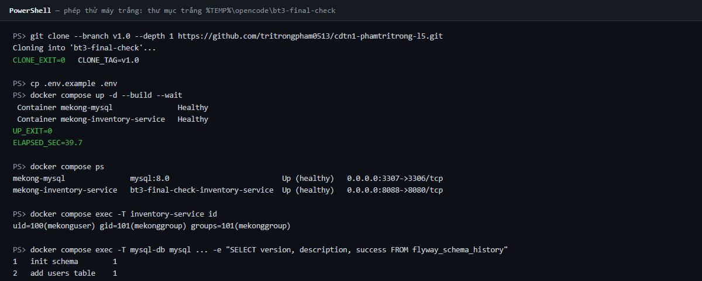
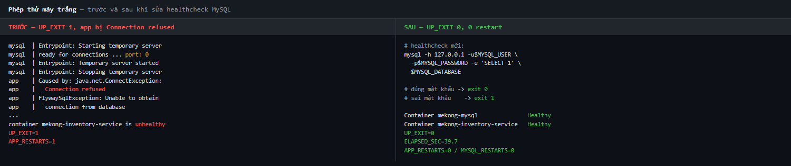
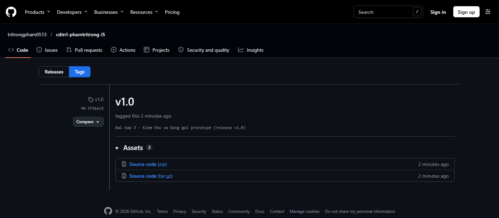

<div class="cover">
<div class="cover-top">
<div class="cover-school">TRƯỜNG ĐẠI HỌC VĂN LANG</div>
<div class="cover-faculty">KHOA CÔNG NGHỆ THÔNG TIN</div>
<div class="cover-line"></div>
<div class="cover-course">CHUYÊN ĐỀ TỐT NGHIỆP 1 — HỌC KỲ 1, NĂM HỌC 2026–2027</div>
</div>
<div class="cover-mid">
<div class="cover-title">BÁO CÁO BÀI TẬP 3</div>
<div class="cover-subtitle">KIỂM THỬ VÀ ĐÓNG GÓI PROTOTYPE</div>
<div class="cover-flow">Luồng nghiệp vụ L5 — Quản lý Kho Linh kiện Thay thế<br>Mekong Mobile Smart CRM</div>
</div>
<table class="cover-info">
<tr><td>Sinh viên thực hiện</td><td><b>Phạm Trí Trọng</b></td></tr>
<tr><td>Mã số sinh viên</td><td><b>2374802010525</b></td></tr>
<tr><td>Lớp / Track</td><td>Kỹ thuật Phần mềm (Software Engineering — SE)</td></tr>
<tr><td>Giảng viên hướng dẫn</td><td>TS. Nguyễn Trí Hải</td></tr>
<tr><td>Ngày nộp</td><td>12/11/2026</td></tr>
<tr><td>GitHub Repository</td><td><b>https://github.com/tritrongpham0513/cdtn1-phamtritrong-l5</b></td></tr>
<tr><td>Git Tag phát hành</td><td><b>v1.0</b></td></tr>
<tr><td>Bản deploy thử</td><td>CHƯA LÀM — chỉ kiểm chứng cục bộ (Mục 4.6)</td></tr>
</table>
<div class="cover-note">Báo cáo kèm bộ 12 automated test (7 Unit + 3 Integration + 2 API),<br>Docker Compose 2 lệnh và đầy đủ minh chứng chạy thật.</div>
</div>

<div class="pagebreak"></div>

<div class="sec1">

# MỤC 1. TEST PLAN RÚT GỌN

## Luồng L5 — Quản lý Kho Linh kiện Thay thế (Track SE)
* **Hệ thống:** Mekong Mobile Smart CRM | **Sinh viên:** Phạm Trí Trọng — MSSV: 2374802010525
* **Công nghệ:** Java 17, Spring Boot 3.2.5, JUnit 5, Mockito, MockMvc, H2 in-memory | **Tệp:** `docs/test-plan.md`

### 1. Phạm vi kiểm thử và phần chủ ý KHÔNG kiểm

**1.1. In-Scope — 6 quy tắc cốt lõi**
1. **Xuất kho theo phiếu (FR-03, US-03, QT-06):** chỉ xuất khi phiếu `DANG_XU_LY`/`CHO_LINH_KIEN`; phiếu `DA_DONG` bị từ chối ở Service và H2.
2. **Khóa bi quan chống xuất âm (FR-04, US-04, QT-09):** kiểm tra đủ tồn, phát sinh `SELECT ... FOR UPDATE`, từ chối khi vượt số lượng.
3. **Nhập kho (FR-02, US-02):** tăng tồn thực tế và ghi giao dịch `IMPORT` vào `part_transactions`.
4. **Cảnh báo tồn thấp (FR-05, US-05):** bật `isLowStock` khi `quantity < minThreshold`.
5. **Kiểm soát quyền theo chủ sở hữu (OWASP A01 / S2):** chặn KTV xuất phiếu của trung tâm khác.
6. **Tính tái lập dữ liệu (C8):** chạy lại `DataInitializer` không lỗi, không nhân đôi dữ liệu.

**1.2. Out-of-Scope:** UI E2E M1/M2/M3 kiểm thử thủ công; tải/đồng thời NFR-01/02 thuộc CĐTN2; đối soát toàn vẹn NFR-04 mới kiểm tra số bản ghi sổ cái tăng; FR-01/06/07, Part CRUD, Stock CRUD chưa có test tự động (đã nghiệm thu thủ công ở BT2); `GET /stock`, `GET /transactions` chưa kiểm tra token/center; điều chuyển liên trung tâm là *Won't Have*.

### 2. Loại test và số lượng mỗi tầng

Đúng **12 automated test cases** theo Kim tự tháp: **7 Unit** (`PartTransactionServiceTest`, TC-01…TC-07, Mockito) + **3 Integration** (`DataInitializerIntegrationTest` TC-08 tái lập C8; `PartTransactionIntegrationTest` TC-09 export+import end-to-end, TC-10 từ chối phiếu `DA_DONG`) + **2 API Slice** (`TransactionControllerApiTest` TC-11 HTTP 201, TC-12 HTTP 422).

**Kỹ thuật dữ liệu:** phân vùng tương đương (trạng thái phiếu, `quantity > 0` vs `= 0`, cùng TT01 vs khác TT02) và giá trị biên (xuất 10/10 về 0 vs 11/10 bị từ chối; tồn 4 < 5 bật cảnh báo vs tồn 5 == 5 tắt).

**Phân bổ 5 loại:** Luồng đúng (5): TC-01, TC-02, TC-03, TC-09, TC-11. Biên (2): TC-04, TC-05. Dữ liệu sai (3): TC-06, TC-10, TC-12. Bảo mật/S2 (1): TC-07. Tái lập/C8 (1): TC-08.

### 3. Tiêu chí thành công ĐO ĐƯỢC

1. **Tỷ lệ vượt qua:** 12/12 PASS 100% bằng một lệnh `.\mvnw.cmd test` / `./mvnw test`.
2. **Độ bao phủ:** 100% quy tắc trong phạm vi (QT-06, QT-09, US-02, US-05, A01, C8) có test trực tiếp.
3. **Tồn đọng lỗi:** 0 Critical, 0 Major đang mở; bug đã sửa ghi tại `docs/bug-log.md`.
4. **Không hồi quy:** 100% test vẫn PASS sau mỗi lần sửa bug/refactor.

### 4. Môi trường và dữ liệu thử

* **Môi trường:** JDK 17 LTS + Maven Wrapper; `.\mvnw.cmd test` (Windows) / `./mvnw test` (Linux/macOS).
* **CSDL:** H2 in-memory `jdbc:h2:mem:testdb`, `ddl-auto=create-drop`, tắt Flyway/seeder cho Unit/API; TC-08 bật `app.seed.enabled=true`.
* **Cô lập:** Unit/API dùng Mockito và `MockMvcBuilders.standaloneSetup()`; Integration dùng `@SpringBootTest` + `@Transactional` rollback, TC-08 dùng `@DirtiesContext`.
* **Dữ liệu:** Seeds thật cho TC-08 (6 centers, 180 parts, 7.800 tickets, 717 stocks, 4.954 transactions); fixture tự tạo cho các TC còn lại.
* **Endpoint:** `POST /api/v1/transactions/export` — 201 Created và 422 Unprocessable Entity.

</div>

<div class="pagebreak"></div>

# MỤC 2. TEST REPORT — 12 TEST CASE ĐÃ CHẠY THẬT

**Kết quả tổng:** **12/12 PASS (100%)** · 0 failures · 0 errors · 0 skipped · BUILD SUCCESS. Phân tầng **7 Unit + 3 Integration + 2 API**; phân bổ 5 loại: Luồng đúng 5 · Giá trị biên 2 · Dữ liệu sai 3 · Bảo mật 1 · Tái lập 1. Lệnh chạy: `.\mvnw.cmd test` (Windows) / `./mvnw test`.

| Mã | Tiền điều kiện | Các bước | Dữ liệu thử | Kết quả mong đợi | Ưu tiên | Kết quả thực tế | PASS/FAIL |
|:---|:---|:---|:---|:---|:---:|:---|:---:|
| **TC-01**<br>Unit — Luồng đúng | `PartTransactionServiceTest`; mock `PIN-IP15` tồn 10, ngưỡng 5; phiếu `BH-000456/2026` `DANG_XU_LY` TT01. | Tạo `ExportTransactionRequestDTO` qty=2; gọi `exportPart(1L, request)`; kiểm tra response, tồn, sổ cái. | `ticketId=BH-000456/2026`; `partId=PIN-IP15`; `quantity=2`; `performedBy=KTV - Phạm Trí Trọng`. | Response `EXPORT`; tồn 10→8; `remainingStock=8`; `save()` gọi đúng 1 lần. | Cao | PASS — response `EXPORT`, tồn 8, sổ cái 1 bản ghi. | **PASS** |
| **TC-02**<br>Unit — Luồng đúng (US-02) | `PartTransactionServiceTest`; mock `PIN-IP15` tồn 10, ngưỡng 5. | Tạo `ImportTransactionRequestDTO` qty=20; gọi `importPart(1L, request)`; kiểm tra response, tồn, sổ cái. | `partId=PIN-IP15`; `quantity=20`; `performedBy=Quản lý kho`. | Tồn 10→30; response `IMPORT`; `remainingStock=30`; `isLowStock=false`; sổ cái 1 bản ghi. | Cao | PASS — tồn 30, response `IMPORT`, `isLowStock=false`. | **PASS** |
| **TC-03**<br>Unit — Luồng đúng (US-05) | `PartTransactionServiceTest`; `PartStock` với `minThreshold=5`. | Gán tồn 4, 5, 10; gọi `isLowStock()` từng trường hợp. | `quantity=4/5/10`; `minThreshold=5`. | Tồn 4 → `true`; tồn 5 và 10 → `false`. | Cao | PASS — `true`, `false`, `false` khớp tuyệt đối. | **PASS** |
| **TC-04**<br>Unit — Giá trị biên | `PartTransactionServiceTest`; mock `PIN-IP15` tồn 10; phiếu hợp lệ. | Export qty=10 (đúng bằng tồn); kiểm tra tồn và cờ cảnh báo. | `quantity=10`; `stock=10`; `minThreshold=5`. | Tồn về đúng 0, không âm; `remainingStock=0`; `isLowStock=true`. | Cao | PASS — tồn 0, `isLowStock=true`. | **PASS** |
| **TC-05**<br>Unit — Giá trị biên | `PartTransactionServiceTest`; mock `PIN-IP15` tồn 10; phiếu hợp lệ. | Export qty=11 (vượt tồn 1); bắt exception; kiểm tra tồn, sổ cái. | `quantity=11`; `stock=10`. | `IllegalStateException` chứa "vượt quá số tồn"; tồn giữ 10; không ghi sổ cái. | Cao | PASS — exception đúng, tồn giữ 10, không lưu sổ cái. | **PASS** |
| **TC-06**<br>Unit — Dữ liệu sai | `PartTransactionServiceTest`; mock phiếu `BH-000789/2026` trạng thái `DA_DONG`. | Export qty=1; bắt exception; verify không khóa tồn. | `ticketId=BH-000789/2026`; `status=DA_DONG`; `quantity=1`. | `IllegalStateException` chứa `DA_DONG`; không gọi `findByCenterIdAndPartCodeForUpdate`. | Cao | PASS — exception chứa `DA_DONG`, không khóa tồn. | **PASS** |
| **TC-07**<br>Unit — Bảo mật (S2/A01) | `PartTransactionServiceTest`; phiếu `BH-000002/2025` thuộc TT02; KTV `centerId=1`. | Export qty=1 với `centerId=1`; bắt exception; verify không khóa tồn. | `ticketId=BH-000002/2025`; `centerId=1`; ticket center=2. | `IllegalArgumentException` chứa "không thuộc quyền quản lý"; không khóa tồn. | Cao | PASS — chặn đúng A01, không khóa tồn. | **PASS** |
| **TC-08**<br>Integration — Tái lập (C8) | `DataInitializerIntegrationTest`; `@SpringBootTest`; H2; `app.seed.enabled=true`; `app.seed.path=seeds`. | Context nạp seeder lần 1; đếm 5 bảng; gọi `dataInitializer.run()` lần 2; đếm lại và so sánh. | CSV `seeds/`: 6 centers, 180 parts, 7.800 tickets, 717 stocks, 4.954 transactions. | Không ngoại lệ; số bản ghi 5 bảng giữ nguyên 100% sau lần 2. | Cao | PASS — 6/180/7800/717/4954 giữ nguyên. | **PASS** |
| **TC-09**<br>Integration — Luồng đúng | `PartTransactionIntegrationTest`; H2; `@Transactional`; fixture `TT-INT-01`, `PIN-INT-01` tồn 10, phiếu `BH-INT-0001/2026` `DANG_XU_LY`. | Export qty=4; kiểm tra tồn, sổ cái; import qty=20; kiểm tra lại. | Export qty=4; import qty=20; tồn đầu 10; ngưỡng 5. | Tồn 10→6→26; sổ cái có 1 `EXPORT` và 1 `IMPORT`. | Cao | PASS — tồn 6 rồi 26, sổ cái đủ 2 giao dịch. | **PASS** |
| **TC-10**<br>Integration — Dữ liệu sai (QT-06) | `PartTransactionIntegrationTest`; H2; fixture `TT-INT-02`, `PIN-INT-02` tồn 10, phiếu `BH-INT-0002/2026` `DA_DONG`. | Export qty=1 cho phiếu đã đóng; bắt exception; đếm bản ghi sổ cái H2. | `ticketCode=BH-INT-0002/2026`; `status=DA_DONG`; `quantity=1`. | `IllegalStateException` chứa `DA_DONG`; sổ cái đúng 0 bản ghi. | Cao | PASS — exception đúng, sổ cái 0 bản ghi. | **PASS** |
| **TC-11**<br>API — Luồng đúng (201) | `TransactionControllerApiTest`; `MockMvcBuilders.standaloneSetup()`; service mock; token TECHNICIAN; `X-Center-Id: 1`. | POST `/api/v1/transactions/export`; kiểm tra HTTP status và envelope `ApiResponseDTO`. | `ticketId=BH-000022/2025`; `partId=MH-SS-01`; `quantity=1`; `performedBy=ktv_trong`. | HTTP 201; `success=true`; `data.transactionType=EXPORT`; `remainingStock=9`. | Cao | PASS — HTTP 201, envelope đúng, `remainingStock=9`. | **PASS** |
| **TC-12**<br>API — Dữ liệu sai (422) | `TransactionControllerApiTest`; `standaloneSetup()`; token TECHNICIAN; `X-Center-Id: 1`. | POST export qty=0; kiểm tra HTTP status và lỗi validation. | `ticketId=BH-000001/2025`; `partId=MH-SS-01`; `quantity=0` (vi phạm `@Min(1)`). | HTTP 422; `success=false`; `error.code=VALIDATION_ERROR`; có `error.details.quantity`. | Cao | PASS — HTTP 422, `VALIDATION_ERROR`, chi tiết `quantity`. | **PASS** |

**Tổng hợp theo lớp test:** `PartTransactionServiceTest` 7/7 PASS (0,351 s) · `DataInitializerIntegrationTest` 1/1 PASS (15,450 s) · `PartTransactionIntegrationTest` 2/2 PASS (1,397 s) · `TransactionControllerApiTest` 2/2 PASS (0,800 s) · **Tổng 12/12 PASS**.

**Known Gaps (trung thực):** (1) FR-01/06/07, Part CRUD, Stock CRUD chưa có test tự động (đã kiểm thủ công ở BT2); (2) chưa kiểm thử tải 50 luồng đồng thời NFR-02 (thuộc CĐTN2); (3) NFR-04 mới kiểm tra số bản ghi sổ cái tăng, chưa đối soát toàn bộ 10.000 giao dịch; (4) `GET /stock`, `GET /transactions` chưa kiểm tra token/center; (5) chưa có API test riêng cho HTTP 403 RBAC và HTTP 409 phiếu `DA_DONG` — các quy tắc này được kiểm ở tầng Service (TC-06, TC-07).

<div class="pagebreak"></div>

# MỤC 3. BUG LOG — 3 LỖI ĐÃ SỬA

**Phạm vi:** 03 lỗi (01 CRITICAL + 02 MAJOR) phát hiện khi kiểm thử bảo mật thủ công BT3; cả 03 đã khắc phục bằng commit riêng và xác nhận lại bằng cURL + bộ 12 test.

| Mã lỗi | Mức độ | Thành phần ảnh hưởng | Phát hiện bởi | Commit khắc phục |
|:---|:---:|:---|:---|:---|
| **BUG-BT3-01** | **CRITICAL** | Auth + Transaction/Stock Controller | `SEC-01` (bảo mật thủ công) | [`1b9f84a`](https://github.com/tritrongpham0513/cdtn1-phamtritrong-l5/commit/1b9f84aa2fefe489aef617a04a091764f0a3198d) |
| **BUG-BT3-02** | **MAJOR** | AuthController (`/api/v1/auth/me`) | `SEC-02` (bảo mật thủ công) | [`0d0dd1e`](https://github.com/tritrongpham0513/cdtn1-phamtritrong-l5/commit/0d0dd1e0da49eed7b4315be759fdc6f13caa0b26) |
| **BUG-BT3-03** | **MAJOR** | GlobalExceptionHandler | `SEC-03` (bảo mật thủ công) | [`dd354f8`](https://github.com/tritrongpham0513/cdtn1-phamtritrong-l5/commit/dd354f88fd3b1a6c2eb0ca2600aa430ed014db1e) |

### BUG-BT3-01 — Giả mạo `X-Center-Id` để thao tác kho trung tâm khác (CRITICAL)
- **Mã và mức độ:** `BUG-BT3-01` — CRITICAL — Auth / Transaction Controller / Stock Controller.
- **Phát hiện bởi:** `SEC-01`, kiểm tra OWASP A01 / S2 (kiểm soát quyền sở hữu theo trung tâm).
- **Triệu chứng:** KTV TT01 (`ktv_trong`) đổi header `X-Center-Id: 4` và xuất được linh kiện cho phiếu TT04; API trả **HTTP 201** thay vì 403. Lỗ hổng tương tự cho phép Quản lý kho thao tác kho trung tâm khác.
- **Cách tái lập:** Đăng nhập `ktv_trong/123456`; gửi `POST /api/v1/transactions/export` với `X-Center-Id: 4`, body `{"ticketId":"BH-000051/2025","partId":"MH-SS-02","quantity":1,"performedBy":"ktv_trong"}`. Trước sửa: 201; sau sửa: **403 FORBIDDEN**.
- **Nguyên nhân:** Controller tin trực tiếp `X-Center-Id` do client gửi; token cũ không chứa `centerId`, nên phép so sánh `centerId` header với `centerId` phiếu luôn khớp — lỗi BOLA/A01.
- **Cách sửa:** Thêm `centerId` vào token (`userId:username:role:centerId:issuedAt`); thêm `AuthTokenService.requireRoleAndCenter()` và áp dụng cho toàn bộ endpoint ghi kho (import/export/stock create/threshold/delete).
- **Link commit và xác nhận:** [`1b9f84a`](https://github.com/tritrongpham0513/cdtn1-phamtritrong-l5/commit/1b9f84aa2fefe489aef617a04a091764f0a3198d) — `fix(auth): rang buoc X-Center-Id voi trung tam trong token (A01)`. Chạy lại SEC-01 nhận 403; `.\mvnw.cmd test` đạt 12/12 PASS.

### BUG-BT3-02 — `/api/v1/auth/me` trả sai danh tính người dùng (MAJOR)
- **Mã và mức độ:** `BUG-BT3-02` — MAJOR — AuthController (`/api/v1/auth/me`).
- **Phát hiện bởi:** `SEC-02`, kiểm tra xác thực danh tính phiên làm việc.
- **Triệu chứng:** Đăng nhập `quanly_kho` (MANAGER, center 1) nhưng `GET /auth/me` vẫn trả `username=ktv_trong`, `role=TECHNICIAN`, `fullName="Phạm Trí Trọng"`; UI hiển thị sai người và sai quyền.
- **Cách tái lập:** Đăng nhập `quanly_kho/123456`, lấy token; gọi `GET /api/v1/auth/me` với `Authorization: Bearer <token>`. Trước sửa: trả `ktv_trong`; sau sửa: trả đúng `quanly_kho`, `MANAGER`, `centerId=1`; thiếu token → **403**.
- **Nguyên nhân:** `getCurrentUser()` hard-code `MOCK_USERS.get("ktv_trong")`; `AuthTokenService` không được inject nên header `Authorization` bị bỏ qua.
- **Cách sửa:** Inject `AuthTokenService`; gọi `extractUser(authHeader)`; tra đúng hồ sơ theo username; trả đủ `userId`, `username`, `fullName`, `role`, `centerId`, `centerName`; token thiếu/không hợp lệ ném `ForbiddenException` (403).
- **Link commit và xác nhận:** [`0d0dd1e`](https://github.com/tritrongpham0513/cdtn1-phamtritrong-l5/commit/0d0dd1e0da49eed7b4315be759fdc6f13caa0b26) — `fix(auth): /auth/me tra dung danh tinh tu token thay vi hard-code`. Chạy lại SEC-02 nhận đúng `quanly_kho`; 12/12 PASS.

### BUG-BT3-03 — Phản hồi HTTP 500 làm lộ chi tiết nội bộ (MAJOR)
- **Mã và mức độ:** `BUG-BT3-03` — MAJOR — GlobalExceptionHandler / Security (S4).
- **Phát hiện bởi:** `SEC-03`, kiểm tra chuẩn hóa phản hồi lỗi và an toàn thông tin.
- **Triệu chứng:** Lỗi chưa xử lý (ví dụ `X-Center-Id: abc`) trả HTTP 500 kèm nguyên văn `ex.getMessage()`, có thể lộ kiểu dữ liệu Java, tên bảng `part_stock`, chuỗi kết nối `jdbc:mysql://...`.
- **Cách tái lập:** Gửi `GET /api/v1/stock` với header `X-Center-Id: abc`. Trước sửa: body chứa chi tiết nội bộ; sau sửa: `{"success":false,"error":{"code":"INTERNAL_SERVER_ERROR","message":"Đã xảy ra lỗi hệ thống. Vui lòng liên hệ quản trị viên."},"timestamp":"..."}` (không có `data`, `meta`, `details` do `NON_NULL`).
- **Nguyên nhân:** `handleGenericException(Exception ex)` nối trực tiếp `ex.getMessage()` vào response; chưa ghi log đầy đủ ở server — lỗi Information Disclosure (S4).
- **Cách sửa:** Ghi `log.error("Lỗi hệ thống chưa được xử lý", ex)` tại server; trả thông điệp trung tính cố định với mã `INTERNAL_SERVER_ERROR`; để `error.details = null` và bị lược bỏ bởi `@JsonInclude(NON_NULL)`.
- **Link commit và xác nhận:** [`dd354f8`](https://github.com/tritrongpham0513/cdtn1-phamtritrong-l5/commit/dd354f88fd3b1a6c2eb0ca2600aa430ed014db1e) — `fix(error): khong lo chi tiet noi bo trong phan hoi 500 (S4)`. Chạy lại SEC-03 nhận 500 trung tính; 12/12 PASS.

<div class="pagebreak"></div>

<div class="sec4">

# MỤC 4. DEPLOYMENT GUIDE (ENGLISH)

Deployment and verification instructions for the Mekong Mobile Smart CRM Module L5 prototype, release tag `v1.0`.

### 4.1. Requirements
- **OS:** Windows 10/11, macOS, or Linux. **Docker:** Engine 24+ and Compose v2 (tested 28.5.1 / v2.40.3); Docker Desktop/daemon must be running.
- **Git:** 2.30+. **Resources:** 2 GB RAM, 2 GB disk. **Ports:** `8088` and `3307` free. **Testing:** JDK 17 for host tests.
- MySQL, Maven, and Java are **not** required for the Docker path.

### 4.2. Setup steps (exactly two commands after cloning)
```bash
git clone --branch v1.0 https://github.com/tritrongpham0513/cdtn1-phamtritrong-l5.git
cd cdtn1-phamtritrong-l5
cp .env.example .env          # Windows CMD: copy .env.example .env
docker compose up -d --build --wait
```
**Expected:** build takes 2–4 minutes; the command blocks until both containers report `Healthy` and exits with code 0.

### 4.3. Environment variables
| Variable | Meaning | Default |
|:---|:---|:---|
| `APP_PORT` | Web host port | `8088` |
| `MYSQL_HOST_PORT` | MySQL host port | `3307` |
| `MYSQL_ROOT_PASSWORD` / `MYSQL_DATABASE` | Root password / DB name | `root` / `mekong_crm_inventory` |
| `MYSQL_USER` / `MYSQL_PASSWORD` | Application DB user/password | `springstudent` / `springstudent` |
| `SPRING_PROFILES_ACTIVE` | Spring profile | `dev` |
| `SEED_ENABLED` / `SEED_DATA_PATH` | Seed ingestion / CSV folder | `true` / `seeds` |
| `TZ` | OS timezone | `Asia/Ho_Chi_Minh` |

`DB_HOST`, `DB_PORT`, and `PORT` are fixed inside `docker-compose.yml`. Changing `MYSQL_*` on an existing volume has no effect: run `docker compose down -v` first.

### 4.4. Sample data and demo accounts
`DataInitializer` ingests 5 CSV files from `seeds/` on startup if empty; it is idempotent.
```bash
docker compose exec -T mysql-db mysql -uspringstudent -pspringstudent mekong_crm_inventory -e "SELECT 'service_centers' AS t, COUNT(*) AS n FROM service_centers UNION ALL SELECT 'parts', COUNT(*) FROM parts UNION ALL SELECT 'tickets', COUNT(*) FROM tickets UNION ALL SELECT 'part_stock', COUNT(*) FROM part_stock UNION ALL SELECT 'part_transactions', COUNT(*) FROM part_transactions UNION ALL SELECT 'users', COUNT(*) FROM users;"
```
**Expected:** `service_centers=6`, `parts=180`, `tickets=7800`, `part_stock=717`, `part_transactions=4954`, `users=3`.

| Username | Password | Role | Center |
|:---|:---|:---|:---:|
| `ktv_trong` | `123456` | TECHNICIAN | 1 |
| `quanly_kho` | `123456` | MANAGER | 1 |
| `ktv_cantho` | `123456` | TECHNICIAN | 4 |

Passwords are stored only as BCrypt hashes (`$2a$10$...`, 60 chars); plaintext is listed here solely for grading.

### 4.5. Verify it works
1. `docker compose ps` → both containers `Up (healthy)`.
2. `curl.exe -s http://localhost:8088/api/health` → HTTP 200, `{"status":"UP",...}`.
3. `curl.exe -s -o NUL -w "%{http_code}" http://localhost:8088/` → `200`.
4. `docker compose exec -T inventory-service id` → `uid=100(mekonguser) gid=101(mekonggroup)`.
5. Row counts match 4.4; `.\mvnw.cmd test` → `Tests run: 12, Failures: 0, Errors: 0, Skipped: 0`, `BUILD SUCCESS`.

**Troubleshooting:** port conflict → set `APP_PORT=18080` in `.env`; stale volume → `docker compose down -v` then `up -d --build --wait`; logs → `docker compose logs -f inventory-service` / `mysql-db`.

### 4.6. Optional free-tier deployment — CHƯA LÀM

The stack is fully reproducible locally with the two commands above. A public free-tier deployment (Render/Railway) was **not completed**: both require an account with GitHub OAuth and credit-card verification, unavailable here. No public URL is claimed; all C1–C9 criteria are verified locally on tag `v1.0`.

</div>

<div class="pagebreak"></div>

# MỤC 5. CHECKLIST BẢO MẬT 7 MỤC (OWASP TOP 10:2025)

**Ngày kiểm chứng:** 12/11/2026 · **Commit:** `c689ec1` · **Môi trường:** Docker Desktop 28.5.1 / Compose v2.40.3 / Windows 11. Mọi minh chứng dưới đây được chạy thật.

| STT | Mục kiểm tra | Trạng thái | Minh chứng thực tế | Khắc phục |
|:---:|:---|:---:|:---|:---|
| 1 | Không có secret trong repo (A02) | **ĐÃ LÀM** | `git ls-files \| Select-String '\.env$'` rỗng; `.gitignore` chặn `.env`; `.env.example` chỉ có cấu hình demo; mã nguồn chỉ còn hash BCrypt trong `users`. | Không |
| 2 | Dữ liệu vào được kiểm ở tầng ứng dụng (A05) | **ĐÃ LÀM** | `@NotBlank`, `@NotNull`, `@Min(1)`, `@Size` trong `ImportTransactionRequestDTO`; gửi `{}` tới `POST /transactions/import` → HTTP 422 `VALIDATION_ERROR`. | Không |
| 3 | Kiểm soát truy cập theo chủ sở hữu (A01) | **ĐÃ LÀM** | **Manual:** `ktv_cantho` gọi export với `X-Center-Id: 1` → HTTP 403 `FORBIDDEN`. **Automated:** TC-07 ném `IllegalArgumentException` PASS. | Không |
| 4 | Mật khẩu/dữ liệu nhạy cảm được băm (A04, A07) | **ĐÃ LÀM** | `V2__add_users_table.sql` tạo `users.password_hash`; `AuthController` dùng `BCryptPasswordEncoder.matches()`; SQL trả `$2a$10$` / 60 ký tự cho cả 3 tài khoản; login đúng 200, sai 409. | Không |
| 5 | Thông báo lỗi không lộ cấu trúc (A10, A02) | **ĐÃ LÀM** | `GlobalExceptionHandler` bọc lỗi 500 thành `INTERNAL_SERVER_ERROR` trung tính; JSON `"{bad json"` → HTTP 500 không lộ stack trace/tên bảng. | Không |
| 6 | Nhật ký không ghi secret/dữ liệu cá nhân (A09) | **ĐÃ LÀM** | Quét `docker compose logs inventory-service` với `password|token|secret|bearer|authorization|0[0-9]{9}` → không có dòng rò rỉ. | Không |
| 7 | Phụ thuộc ghim phiên bản và kiểm CVE (A03) | **CHƯA LÀM** | `pom.xml` khóa `spring-boot 3.2.5`, Java 17, mysql-connector-j, flyway; **chưa** tích hợp OWASP Dependency-Check/Dependabot trong CI/CD. | Cấu hình scanner ở CĐTN2 |

<div class="pagebreak"></div>

# MỤC 6. API DOCUMENTATION (17 ENDPOINTS)

Base URL: `http://localhost:8088`. Envelope: `{"success","data","meta","error":{"code","message","details"},"timestamp"}` (NON_NULL). Full request/response examples: `docs/api-docs/README.md`.

| # | Method & Path | Auth | Description |
|:---:|:---|:---|:---|
| 1 | `POST /api/v1/auth/login` | Public | Authenticate against `users` (BCrypt); returns Bearer token. |
| 2 | `GET /api/v1/auth/me` | Bearer | Return current user profile from token. |
| 3 | `GET /api/health` | Public | Liveness/readiness; 200 `UP` after seeding. |
| 4 | `POST /api/v1/parts` | Public | Create a part master record. |
| 5 | `GET /api/v1/parts` | Public | List parts with pagination/search. |
| 6 | `GET /api/v1/parts/{partCode}` | Public | Get one part by code. |
| 7 | `PUT /api/v1/parts/{partCode}` | Public | Update part information. |
| 8 | `DELETE /api/v1/parts/{partCode}` | Public | Soft-delete a part (`isActive=false`). |
| 9 | `GET /api/v1/stock` | Public | List stock balances by center. |
| 10 | `GET /api/v1/stock/{partCode}` | Public | Get one stock balance. |
| 11 | `POST /api/v1/stock` | MANAGER | Initialize a stock record. |
| 12 | `PUT /api/v1/stock/threshold` | MANAGER | Update safety-stock threshold. |
| 13 | `DELETE /api/v1/stock/{partCode}` | MANAGER | Delete an empty stock record. |
| 14 | `POST /api/v1/transactions/import` | MANAGER | Import parts; increases stock and writes ledger. |
| 15 | `POST /api/v1/transactions/export` | TECHNICIAN | Export for a warranty ticket; pessimistic lock. |
| 16 | `GET /api/v1/transactions` | Public | List immutable transaction ledger. |
| 17 | `GET /api/v1/tickets/{ticketId}/parts` | Public | List parts exported for a ticket. |

### Sample endpoint — `POST /api/v1/transactions/export`
1. **Method & Path:** `POST /api/v1/transactions/export` — Base URL `http://localhost:8088`.
2. **Business Description:** Exports a replacement part for a warranty ticket, validates ticket status/center ownership, locks the stock row, decreases quantity and appends an `EXPORT` ledger row.
3. **Authentication & Authorization:** Bearer token with role `TECHNICIAN`; `X-Center-Id` must match the token's `centerId`.
4. **Request Parameters & Body:**
```bash
curl.exe -X POST "http://localhost:8088/api/v1/transactions/export" \
  -H "Content-Type: application/json" -H "Authorization: Bearer <token>" -H "X-Center-Id: 1" \
  -d '{"ticketId":"BH-000022/2025","partId":"MH-SS-01","quantity":1,"performedBy":"KTV - Pham Tri Trong"}'
```
| Field | Type | Required | Description |
|:---|:---|:---:|:---|
| `ticketId` | string | Yes | Warranty ticket code. |
| `partId` | string | Yes | Part code. |
| `quantity` | integer | Yes | Must be `>= 1` and `<=` available stock. |
| `performedBy` | string | Yes | Technician name. |
5. **Success Response Body:** HTTP `201 Created`
```json
{"success":true,"data":{"transactionId":5001,"transactionType":"EXPORT","ticketId":"BH-000022/2025","partId":"MH-SS-01","quantity":1,"remainingStock":9,"performedBy":"KTV - Pham Tri Trong","transactionDate":"2026-11-12T01:49:26"},"timestamp":"2026-11-12T01:49:26.500"}
```
6. **Error Responses:** `422 VALIDATION_ERROR` when `quantity=0` (`error.details.quantity`); `403 FORBIDDEN` when `X-Center-Id` differs from token; `409 BUSINESS_RULE_VIOLATION` for closed/nonexistent ticket or insufficient stock.
7. **Notes & Constraints:** Stock row is locked with `SELECT ... FOR UPDATE`; ledger is append-only; request is transactional (rollback on failure).

<div class="pagebreak"></div>

# MỤC 7. ẢNH CHỤP MINH CHỨNG

**Minh chứng 1 — Hệ thống lên được, UI thật sau đăng nhập `quanly_kho` (HTTP 200):**


**Minh chứng 2 — Bộ 12 test PASS thật (12/12, BUILD SUCCESS, 30.309 s):**


**Minh chứng 3 — Hai container healthy, health 200, seed 6/180/7800/717/4954/3 và hash BCrypt:**


**Minh chứng 4 — Phép thử máy trắng từ tag `v1.0`: 2 lệnh, exit 0 sau 39.7 s, 0 restart:**



**Minh chứng 5 — Phép thử máy trắng phát hiện lỗi healthcheck và kết quả sau khi sửa:**



**Minh chứng 6 — GitHub repo PUBLIC và tag `v1.0` tại commit `3741ec9`:**



**Đối chiếu 6 minh chứng với tiêu chí đánh giá của đề bài:**

| Minh chứng | Tiêu chí | Số liệu thật đo được |
|:---|:---|:---|
| 1 — UI sau khi đăng nhập | C1, C4 (prototype chạy được) | HTTP 200; đăng nhập `quanly_kho`; dashboard hiển thị 123 linh kiện trong danh mục, 15 đủ hàng, 0 cảnh báo tồn thấp |
| 2 — Bộ kiểm thử tự động | C2 (đúng 7 Unit + 3 Integration + 2 API) | `Tests run: 12, Failures: 0, Errors: 0, Skipped: 0`; BUILD SUCCESS; 30.309 s |
| 3 — Health + dữ liệu mẫu | C1, C8 (seed tái lập) | 2 container `healthy`; `RestartCount=0`; 6/180/7800/717/4954/3; hash `$2a$10$` dài 60; Flyway V1+V2 success; login 200/409 |
| 4 — Phép thử máy trắng | C1 (đúng 2 lệnh, không hỏi) | `git clone --branch v1.0`; `up -d --build --wait` exit 0 sau 39.7 s; user `uid=100(mekonguser)` |
| 5 — Trước/sau khi sửa | Quy trình kiểm thử (bug log) | `UP_EXIT=1`, `APP_RESTARTS=1`, `Connection refused` → `UP_EXIT=0`, `APP_RESTARTS=0` |
| 6 — GitHub tag | C9 (đóng gói, phát hành) | Repo PUBLIC; tag `v1.0`; commit `3741ec9`; 2 asset source code |

<div class="pagebreak"></div>

# PHỤ LỤC. BẢNG KHAI BÁO SỬ DỤNG CÔNG CỤ AI (BẮT BUỘC)

| Công cụ | Dùng vào việc gì | Áp dụng ở tệp/hàm nào | Em đã kiểm chứng thế nào |
|:---|:---|:---|:---|
| **— Không dùng AI —** | **[BT2]** Tự thiết kế quy tắc vòng đời phiếu (QT-06), khóa bi quan chống xuất âm, xác thực token/RBAC và ràng buộc toàn vẹn CSDL. | `PartTransactionServiceImpl.java`; `AuthTokenService.java`; `migrations/V1__init_schema.sql` | Tự kiểm từng điều kiện, viết test biên, kiểm log Hibernate, gọi curl/Postman với dữ liệu hợp lệ và không hợp lệ. |
| **Antigravity AI IDE (Claude 3.7 Sonnet & Gemini 3.8 Flash)** | **[BT2]** Gợi ý cấu trúc Spring Boot 3 lớp, scaffold Entity/Repository/DTO, khung test Mockito, khung HTML/CSS/JS 3 màn hình. | `entity/*`, `repository/*`, `dto/*`, `src/test/java/*`, `static/*` | Rà soát 100% thuộc tính Entity với `V1__init_schema.sql`; bổ sung `@NotBlank`, `@DecimalMin`; chạy `mvnw test` 12/12 PASS; kiểm tra UI 3 trạng thái Loading/Empty/Error. |
| **Claude Sonnet** | **[BT2]** Gợi ý `@Lock(PESSIMISTIC_WRITE)`, cấu hình Flyway, thuật toán seeder chống trùng, Dockerfile đa tầng và docker-compose healthcheck. | `PartStockRepository.java`; `pom.xml`; `application-dev.properties`; `DataInitializer.java`; `Dockerfile`; `docker-compose.yml` | Chạy MySQL 8 thật, xác nhận `SELECT ... FOR UPDATE`; khởi động trên DB trống thấy Flyway tạo đủ bảng; chạy seeder 2 lần không nhân đôi; kiểm tra user non-root `mekonguser`. |
| **OpenCode (DeepSeek V4.1 Flash)** | **[BT3]** Cấu trúc Test Plan, chuẩn hóa 12 test case (7+3+2), rà soát Bug Log 3 lỗi SEC-01/02/03, viết Deployment Guide và Checklist bảo mật 7 mục. | `docs/test-plan.md`; `docs/test-report.md`; `docs/bug-log.md`; `docs/deployment-guide.md`; `docs/checklist-bao-mat.md` | Đối chiếu từng test với mã nguồn; chạy lại `.\mvnw.cmd test` 12/12 PASS; kiểm 3 commit sửa lỗi; render Guide đúng 2 trang A4; chạy lại toàn bộ lệnh curl/docker trong tài liệu. |
| **OpenCode (DeepSeek V4.1 Flash)** | **[BT3]** Soạn `docs/api-docs/README.md` tiếng Anh cho 17 endpoint, sinh OpenAPI/Swagger UI; cấu hình cổng `8088`, `TZ=Asia/Ho_Chi_Minh`, hướng dẫn 2 lệnh. | `docs/api-docs/README.md`; `docs/api-docs/openapi.yaml`; `swagger.json`; `index.html`; `docker-compose.yml`; `.env.example` | Gọi thật 17 endpoint qua curl/PowerShell trên Docker; dán response JSON thật; kiểm 18 khối JSON parse hợp lệ; clean-room 2 lệnh đạt exit 0, health 200, seed đủ. |
| **OpenCode (DeepSeek V4.1 Flash)** | **[BT3 — S3]** Hiện thực BCrypt + bảng `users`: entity/repository/encoder, migration V2, sửa `AuthController`, seed idempotent. | `entity/User.java`; `repository/UserRepository.java`; `config/SecurityConfig.java`; `controller/AuthController.java`; `config/DataInitializer.java`; `migrations/V2__add_users_table.sql`; `pom.xml` | Sinh 3 hash BCrypt cost 10 bằng `spring-security-crypto`; `.\mvnw.cmd test` 12/12 PASS; SQL xác nhận `$2a$10$`/60 ký tự; login đúng 200, sai 409; restart vẫn 3 user. |
| **OpenCode (DeepSeek V4.1 Flash)** | **[BT3 — C1]** Chẩn đoán healthcheck MySQL báo `healthy` sớm trong phép thử máy trắng; đề xuất kiểm tra TCP + xác thực và retry Flyway. | `docker-compose.yml`; `src/main/resources/application-dev.properties`; `docs/thay-doi-thiet-ke.md` | Đối chiếu timestamp log MySQL (temporary server) với `Connection refused`; thử healthcheck mới: đúng mật khẩu exit 0, sai exit 1; clean-room lại đạt 39.7 s, exit 0, 0 restart. |

**Cam kết:** Bảng trên phản ánh trung thực 100% việc sử dụng AI. AI chỉ hỗ trợ cấu trúc/định dạng tài liệu, rà soát và gợi ý kỹ thuật; toàn bộ logic nghiệp vụ, 12 test case, phân tích lỗi và nội dung nộp đều do em trực tiếp kiểm chứng trên môi trường thật và hiểu rõ từng dòng.

- **Sinh viên cam kết:** Phạm Trí Trọng — MSSV 2374802010525 — Track SE
- **Ngày cam kết:** 12/11/2026 — **Chữ ký:** *(đã ký điện tử)*
