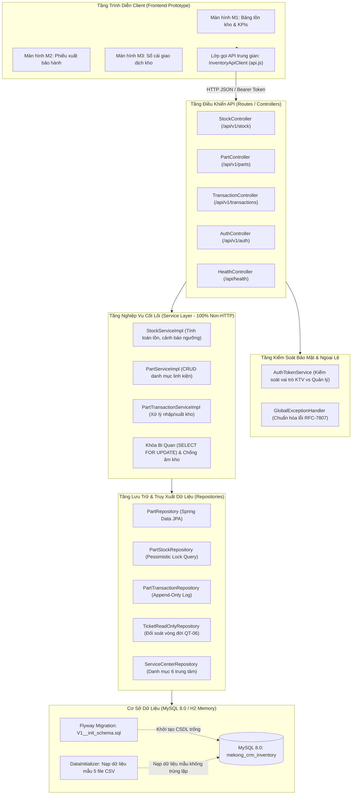

# Kiến Trúc Thực Tế Hệ Thống — Module L5: Kho Linh Kiện Thay Thế

> **Học phần:** Chuyên đề Tốt nghiệp 1 · Học kỳ 1, Năm học 2026 – 2027 · Trường Đại học Văn Lang  
> **Sinh viên:** Phạm Trí Trọng — MSSV: 2374802010525  
> **Chuyên ngành (Track):** Software Engineering (SE)  
> **Luồng nghiệp vụ:** L5 — Kho linh kiện thay thế (Mekong Mobile Smart CRM)  
> **Tài liệu nghiệm thu:** Bài tập 2 (Hiện thực hóa module cốt lõi)  

---

## 1. Sơ đồ kiến trúc phân tầng thực tế (Actual Layered Architecture)

Hệ thống được tổ chức theo mô hình phân tầng nghiêm ngặt (Strict Layered Architecture) chuẩn công nghiệp cho hệ thống Back-Office/ERP, đảm bảo nguyên tắc phụ thuộc một chiều từ trên xuống dưới:

---

## 2. Bản đồ ánh xạ thư mục mã nguồn thực tế (Directory Mapping)

Mọi lớp kiến trúc được tổ chức tương ứng với các gói mã nguồn riêng biệt, tuân thủ tiêu chí tách lớp **C2** và **S2**:

| Lớp kiến trúc | Thư mục mã nguồn thực tế | Các tệp tiêu biểu | Trách nhiệm chính |
| :--- | :--- | :--- | :--- |
| **Presentation (UI)** | `src/main/resources/static/` | `index.html`, `css/style.css`, `js/api.js`, `js/app.js` | Giao diện prototype 3 màn hình M1, M2, M3; xử lý 3 trạng thái (*Loading, Empty, Error*); quản lý Bearer Token. |
| **Routes (API Controllers)** | `src/main/java/com/mekongmobile/inventory/controller/` | `PartController.java`, `StockController.java`, `TransactionController.java`, `AuthController.java`, `HealthController.java` | Tiếp nhận HTTP request, phân giải tham số, gán mã trạng thái HTTP chuẩn RESTful và ủy quyền cho Service. |
| **Data Transfer Objects (DTO)** | `src/main/java/com/mekongmobile/inventory/dto/` | `request/*`, `response/*`, `ApiResponseDTO.java` | Định nghĩa hợp đồng dữ liệu vào/ra chuẩn hóa, ràng buộc validation (`@NotBlank`, `@DecimalMin`). |
| **Business Logic (Services)** | `src/main/java/com/mekongmobile/inventory/service/` | `StockService.java`, `PartService.java`, `PartTransactionService.java`, `impl/*` | **Tuyệt đối không chứa đối tượng HTTP** (HttpServletRequest, Response, Status). Chứa toàn bộ quy tắc nghiệp vụ QT-06, QT-09, NFR-02, NFR-04. |
| **Security & Phân quyền (RBAC)** | `src/main/java/com/mekongmobile/inventory/service/` | `AuthTokenService.java`, `ForbiddenException.java` | Xác thực token người dùng, kiểm soát quyền hạn Kỹ thuật viên (chỉ xuất kho) và Quản lý kho (chỉ nhập kho, sửa ngưỡng). |
| **Repositories (Persistence)** | `src/main/java/com/mekongmobile/inventory/repository/` | `PartStockRepository.java`, `PartTransactionRepository.java`, `PartRepository.java`, `TicketReadOnlyRepository.java` | Truy vấn Spring Data JPA, định nghĩa câu lệnh khóa bi quan `SELECT ... FOR UPDATE` chặn xung đột đồng thời. |
| **Entities (ORM Domain)** | `src/main/java/com/mekongmobile/inventory/entity/` | `Part.java`, `PartStock.java`, `PartTransaction.java`, `TicketReadOnly.java`, `ServiceCenter.java` | Ánh xạ ORM Hibernate vào 5 bảng CSDL MySQL, khớp 100% thuộc tính thiết kế ERD. |
| **Config & Exceptions** | `src/main/java/com/mekongmobile/inventory/config/`, `exception/` | `GlobalExceptionHandler.java`, `DataInitializer.java`, `FlywayConfig.java`, `BusinessRuleException.java` | Bắt lỗi toàn cục trả về chuẩn RFC-7807; nạp dữ liệu khởi tạo chống trùng lặp; tự động chạy migration. |
| **Database Migration & Seeds** | `migrations/`, `seeds/` | `migrations/V1__init_schema.sql`, 5 tệp CSV trong `seeds/` | Kịch bản DDL dựng toàn bộ CSDL từ trạng thái trống và bộ dữ liệu mẫu 100% của case study. |
| **Kiểm thử tự động (Unit Tests)** | `src/test/java/` | `PartTransactionServiceTest.java`, `PartServiceTest.java`, `AuthTokenServiceTest.java` | Bộ 17 test case độc lập trên CSDL H2 in-memory, bao phủ luồng đúng, giá trị biên và dữ liệu sai. |

---

## 3. Các cơ chế xử lý nghiệp vụ chuyên sâu đã hiện thực

### 3.1. Cơ chế Khóa bi quan chống xuất âm kho (QT-09 & NFR-02)
* **Vấn đề thực tế**: Khi hai KTV cùng lập phiếu xuất cho cùng một linh kiện còn tồn 1 cái tại cùng một thời điểm.
* **Hiện thực**: Tại [PartStockRepository.java](file:///d:/chuyen-de-tot-nghiep-01/cdtn1-phamtritrong-l5/src/main/java/com/mekongmobile/inventory/repository/PartStockRepository.java), phương thức `findByCenterIdAndPartCodeForUpdate` sử dụng chỉ dẫn `@Lock(LockModeType.PESSIMISTIC_WRITE)`. Hibernate sẽ phát sinh lệnh SQL `SELECT ... FOR UPDATE`, khóa bản ghi tồn kho của linh kiện đó trong suốt thời gian diễn ra transaction. Giao dịch thứ hai buộc phải đợi giao dịch thứ nhất hoàn tất; khi giao dịch thứ hai đọc lại số tồn thì số lượng đã về 0 và hệ thống ném ngoại lệ `BusinessRuleException` chặn xuất âm kho ngay lập tức.
* **Ràng buộc cứng CSDL**: Bổ sung `CONSTRAINT chk_stock_qty CHECK (quantity >= 0)` tại tầng DDL MySQL để ngăn chặn triệt để mọi lỗi ở mức hạ tầng.

### 3.2. Đối soát vòng đời phiếu bảo hành (QT-06)
* Khi tiếp nhận yêu cầu xuất kho linh kiện, Service tra cứu thực thể `TicketReadOnly`.
* Chỉ cho phép xuất kho khi trạng thái phiếu bảo hành là `DANG_XU_LY` hoặc `CHO_LINH_KIEN`. Nếu phiếu ở trạng thái `HOAN_TAT`, `DA_DONG` hoặc `TIEP_NHAN`, hệ thống lập tức từ chối và thông báo lỗi rõ ràng.

### 3.3. Sổ cái biến động kho bất biến (NFR-04)
* Bảng `part_transactions` hoạt động theo mô hình **Append-Only Ledger**.
* Tầng Service và Controller **không cung cấp bất kỳ API sửa hoặc xóa** đối với bản ghi giao dịch kho. Mọi biến động đều phát sinh bản ghi giao dịch mới kèm thời gian và người thực hiện. Số tồn kho thực tế luôn bằng tổng lượng nhập trừ tổng lượng xuất.

